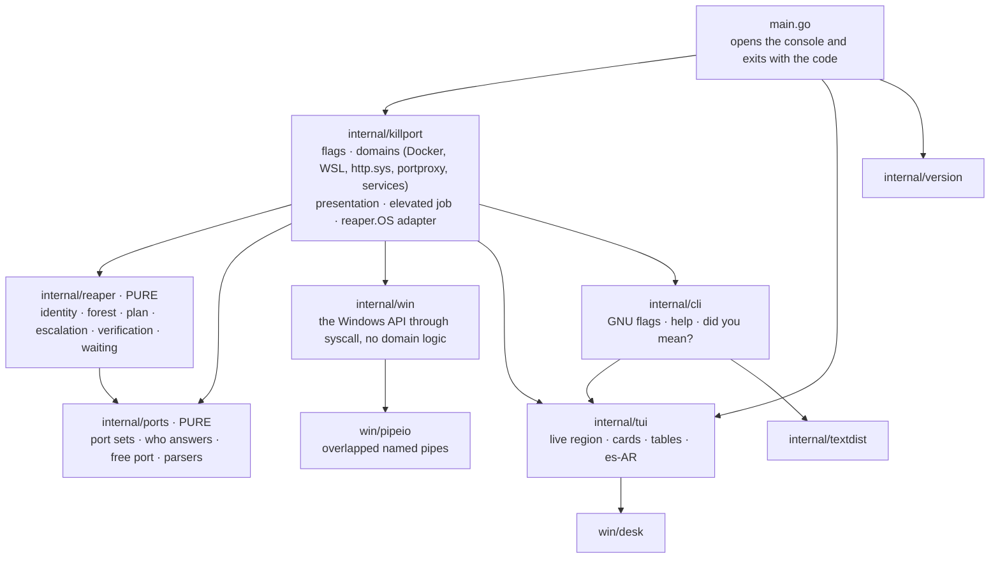
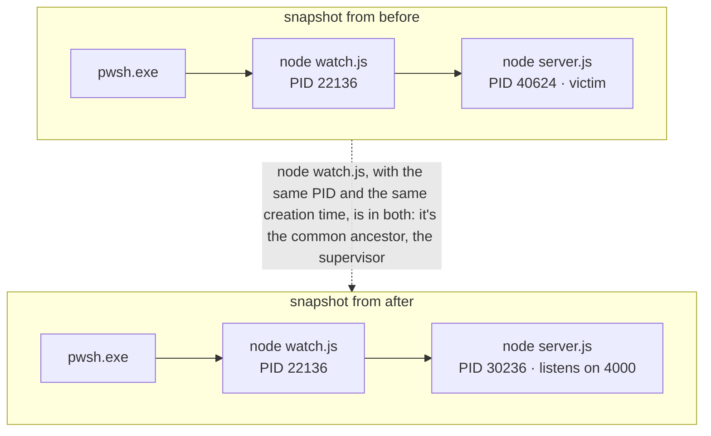
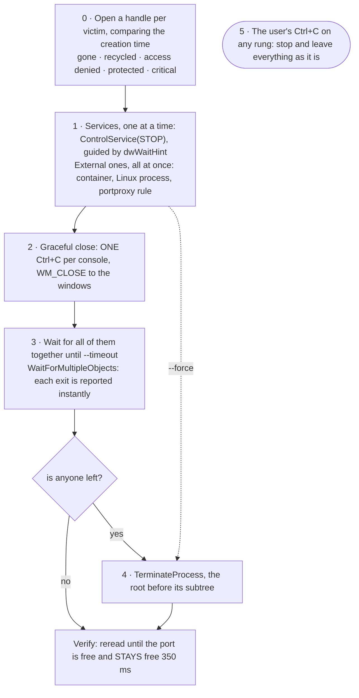
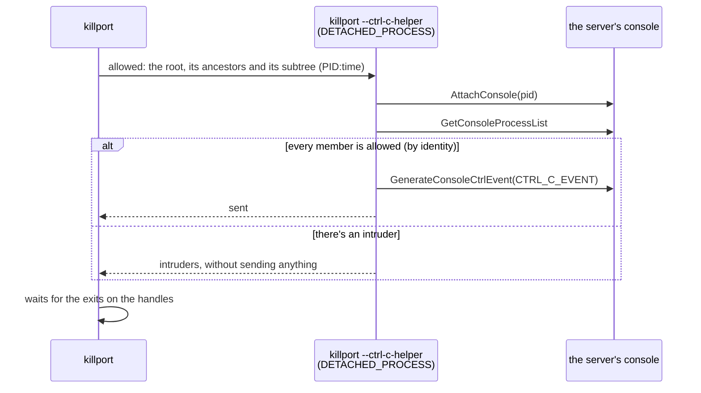
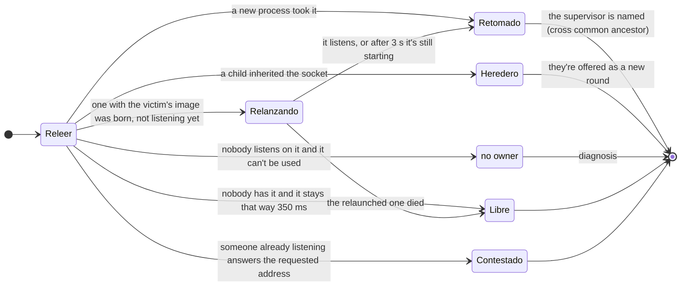
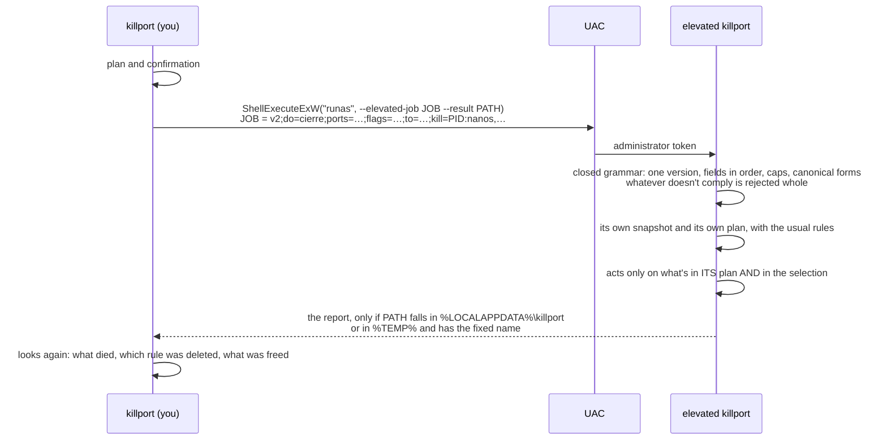

<p align="right"><sub><b>English</b> · <a href="README.md">Español</a></sub></p>

# killport

<p>
  <a href="https://github.com/agustinyarrus/killport/releases/latest"></a>
  
  
  
  <a href="LICENSE"></a>
</p>

Free the port you need, carefully. killport tells you what's holding a port on Windows —a process, a service, a container, a process inside WSL, an http.sys URL—, closes it the way you'd do it by hand (Ctrl+C in its window and, only if it doesn't give in, by force) and then checks that it's really free.

<p align="center">
  <picture>
    <source media="(prefers-reduced-motion: reduce)" srcset="demo/demo.png">
    
  </picture>
</p>
<p align="center"><sub>A real session in a 100×30 terminal, recorded with <a href="https://github.com/charmbracelet/vhs">VHS</a> against three test servers · <a href="demo/demo.webm">as video</a> · <a href="demo/demo.tape">the script</a> · <a href="demo/LEEME.en.md">how to re-record it</a></sub></p>

<details>
<summary>No images? The same session, as text</summary>

```text
> killport --project . --list

  killport  ·  libera el puerto que necesitás                                               v1.0.0


  ● node.exe  PID 19316 · hace 5 s
      3000 TCP escuchando en 0.0.0.0 · toda la red
      node web.js
      proyecto: tienda (rama feat/carrito) · X:\dev\tienda
      cadena: pwsh.exe → node.exe

  ● node.exe  PID 15564 · hace 5 s
      5173 TCP escuchando en [::1] · esta PC (v6)
      node dev.js
      proyecto: tienda (rama feat/carrito) · X:\dev\tienda
      cadena: pwsh.exe → node.exe

  ● python.exe  PID 26512 · hace 5 s
      8080 TCP escuchando en 0.0.0.0 · toda la red
      python api.py
      proyecto: tienda (rama feat/carrito) · X:\dev\tienda
      cadena: pwsh.exe → python.exe

    › solo miré; killport <puerto> -y lo cierra

> killport 3000

  killport  ·  libera el puerto que necesitás                                               v1.0.0


  ● node.exe  PID 19316 · hace 8 s
      3000 TCP escuchando en 0.0.0.0 · toda la red
      node web.js
      proyecto: tienda (rama feat/carrito) · X:\dev\tienda
      cadena: pwsh.exe → node.exe

  ¿Cerrar node.exe y liberar el 3000? [s/N] y

  › Ctrl+C a node.exe
  ✓ node.exe cerró   18 ms · Ctrl+C


     killport

     ● Puertos libres   1 de 1                    ● Cerraron solos   1

> killport 3000 --free

  killport  ·  un puerto libre de verdad                                                    v1.0.0

  ✓ 3000 libre   TCP · IPv4 e IPv6 · confirmado con un bind exclusivo

    › en un script, sin consola, sale solo el número: $port = killport --free 3000 (en bash,
      PORT=$(killport --free 3000))
```

</details>

A single `.exe` of about 5 MB, in pure Go: no installer, no dependencies, no cloud, no administrator except when it's truly needed. It used to live in navaja, a suite of console tools for Windows; now it's a project of its own.

[Why](#why) · [Install](#install) · [Usage](#usage) · [Walkthrough](#walkthrough) · [What it never does](#what-it-never-does) · [How it works](#how-it-works) · [Windows gotchas](#windows-gotchas) · [How it was verified](#how-it-was-verified) · [Limits](#limits)

## Why

`Error: listen EADDRINUSE: address already in use :::3000`. The usual recipe on Windows is `netstat -ano | findstr :3000` and then `taskkill /PID 1234 /F`. The Stack Overflow question that teaches it ([39632667](https://stackoverflow.com/questions/39632667)) has 1,394 votes and more than 4 million views, and npm's `kill-port` package is downloaded 2.4 million times a week (figures as of Sep 27, 2026). The recipe works almost always, and when it doesn't it's because of something netstat doesn't tell you:

- **A PID is a number, not a process.** Between reading it and killing it, Windows may have recycled it.
- **`/F` doesn't warn.** The server doesn't get to close its connections or delete its temporary files; the Ctrl+C you would have pressed yourself does let it.
- **The owner on record isn't the one listening.** Port 80 under System (PID 4) is almost always http.sys working for another program: the Stack Overflow question about that ([1430141](https://stackoverflow.com/questions/1430141)) has 455 votes and more than 720,000 views, and it's a guessing game. `com.docker.backend.exe` is the whole of Docker Desktop publishing a container, `wslrelay.exe` is WSL forwarding a Linux process and `svchost.exe` can be a forgotten `portproxy` rule. Killing the one on record breaks something else and the port stays busy.
- **Someone else takes it again.** nodemon, pm2 or a service relaunch the server in less than a quarter of a second, and the port looks "unkillable".
- **Two listen on the same port.** One on `[::1]` and another on `0.0.0.0`, without an error: the browser shows the old version and netstat shows two rows nobody looks at.
- **Nobody has it.** WinNAT reserved the block for Hyper-V, WSL or Docker: there's no process to kill, and the [Docker issue](https://github.com/docker/for-win/issues/3171) that describes it has 184 👍 and is still open. And not every exclusion is WinNAT's: the 2869 and the 5357 that show up in so many tables are set aside by Windows while its services handle them, and there the recipes' `net stop winnat` cuts WSL's and Docker's networking for nothing.

killport solves each of those cases, and in the ones that can't be solved it says why and what to do.

## Install

Download `killport.exe` from the [latest release](https://github.com/agustinyarrus/killport/releases/latest) and copy it to a folder on your `PATH`. It's the whole program: 64-bit Windows 10 or 11 (it was tested on Windows 11), no installer. Next to it comes `SHA256SUMS` to check it:

```powershell
(Get-FileHash .\killport.exe -Algorithm SHA256).Hash -eq ((Get-Content .\SHA256SUMS) -split '\s+')[0]   # True
```

The `.exe` is reproducible: the same tag built with the same Go gives the same bytes on any machine ([how](docs/RELEASE.en.md#5-the-exe-is-reproducible)).

With [Go](https://go.dev/dl) 1.26 or newer (with an older Go 1.21+, Go downloads the version the `go.mod` asks for on its own):

```powershell
go install github.com/agustinyarrus/killport@latest
```

From the repo:

```powershell
.\build.ps1          # dist\killport.exe, with the version, the commit and the SHA256
.\build.ps1 -Test    # before that, go vet and all the tests
```

killport uses Docker Desktop (or Podman) and WSL if they're installed, to see which container or which Linux process is behind a port. Without them it works just the same, and it never starts a distro or the engine.

## Usage

```powershell
killport                          # what's listening on each port, with its project (hides Windows' own)
killport 3000                     # who has 3000; asks and closes it
killport 3000 5173 8080,8081      # several ports and ranges (5000-5003)
killport localhost:5173 -y        # only the one answering localhost, without asking
killport 8080                     # if a container publishes it, stops the container
killport --orphans -n node        # the node processes left listening after their terminal was closed
killport --project . --list       # what this project is listening on (its folder, its branch)
$port = killport --free 3000      # the first truly free port from 3000 on
killport 5173 --wait 60s          # waits for the server to listen (for scripts)
killport 3000 --reserve           # so WinNAT doesn't reserve 3000 again
```

| Flag | What it does |
|---|---|
| `-l`, `--list` | just look |
| `-y`, `--yes` | don't ask |
| `-f`, `--force` | no graceful close: by force |
| `-t`, `--tree` | also the child processes |
| `--timeout T` | how long to wait for the graceful close before going by force (3 s) |
| `--manual` | the service that gets stopped is left on manual start |
| `--orphans`, `-n`/`--name NAME`, `--project DIR` | pick without naming ports; they combine and each one narrows it down |
| `--free`, `--count N` | the first truly free port (or the first N) |
| `--wait T`, `--wait-free T`, `--any`, `--stable T`, `--new` | wait for it to listen or to be freed |
| `--reserve`, `--unreserve`, `--fix-dynamic` | ports Windows reserves |
| `--tcp`, `--udp`, `-a`/`--all-states`, `-s`/`--system`, `--wsl`, `--no-docker` | what to look at |
| `--json` | for scripts; without `--yes`, it only describes |

`killport --help` has the full help, with 19 examples. It honors `NO_COLOR` and `--no-color`; if the output isn't a console, it doesn't emit a single escape code. Exit codes: `0` done (or it was already free) · `1` partly · `2` invalid command line · `3` it couldn't be done (or the wait expired) · `130` canceled. With `--list`, `0` if it could look. With `--json`, the same as the text.

## Walkthrough

Every output in this section is real: killport 1.0.0 in a 100-column console against test servers (the demo's shop, a couple more, an nginx container and a program that reserves ports), captured on Sep 28, 2026 (the tool speaks Spanish). The folders are mounted as `X:\dev\…` so no real path shows up, and the blocks that close or look at ports leave out the header, which is always the same (`killport  ·  libera el puerto que necesitás  v1.0.0`).

### The listing

With no arguments, killport lists what the machine is listening on and asks which one to free. It hides Windows' own (`--system` shows it) and the columns give up width when the window is narrow: it trims what's left over in the middle and keeps what matters.

```text
> killport

  killport  ·  qué escucha en cada puerto                                                   v1.0.0

   #   PUERTO   PROTO   ALCANCE          PID   PROCESO          PROYECTO      COMANDO
   1       80   TCP     toda la red    37528   http.s…wsh.exe   tienda · f…   http://+:…ES/TIENDA/
   2     3000   TCP     toda la red    40252   node.exe         tienda · f…   node web.js
   3     4000   TCP     toda la red     9576   node.exe         tienda · f…   node server.js
   4     4001   TCP     toda la red    37424   node.exe         tienda · f…   node colgado.js
   ⋮
   7   ! 5173   TCP     esta PC (v6)   30884   node.exe         tienda · f…   node dev.js
   8   ! 5173   TCP     toda la red    41844   node.exe         landing · …   node preview.js
   ⋮
  13     6006   TCP     toda la red    23580   node.exe         tienda · f…   node storybook.js
   ⋮
  17     8080   TCP     toda la red    25432   python.exe       tienda · f…   python api.py
   ⋮

    ! 5173: lo escuchan 2 procesos distintos a la vez, y ninguno dio error
      localhost y [::1] → node.exe (PID 30884) en [::1]
      127.0.0.1 y la red por IPv4 → node.exe (PID 41844) en 0.0.0.0
      → killport localhost:5173 cierra solo al que contesta localhost; killport 5173, a todos
    › 19 procesos de Windows ocultos · --system los muestra; 75 sockets UDP de clientes ocultos
      · --all-states los muestra
    › killport <puerto> cierra lo que ocupa ese puerto

  ¿Cuál liberar? número, o Enter para salir:
```

<sub>Trimmed: the `⋮` rows are programs from the machine where it was captured. Like every hint that doesn't fit, the one about hidden items is wrapped at the console's width, with the separator at the start of the next line.</sub>

Row 1 already says something netstat doesn't: port 80 is listed under System (PID 4), but what's listening is a `pwsh.exe` that registered a URL in http.sys (`http.s…wsh.exe` is `http.sys · pwsh.exe` trimmed in the middle, and the PID is its own). The PROJECT comes from each process's working folder, walking up to the nearest marker: the name, from whatever declares it (`package.json`, `go.mod`, `Cargo.toml`, `pyproject.toml`, a `.csproj`) or from the folder, and the branch, from `.git\HEAD`, without running git.

### Closing

One block per owner and, without `-y`, the question (the demo above shows it). The Ctrl+C reaches each console only once, all the victims are waited on together and the card tallies how each one ended:

```text
> killport 3000 8080 6006 -y

  ● node.exe  PID 40252 · hace 5 min 16 s
      3000 TCP escuchando en 0.0.0.0 · toda la red
      node web.js
      proyecto: tienda (rama feat/carrito) · X:\dev\tienda
      cadena: pwsh.exe → node.exe

  ● node.exe  PID 23580 · hace 5 min 14 s
      6006 TCP escuchando en 0.0.0.0 · toda la red
      node storybook.js
      proyecto: tienda (rama feat/carrito) · X:\dev\tienda
      quedó suelto: su padre (PID 36056) ya no existe

  ● python.exe  PID 25432 · hace 5 min 16 s
      8080 TCP escuchando en 0.0.0.0 · toda la red
      python api.py
      proyecto: tienda (rama feat/carrito) · X:\dev\tienda
      cadena: pwsh.exe → python.exe

  › Ctrl+C a node.exe (PID 40252)
  › Ctrl+C a node.exe (PID 23580)
  › Ctrl+C a python.exe
  ✓ node.exe (PID 40252) cerró   17 ms · Ctrl+C
  ✓ node.exe (PID 23580) cerró   17 ms · Ctrl+C
  ✓ python.exe cerró   115 ms · Ctrl+C


     killport

     ● Puertos libres   3 de 3                    ● Cerraron solos   3
```

If it doesn't give in within `--timeout`, by force, and it says so:

```text
> killport 4001 -y --timeout 1s

  ● node.exe  PID 37424 · hace 1 min 53 s
      4001 TCP escuchando en 0.0.0.0 · toda la red
      node colgado.js
      proyecto: tienda (rama feat/carrito) · X:\dev\tienda
      cadena: pwsh.exe → node.exe

  › Ctrl+C a node.exe
  ! node.exe terminado en seco   no cedió al Ctrl+C en 1 s


     killport

     ● Puertos libres   1 de 1                    ● En seco          1
```

### The one that takes it back

A nodemon-style supervisor relaunches the server as soon as it dies, and on top of that it ignores Ctrl+C. Before asking, killport warns that the Ctrl+C also reaches the parent (they share the console). After closing, the check sees that another process took the port, finds who relaunched it and offers to close that one:

```text
> killport 4000

  ● node.exe  PID 40624 · hace 8 s
      4000 TCP escuchando en 0.0.0.0 · toda la red
      node server.js
      proyecto: tienda (rama feat/carrito) · X:\dev\tienda
      cadena: pwsh.exe → node.exe → node.exe
      el Ctrl+C le llega también a node.exe (PID 22136), su padre: comparte la consola

  ¿Cerrar node.exe y liberar el 4000? (el Ctrl+C le llega también a node.exe (PID 22136)) [s/N] s

  › Ctrl+C a node.exe   le llega también a node.exe (PID 22136), que comparte la consola
  ✓ node.exe cerró   39 ms · Ctrl+C
  ! puerto 4000 lo retomó otro proceso
      lo relanza node.exe (PID 22136): cerrá ese supervisor (por ej. nodemon/pm2) y después el
      puerto queda libre
    → el 4001 está libre, si te sirve otro puerto
  ¿Cerrar también a node.exe (PID 22136), que lo relanza, con sus hijos? [s/N] s

  › Ctrl+C a node.exe (PID 22136)
  ✓ node.exe (PID 30236) cerró   16 ms · Ctrl+C
  ! node.exe (PID 22136) terminado en seco   no cedió al Ctrl+C en 3 s


     killport

     ● Puertos libres   1 de 1     ● Cerraron solos   2          ● En seco          1
```

With `-y` or without a console it doesn't close the supervisor (nobody named it): it gives the exact command.

### localhost isn't 127.0.0.1

Two processes listen on 5173: an old server from another project on `0.0.0.0` (like a forgotten `vite preview`) and the dev server on `[::1]`. Windows lets them coexist without an error; the browser asks for `localhost`, tries `::1` first and reaches one, and a `curl 127.0.0.1` reaches the other:

```text
> killport 5173 --list

  ● node.exe  PID 41844 · hace 1 min 42 s
      5173 TCP escuchando en 0.0.0.0 · toda la red
      node preview.js
      proyecto: landing (rama main) · X:\dev\landing
      cadena: pwsh.exe → node.exe

  ● node.exe  PID 30884 · hace 10 s
      5173 TCP escuchando en [::1] · esta PC (v6)
      node dev.js
      proyecto: tienda (rama feat/carrito) · X:\dev\tienda
      cadena: pwsh.exe → node.exe

    ! 5173: lo escuchan 2 procesos distintos a la vez, y ninguno dio error
      localhost y [::1] → node.exe (PID 30884) en [::1]
      127.0.0.1 y la red por IPv4 → node.exe (PID 41844) en 0.0.0.0
      → killport localhost:5173 o 127.0.0.1:5173 apuntan solo al que contesta esa dirección

    › solo miré; killport <puerto> -y lo cierra
```

An address aims. `killport localhost:5173` closes only the one answering `localhost`, leaves the other one out of it and, when checking, tells the uncomfortable truth: `localhost` still reaches someone, so for what was asked the port wasn't freed (it exits with `3`):

```text
> killport localhost:5173 -y

  ● node.exe  PID 30884 · hace 10 s
      5173 TCP escuchando en [::1] · esta PC (v6)
      node dev.js
      proyecto: tienda (rama feat/carrito) · X:\dev\tienda
      cadena: pwsh.exe → node.exe

    · node.exe (PID 41844) queda al margen
        escucha el 5173 en 0.0.0.0 · toda la red; no contesta localhost: no se toca

    ! 5173: lo escuchan 2 procesos distintos a la vez, y ninguno dio error
      localhost y [::1] → node.exe (PID 30884) en [::1]
      127.0.0.1 y la red por IPv4 → node.exe (PID 41844) en 0.0.0.0

  › Ctrl+C a node.exe
  ✓ node.exe cerró   16 ms · Ctrl+C
  ✓ localhost:5173 ya no llega a node.exe (PID 30884)
  ! ahora localhost (por 127.0.0.1) llega a node.exe (PID 41844)
      que ya escuchaba en 0.0.0.0 y no se pidió
    → el 5174 está libre, si te sirve otro puerto


     killport

     ● Puertos libres   0 de 1                    ● Cerraron solos   1
```

### What's behind the owner

When the table names an intermediary, killport looks behind it and the target becomes whatever is really listening. The intermediary is never touched.

**http.sys.** Port 80 is under System, but a program registered the URL (here, a .NET `HttpListener` in a `pwsh`). killport finds it in http.sys's queues and closes that one:

```text
> killport 80 -y

  ● pwsh.exe  PID 37528 · hace 5 min 23 s
      80 TCP escuchando en ∗ v4+v6 · toda la red
      pwsh -NoProfile -File http.ps1
      proyecto: tienda (rama feat/carrito) · X:\dev\tienda
      cadena: pwsh.exe → pwsh.exe
      registró http://+:80/TEMPORARY_LISTEN_ADDRESSES/TIENDA/
      Windows lo ve como System (PID 4): es http.sys, el servidor HTTP de Windows, no se toca

  › Ctrl+C a pwsh.exe
  ✓ pwsh.exe cerró   76 ms · Ctrl+C


     killport

     ● Puertos libres   1 de 1                    ● Cerraron solos   1
```

**WSL.** A server inside Ubuntu shows up on Windows as `wslrelay.exe`. killport asks inside the distros that are already running, confirms the owner by the socket's inode and closes it with Linux signals:

```text
> killport 8765 -y

  ● python3  PID 463 en Ubuntu · hace 14 s
      8765 TCP escuchando en 127.0.0.1 · esta PC
      python3 -m http.server 8765
      usuario: root (dentro de WSL)
      Windows lo ve como wslrelay.exe (PID 35116): es el reenvío de WSL, no se toca

  › SIGINT a python3 en Ubuntu   si no cede: SIGTERM y después SIGKILL
  ✓ python3 en Ubuntu se detuvo   176 ms · SIGINT


     killport

     ● Puertos libres            1 de 1           ● Procesos Linux cerrados   1
```

**Docker and Podman.** If a container publishes the port, the block is the container's: name, image, compose project and service, every port it publishes (and that stopping it also frees the others), the restart policy and the equivalent `docker compose … stop`. Here, a test nginx with the shop's compose labels, on Docker Desktop 4.91:

```text
> killport 8088

  ● contenedor kp-prueba-web  nginx:alpine · compose tienda/web
      8088 TCP escuchando en ∗ v4+v6 · toda la red
      publica 8088 → 80/tcp, 8443 → 443/tcp
      se detiene entero: libera también 8443
      reinicio: unless-stopped (detenido a mano, no vuelve solo)
      es lo mismo que `docker compose -p tienda stop web`
      Windows lo ve como com.docker.backend.exe (PID 38200): es Docker Desktop, no se toca

  ¿Detener el contenedor kp-prueba-web y liberar el 8088? [s/N] y

  › Deteniendo el contenedor kp-prueba-web
  ✓ el contenedor kp-prueba-web se detuvo   403 ms · stop del motor


     killport

     ● Puertos libres           1 de 1            ● Contenedores detenidos   1
```

It's stopped through the engine's API (`POST /containers/{id}/stop?t=`, with `t` = `--timeout`), not by killing Docker Desktop. With the WSL 2 backend, a published port is three sockets from two owners (the engine on `0.0.0.0` and `[::]`, `wslrelay` on `[::1]`), and they're shown as one. [`_oracle/docker.ps1`](internal/killport/_oracle/docker.ps1) verifies it against real containers (49 of 49).

**portproxy.** If the IP Helper service holds the port, it's a `netsh interface portproxy` rule: killport shows it with the exact command that deletes it and deletes it (it needs administrator), revalidating it against the registry before and after. The service isn't touched: WSL's localhost forwarding and IPv6 tunnels depend on it, and the forums' `net stop iphlpsvc` cuts them.

**Services.** A third-party service (SQL Server, PostgreSQL, Apache) is stopped as a service, because if the process is killed the service manager revives it. The block says its startup type and whether it comes back on its own after a reboot; `--manual` leaves it on manual start and says how to undo it. A small table of the usual suspects (IIS and MsDepSvc on 80, VMware on 443, Reporting Services, WinRM, and the Windows ones served through http.sys: SSDP on 2869, WSD on 5357) adds its advice. Windows' own things aren't touched, with the reason:

```text
> killport 445 135 --list

  ● 135 — svchost.exe
      no se toca: lo escucha el servicio de Windows RpcSs (dentro de svchost)
      → Windows no deja detener RpcSs (corre sin aceptar esa orden): para ese puerto no hay nada que
        cerrar; usá otro
      servicio RpcSs · inicio automático: vuelve al reiniciar Windows

  ● 445 — System
      no se toca: es compartir archivos e impresoras de Windows (SMB): lo atiende el kernel, no
        http.sys
      → se libera apagando el uso compartido (servicio Servidor, LanmanServer) y reiniciando: si no
        es eso lo que buscás, usá otro puerto

    › solo miré; killport <puerto> -y lo cierra
```

### The port Windows reserves

Nobody is listening on it and yet it gives `EACCES`: Windows excluded it. The exclusion table (`netsh int ipv4 show excludedportrange`) doesn't say who put each row there, only whether an administrator added it (the `*` mark). killport tells it apart from a busy port by probing it with an exclusive bind, deduces whose it is from the shape of the row and from what it sees in http.sys, and only gives WinNAT's ways out to what belongs to WinNAT:

| The row | Whose it is | What killport says |
|---|---|---|
| 100 ports, no `*` | WinNAT, for Hyper-V, WSL and Docker; it picks them again on every boot | the block, `--reserve` and restarting WinNAT |
| a single TCP port, no `*`, with something from http.sys there | http.sys, while it handles that port: SSDP's 2869 and WSD's 5357 come and go like that | what it's for and on whose behalf; it goes away on its own |
| any other without `*` | a program that asked for a reservation while it runs; Windows doesn't say which | it goes away when that program releases it or ends |
| with `*` | an administrator (or `killport --reserve`) | a program that asks for it can use it |

A WinNAT block:

```text
> killport 55200 --list

  · puerto 55200 lo reserva Windows
      cae en el bloque 55150–55249 que WinNAT reservó para Hyper-V, WSL o Docker (los elige de nuevo
      en cada arranque)
    → killport 55200 --reserve             lo reserva para vos: WinNAT no lo vuelve a tomar
                                           (permanente; pide administrador)
    → net stop winnat && net start winnat  como administrador: lo libera ahora; en el próximo
                                           arranque WinNAT vuelve a elegir sus bloques
    → el 55250 está libre, si te sirve otro puerto
```

A program's reservation (a test one, of 7 ports, requested without administrator): neither `--reserve` nor restarting WinNAT removes it, and killport doesn't offer them.

```text
> killport 54465

  · puerto 54465 lo reserva Windows
      cae en la exclusión 54462–54468, que no es de WinNAT (sus bloques son de 100 puertos) ni la
      agregó un administrador: la tiene reservada un programa mientras corre, y Windows no dice cuál
    → no hay proceso a la vista que cerrar: la reserva se va cuando ese programa la suelta o
      termina; ni reservarlo ni reiniciar WinNAT la sacan
    → el 54469 está libre, si te sirve otro puerto
```

And 2869 while SSDP handles it (it was triggered by subscribing to the notifications of a UPnP device on the network). The table puts it under System; behind it is the SSDPSRV service, which isn't touched, and the line below says what it is and what can be done without breaking anything:

```text
> killport 2869 --list

  ● 2869 — svchost.exe  PID 6528 · a través de System
      registró http://*:2869/UPNP/EVENTING/
      no se toca: lo escucha el servicio de Windows SSDPSRV (dentro de svchost)
      → pará el servicio con `net stop SSDPSRV` como administrador; no se mata el svchost
      servicio SSDPSRV · inicio manual: no vuelve solo: arranca cuando alguien lo pide
      es SSDP (UPnP), el descubrimiento de dispositivos de la red: Windows lo atiende mientras algún
        programa sigue los avisos de un dispositivo UPnP (el router, un televisor) o esta PC
        comparte uno, y lo suelta solo: sin romper nada, usá otro puerto

    › solo miré; killport <puerto> -y lo cierra
```

`--reserve` adds an administered exclusion for that port (stopping WinNAT only if one of ITS blocks covers it, and always starting it again), `--unreserve` removes it and `--fix-dynamic` sets the dynamic range back to 49152–65535. They change the whole machine's networking, so they show the plan step by step and always ask, also with `--yes`; without a console they do nothing. If what covers the port belongs to http.sys or to a program, `--reserve` refuses and says why: stopping WinNAT doesn't free it.

### Picking without naming ports

`--orphans` are the ones left listening without their terminal, `-n` picks by name or by path (`node`, `python*`, `C:\dev\*`) and `--project` by folder. They combine, and each one narrows it down:

```text
> killport --orphans --project . --list

  ● node.exe  PID 23580 · hace 4 min 27 s
      6006 TCP escuchando en 0.0.0.0 · toda la red
      node storybook.js
      proyecto: tienda (rama feat/carrito) · X:\dev\tienda
      quedó suelto: su padre (PID 36056) ya no existe

    › solo miré; killport <puerto> -y lo cierra
```

### For scripts

`--free` gives the first truly free port: one nobody is listening on at any address, outside what Windows reserves and the dynamic range, confirmed with an exclusive bind on IPv4 and on IPv6. It says what it skipped and why:

```text
> killport --free 3000 --count 3

  killport  ·  un puerto libre de verdad                                                    v1.0.0

  ✓ 3001, 3002 y 3003 libres   TCP · IPv4 e IPv6 · confirmado con un bind exclusivo

  salteé
    3000   lo escucha node.exe (PID 40252 · tienda)

    › en un script, sin consola, sale un número por línea: $ports = killport --free 3000 --count 3
      (en bash, PORTS=$(killport --free 3000 --count 3))
```

Without a console, only the number comes out:

```powershell
PS> $port = killport --free 3000; $port
3001
```

`--wait` waits for a port to listen, looking at Windows' table: it doesn't connect to anyone, so it doesn't fall into the `localhost` trap or trigger the Firewall prompt. `--wait-free` waits for it to be freed: it rereads the same table, but between reads it sleeps on the owning processes, so the owner's exit wakes it up instantly:

```text
> killport 5174 --wait 20s

  killport  ·  esperar a que escuche                                                        v1.0.0

  · Espero a que escuche el 5174   hasta 20 s
  ✓ 5174 escucha   node.exe (PID 18352 · tienda) en [::1] · a los 2,47 s

> killport 5174 --wait-free 20s

  killport  ·  esperar a que se libere                                                      v1.0.0

  · Espero a que se libere el 5174, sin cerrar nada   hasta 20 s
  · 5174 lo ocupa node.exe (PID 18352 · tienda)
  ✓ 5174 libre   a los 1,85 s · node.exe (PID 18352 · tienda) lo soltó
```

```powershell
npm run dev &                                   # PowerShell 7 or bash
killport 5173 --wait 60s && npx playwright test
```

`--json` is a stable document, with the same exit code as the text; without `--yes`, it only describes:

<details>
<summary><code>killport 3000 --json</code></summary>

```json
{
  "puertos": [
    {
      "puerto": 3000,
      "proto": "TCP",
      "estado": "ocupado",
      "dueno": {
        "pid": 40252,
        "proceso": "node.exe"
      },
      "motivo": "lo tiene node.exe (PID 40252)"
    }
  ],
  "victimas": [],
  "libres": 0,
  "total": 1,
  "cancelado": false,
  "solo_listado": true,
  "objetivos": [
    {
      "tipo": "proceso",
      "pid": 40252,
      "proceso": "node.exe",
      "puertos": [
        3000
      ],
      "direcciones": [
        "0.0.0.0"
      ],
      "alcance": "red",
      "proyecto": {
        "raiz": "X:\\dev\\tienda",
        "nombre": "tienda",
        "marcador": "package.json",
        "repo": "X:\\dev\\tienda",
        "rama": "feat/carrito",
        "carpeta": "X:\\dev\\tienda"
      },
      "desde": "2026-09-28T18:13:56.1619038-03:00",
      "comando": "\"C:\\Program Files\\nodejs\\node.exe\" web.js",
      "ruta": "C:\\Program Files\\nodejs\\node.exe"
    }
  ],
  "negativas": [],
  "externos": [],
  "al_margen": []
}
```

</details>

## What it never does

A program that closes processes has to be more conservative than whoever uses it. These rules are in the code, not just in this text, and the central ones are tested as properties: in 400 random process forests, the plan never picks the kernel, a critical process, killport or its terminal.

- **It never acts on a bare PID.** Every process is PID + creation time. The handle is opened comparing the time: if it doesn't match, the PID was recycled and that process isn't touched. While the handle is open, Windows can't recycle the PID.
- **It never closes itself or the terminal you run it from**, or any ancestor of theirs.
- **It never touches the kernel, a critical process, an `svchost` or an intermediary** (Docker Desktop, `wslrelay`, VS Code, http.sys, the IP Helper). Every refusal comes with its reason and its advice. A Windows name only protects if the path is System32's and the parent is the expected one: an `svchost.exe` in another folder is shown as a possible impostor and treated as the ordinary program it is.
- **It never sends a Ctrl+C to a console where there's a stranger.** The Ctrl+C reaches the whole console, so it's only sent if everyone sharing it belongs to the server's family: its ancestors (the `npm` or the supervisor that launched it) and its children, the same that pressing it in that window would reach. If it's going to reach a family member that wasn't asked for, it says so before asking; if there's a stranger, it doesn't send it and goes by force only against what was asked for.
- **It never acts without your confirmation**: without a console, `--yes` is needed, and `--json` without `--yes` only describes. If what isn't touched keeps holding the port, closing the others wouldn't free it: it says so, and with `--yes` it doesn't close anyone.
- **It never starts a WSL distro or the Docker engine**, and it never advises `wsl --shutdown` without saying what it shuts down: everything running in WSL and, if the Docker Desktop or Podman engine runs there (or it couldn't be determined), also that engine and its containers.
- **It never changes the networking without showing you the plan**, not even with `--yes`. It never advises deleting someone else's port exclusion, disabling the http.sys driver or stopping WinNAT for a port WinNAT didn't set aside.
- **It never leaves anything running.** The commands it executes (`netsh`, `wsl.exe`) run without a window, with a deadline and inside a Job Object that kills them if killport crashes. There's no service, scheduled task or resident process.
- **It never gives orders to an administrator process.** The elevated process receives a selection, looks at the system again and only touches what its own plan allows.

## How it works

What follows is for whoever wants to know how it's built. The full detail, with every decision, is in [docs/ARQUITECTURA.en.md](docs/ARQUITECTURA.en.md).

### Layers



The rule is that the algorithm (`reaper`, `ports`) and the Windows API (`win`) don't know each other. Everything the algorithm needs from the system goes through an interface, `reaper.OS`: in production `internal/killport/sistema.go` implements it with `win`; in the tests, a discrete-event simulator. The pure parts carry no build tag and build on any system (the CI checks it with `GOOS=linux go vet`). It's all standard library: the `go.mod` has no `require` at all, and calls into Windows go through `syscall`, without CGO.

A run of `killport 3000` is: a snapshot (the socket tables and every process, without opening any), a pure plan over that snapshot, unmasking the intermediaries, showing and asking, the escalation, and a check that rereads the system.

### Identity

Windows recycles PIDs, and fast. killport never refers to a process by its number: the unit is `ID{PID, Created}`, the creation time with 100 ns resolution. Opening a process compares `GetProcessTimes` with the expected time and tells apart: no longer exists, was recycled, access denied, protected and critical. The engine holds the handle from the moment it identifies the victim until it sees it die, and while a handle is open the PID can't be reused: between deciding and acting there's no window.

A detail: `ID` is a map key and is compared with `==`, and in Go `time.Time` also compares the time zone and the monotonic reading. The time coming from a handle (local time) wasn't `==` to the same time read from the system (UTC), the wait never found its victim again and the engine spun idly until the deadline. Every identity is canonicalized (UTC, no monotonic reading) when it enters the package.

### The forest and the common ancestor

Every process comes from a single call, `NtQuerySystemInformation(SystemProcessInformation)`: PID, parent, creation time, session and name of all of them, including the protected ones and those from other sessions, without opening any. With that a forest is built in O(n), with one rule: the child → parent edge only counts if the parent wasn't born after the child. If it was born later, the parent's PID is being reused by another process, and the "parent" on record is an impostor.

On the forest there are ancestors, subtree, inheritors and the **cross lowest common ancestor**: between the victim in the forest from before and the port's new owner in the forest from after. That's how the supervisor that relaunched the server is found, without knowing its name:



The same structure solves the classic netstat trap of showing the PID of a dead process: a child inherited the socket's handle. The inheritors are that PID's children born after the socket, and they're offered as a new round.

### The closing ladder



Processes and external targets go in parallel, with a single deadline per rung and no polling; services are stopped one at a time, each with its own deadline. The engine prints nothing: it emits typed events (what you see live) and returns a report with the fate of each victim and each port. Nobody is terminated by force without having had their chance to close gracefully, except with `--force` or when there's no way to ask; it's an invariant that's tested in the simulator.

### A Ctrl+C to someone else's console

`GenerateConsoleCtrlEvent` reaches the whole console of whoever calls it, and a process can only be attached to one console. So killport relaunches itself as a helper, without a console of its own, and the helper attaches to the server's:



The allowed set comes from a single function, and it's the same one that builds the warning you see before confirming ("the Ctrl+C also reaches its parent"). That's no detail: during the final regression, with a parent left out and its child on the same console, the warning said one thing and the engine did another. Since then a property compares the prediction with what the engine does in 600 random process families.

### Unmasking intermediaries

| The table says | What it is | Where killport looks | What it closes |
|---|---|---|---|
| `com.docker.backend.exe`, `gvproxy.exe`, `vpnkit.exe` | Docker Desktop or Podman publishing a container | the engine's API over a named pipe (`docker_engine`, Docker Desktop's, Podman's, or whatever `DOCKER_HOST` and the Docker context say), with our own HTTP/1.1 client | the container (`POST /containers/{id}/stop`) |
| `wslrelay.exe` | WSL forwarding a Linux process | `wsl.exe -d <distro>` in the distros already running: `ss` and `/proc/net`, confirming the inode | the Linux process: SIGINT, SIGTERM, SIGKILL |
| System (PID 4), an HTTP port | http.sys serving a registered URL | `netsh http show servicestate view=requestq`, read by shape | the process that registered the URL |
| IP Helper's `svchost.exe` | a `netsh interface portproxy` rule | the registry (`…\Services\PortProxy`) | the rule (as administrator) |
| System, 445 or 139 | file sharing (SMB) | — | nothing: it's explained |

The plan remembers the snapshot it was built with and asks which ports are masked (`Plan.Masked`); each domain looks behind them and answers an `Unmasking` per port and per socket (two containers can publish the same port on different IPs). `Unmask` rewrites the plan with the same rules as the original plan: what's found behind goes through the same refusal gate, so a domain's answer can never turn the kernel or your terminal into a target. Which classes get unmasked is decided in a single place (`Relay.Unmaskable`).

Docker's pipe is opened in overlapped mode and with `SECURITY_IDENTIFICATION`: a program that grabs the pipe's name first can't impersonate killport, which may be running as administrator. The HTTP client is minimal and our own (`Content-Length`, chunked and until EOF, with caps): without `net/http` or `regexp`, the `.exe` went down from 8.6 to 4.9 MB (measured with Go 1.26), and a test with `go list -deps` keeps them from coming back.

### Verifying with a settling window

The process having died doesn't mean the port is free. After acting, killport rereads the tables with backoff (10 ms → 200 ms, capped at 2 s), and when a port is free it requires that it **stay** free for 350 ms. The number isn't arbitrary: a supervisor took 241 ms to grab the port again (measured), and `wslrelay` releases a container's `[::1]` about 315 ms after the container stopped. The normal case pays that wait no more than once, and a port someone takes back is reported instantly.

Each port ends with a verdict:



### A port without an owner

A port nobody is listening on is **probed first** before diagnosing it: `socket` + `bind` without `listen` (so the Firewall prompt doesn't pop up), exclusive (`SO_EXCLUSIVEADDRUSE`) and on IPv6 with `IPV6_V6ONLY`, so each family is probed on its own. The exclusive part matters: a plain bind to `0.0.0.0` says "free" even if another process has `127.0.0.1` on that port, because for Windows a specific address and a wildcard don't clash.

With the probe and `netsh`'s excluded ranges it tells apart: an administered exclusion that lets you bind is a free port for you; one without `*` is "Windows reserves it", and whose it is comes from the shape of the row (`ExcludedRange.Origin`):

- **WinNAT** sets aside blocks of exactly 100 ports, unaligned (on the development PC, 55150, 55308 and 55408); so do all the tables in the public issues (Docker, WSL, multipass, duplicati). It's the only one that gets typed WinNAT remedies, which turn into commands (`--reserve` with the block's protocol, restarting WinNAT).
- **http.sys** sets aside every TCP port it serves, on IPv4 and on IPv6 (even if the URL is bound to `127.0.0.1`), while it serves it: a single-port row that goes away when it stops serving it. The adapter builds the evidence, and only if there's a row like that: a queue with a URL on that port, the kernel listening on it, or Windows' URL reservation (`netsh http show urlacl`), which says what it's for even if the queue belongs to another user. The accounts are read from the reservation's SDDL, which isn't translated (`LS` is Local Service in any language), and a service's SID (`S-1-5-80-…`, the SHA-1 of its name) is resolved to its name. A small table of Windows services (SSDP, WSD, WinRM, Media Player sharing) says what it's for.
- **A program** can request a reservation at run time (`SIO_ACQUIRE_PORT_RESERVATION`, without administrator) of whatever size it wants: it lasts as long as its socket, and Windows doesn't say whose it is. It's what's left when it's none of the others.

With exclusive binds, `WSAEACCES` is ambiguous (an excluded range, or someone else's socket with `SO_REUSEADDR`), so the socket table is the primary source and the probe only breaks ties.

### Who answers on localhost

`ports.Answer` implements Windows' rules, measured with real connections: the exact address beats the wildcard; a native `0.0.0.0` beats the IPv4 half of a dual-stack socket; between two `0.0.0.0` with `SO_REUSEADDR` the one that bound first answers; `localhost` tries `::1` and falls back to `127.0.0.1`. An address on the command line (`localhost:5173`, `[::1]:8080`, `http://localhost:5173/app`) aims at whoever answers it; `:5173` or `5173` is the whole port.

### The elevated job and its grammar

What needs administrator (stopping a service, deleting a rule, reserving) is done by relaunching killport through UAC. A process with an administrator token that obeys its arguments is a target: any program of yours could launch it with whatever arguments it wanted, and the UAC dialog would say "killport". That's why the job isn't a list of orders but a **selection**:



It travels as arguments, never through a file another process could change between being written and being read. A process is closed only if the child's plan has it as a target and its exact identity is in the selection; a service, if the same process is running it as when you confirmed; a rule, if it's in the registry with the same class, address and destination; the networking is configured only if the fingerprint of the steps matches the one you confirmed. The report is for telling: what happened, the parent checks on its own. The grammar is tested with 82 texts it has to reject, 8 more sent to the real `killport.exe` (it exits with `2` without touching anything) and 60,000 random mutations.

### Waiting without polling

Waiting for a process to die is `WaitForMultipleObjects` on the handles plus an event signaled from `ctx.Done()`: canceling wakes the wait in under 1 ms, and with more than 63 processes they're split into batches, each in its own goroutine. `--wait-free` sleeps on the owners' handles and wakes up with the exit (5.6 ms after the death, measured).

What does get reread is the socket table, because without administrator the kernel doesn't report when someone starts listening (ETW and WFP filtering need administrator). For that there's a lightweight table, only what's listening and without asking for each socket's owning service: 0.34 ms against 6.95 ms for the full one, reread with backoff from 25 to 200 ms. `Watch`, the wait's state machine, is pure (it receives the time and the table, it has no clock of its own) and is tested with a fake clock: `--stable` measures how long it's held from the socket's creation time, so a nodemon restart sets the count back to zero.

### The Windows layer

- **Socket tables**: `GetExtendedTcpTable` and `GetExtendedUdpTable` with the `OWNER_MODULE` classes, which bring the PID, the socket's creation time and, in an svchost, the owning service's name without opening the process. The layout was measured on the machine: rows from offset 8 (4 bytes of padding), TCP4 160 bytes, TCP6 192, UDP4 160, UDP6 176; the port is a DWORD with the 2 low bytes in network order and garbage in the high ones.
- **Each process's path**: class 88 of `NtQuerySystemInformation` (`SystemProcessIdInformation`). Without administrator, `QueryFullProcessImageNameW` refused 50 of 51 services; class 88 gave the path of all of them, without opening any.
- **Another process's working folder**, which Windows doesn't expose: it's read from the PEB with three `ReadProcessMemory` calls (PEB → `ProcessParameters` → `CurrentDirectory`). In a 32-bit process the 32-bit PEB rules, the only one that follows a later `cd`.
- **Raw buffers**: no read without first validating that the window fits entirely; the pointers the system writes inside are read as offsets. A corrupt buffer ends in an error, not a panic.
- **DLLs by absolute System32 path**: with the bare name, `LoadLibrary` would look next to the `.exe` first, and a DLL planted there would win. Only `kernel32` and `ntdll` go by name: they're KnownDLLs, Windows always loads them from System32. The same for `netsh.exe` and `wsl.exe`, which are launched by full path.
- **The bounded executor**: the only path for `netsh` and `wsl.exe`. The child is born suspended, enters a Job Object with `KILL_ON_JOB_CLOSE` and `DIE_ON_UNHANDLED_EXCEPTION` and only then runs, without a window, with a deadline and an output cap.

## Windows gotchas

What the documentation doesn't say and was learned by measuring, almost always by checking killport against an independent source. The ones that were defects came with a test that fails on the code from before.

**A service's PID is at 0x2C.** In `ENUM_SERVICE_STATUS_PROCESSW`, `dwProcessId` is the eighth DWORD: 0x2C, not 0x28, where `dwWaitHint` is (which is 0 in a running service). With 0x28 every service had PID 0. The byte test passed, because it had been built with the same wrong offset; `Win32_Service` caught it.

**`SOCKET_ERROR` arrives unsigned.** `bind` returns -1, but in the 64-bit register it arrives as `0xFFFFFFFF`: `int(r) == -1` was never true and every failure read as success. 135 and 445 came out "free". It's compared with `r != 0`, and that holds for any call that returns a negative 32-bit integer.

**`//go:uintptrescapes`.** A buffer passed as a `uintptr` can live on the goroutine's stack; if the stack grows between the conversion and the call, Windows writes to the old stack and the result comes back empty. It was reproduced every time with 64 new goroutines calling `GetFinalPathNameByHandleW`: it fails without the directive, it passes with it.

**A race inside the standard library.** `go test -race` flagged 18 races, all in `os.File`: it keeps a per-file offset that reads and writes update under different locks, and an HTTP client over a pipe reads and writes at the same time. Harmless (on a pipe the kernel ignores the offset), but it hid any real race. Hence `win/pipeio`, our own overlapped I/O with one OVERLAPPED and one event per direction and deadlines with `CancelIoEx`.

**The helper sees itself.** When it attaches to the target's console, the Ctrl+C helper shows up in the member list: without excluding it, there was always an intruder. And "there's no console" is three error codes (5, 6 and 87), not one.

**netsh speaks Windows' language** and writes UTF-8 to a pipe even if the console is 850, also in the account names (`NT AUTHORITY\SERVICIO LOCAL`). The parsers read the shape and not the words: excluded ranges anchor on the dashed line, http.sys queues are assembled by indentation (the queue's label repeats inside each URL group, so splitting by blank lines would have worked by accident) and URL reservations take the accounts from the SDDL, which isn't translated.

**A URL bound to an IP has a third segment.** An `HttpListener` on `http://127.0.0.1:8080/` ends up in http.sys as `HTTP://127.0.0.1:8080:127.0.0.1/`. Without reading that segment, 8080 was left "with no URL in sight" and the advice blamed other users' URLs; it showed up while investigating http.sys's exclusions.

**Not every exclusion is WinNAT's.** http.sys sets aside, with a single-port row (on IPv4 and on IPv6, even if it only listens on `127.0.0.1`), every port it serves, and releases it when it stops serving it: 2869 appears when SSDP receives the notifications of a UPnP device and goes away within seconds. And any program, without administrator, can reserve ports with `SIO_ACQUIRE_PORT_RESERVATION`: its row doesn't carry `*` either. Taking all of that for WinNAT led to advising `--reserve`, which stops WinNAT and frees neither of the two.

**A Docker port is three sockets.** `com.docker.backend` on `0.0.0.0` and `[::]`, `wslrelay` on `[::1]`, and `wslrelay` releases its own 315 ms after the container. Treating them separately gave one row too many in the listing and, with `--no-docker`, the advice of `wsl --shutdown`, which also shuts down Docker.

**WinNAT changes its mind on every boot.** The blocks it reserves aren't fixed: the `net stop winnat` in every recipe frees the port until the next reboot. That's why `--reserve` adds an administered exclusion, which WinNAT respects.

**Registry's parent was born later.** Registry and Secure System are listed with a parent (System) whose creation time is later than theirs: the forest drops that edge, as with any recycled PID. For those fileless processes you have to look at the raw parent.

**On WOW64 there are two PEBs.** Reading the native PEB of a 32-bit process gives the folder it started in; only the 32-bit PEB follows a later `cd`. A surviving mutation uncovered it: "on WOW64 the 64-bit PEB rules" passed every test until one did a `cd` in a 32-bit cmd.

**From Git Bash the Ctrl+C arrives ignored.** A process launched from bash inherits Ctrl+C disabled: killport sends it, it doesn't arrive, and after 3 s it terminates it by force. That's not a killport bug. The Ctrl+C scripts run from PowerShell, and the Go test that sends a real Ctrl+C re-enables it before launching whoever will receive it.

**Chrome lives in the dynamic range.** The tests bind TCP on a port the system hands out, and Chrome has dozens of ephemeral UDP sockets in that same range. Without `--tcp`, a test's `killport P -y` could close the Chrome of whoever was running it. Every test that closes by port number carries `--tcp` and picks a port that isn't in any table.

## How it was verified

The rule: each layer is checked against something independent. A parser that reads what its own writer wrote proves nothing; netstat, `Win32_Process`, the docker CLI or `ss` inside the distro do.

| What | Against what | Result |
|---|---|---|
| TCP and UDP sockets | `netstat -ano` | 42 of 42 and 109 of 109, identical |
| processes | `Win32_Process` | 417 of 417 in PID, parent, session and creation time |
| services | `Win32_Service`, `sc query`, `sc qc` | 147 of 147 in PID and state |
| command line | `CommandLineToArgvW` | identical on 30,000 random lines |
| Docker | the `docker` CLI and the socket table | 49 of 49 |
| WSL | `ss`, `pgrep` and `wsl -l --running` inside the distro | 31 of 31 |
| whose exclusion it is | `netsh … excludedportrange` with the three classes triggered at once, without administrator | WinNAT: 12 blocks of exactly 100; http.sys: a single-port row for each port it serves, on v4 and v6; a program: a row of its size that dies with it |
| graceful close | the marker a server leaves when it receives SIGINT | it appears with Ctrl+C; it doesn't appear with `--force` |

- **613 Go tests** (`go test ./...`). The end-to-end ones build the real `killport.exe` and run it against test servers; they don't ask for administrator or change the machine's configuration.
- **A discrete-event simulator** for the algorithm: a virtual clock that jumps to the next event, scripted processes (how long they take to give in, whether they ignore Ctrl+C, whether a supervisor relaunches them), shared consoles, services, containers. A Ctrl+C that closes at 420 ms leaves the clock at exactly +420 ms.
- **Properties against naive implementations**, with a fixed seed: the port set against 65,536 booleans, the forest on 500 forests with recycled PIDs, the plan on 400 (never the kernel, a critical process or your terminal), the escalation on 300 scenarios, the Ctrl+C warning against the engine on 600 families, the free port on 400 seeds, the wait on 300 histories, the table on 20,000 layouts, and the http.sys parsers on 300 outputs each with the labels in an invented language, different every time.
- **290 mutations**, all caught: a script changes a line on purpose (inverting a condition, confusing IPv4 with IPv6), runs the tests and restores the file checking the hash. Six survived their first run and each one uncovered a weak test.
- **270 end-to-end checks** against the real machine, with real Docker Desktop and Ubuntu on WSL: 0 failures, no test server alive at the end and the user's processes untouched. It was the final regression, when killport still lived in the suite; what changed afterwards, and how it was tested, is in [VERIFICACION.md](docs/VERIFICACION.en.md#final-regression).
- **CI on `windows-latest`** with the minimum Go from the `go.mod`: `gofmt`, `go vet` (for Linux too), all the tests and the `.exe` with its version and its SHA256.

The details, with the scripts and the numbers of each layer: [docs/VERIFICACION.en.md](docs/VERIFICACION.en.md).

## Limits

- **What needs administrator has never run as administrator.** Deleting a `portproxy` rule, stopping a service and leaving it on manual, `--reserve`, `--unreserve`, `--fix-dynamic` and the path through UAC are tested with doubles, with the plan they'd print and with the elevated process run unelevated against our own processes. The script for the first run is ready: [`_oracle/ADMIN.md`](internal/killport/_oracle/ADMIN.en.md).
- Not tested against the real thing: Podman and Windows containers (only with recorded responses), a really hung WSL relay ([WSL#10601](https://github.com/microsoft/WSL/issues/10601) can't be triggered on purpose) and WSL with `networkingMode=mirrored`, which has no `wslrelay`: there the port shows up without an owner.
- A host name (`api.local:3000`) isn't resolved: the whole port is taken and it warns about it.
- Whose an exclusion is gets deduced from its shape: a program that reserved exactly 100 ports would pass for WinNAT, and for a program's reservation Windows doesn't say which one it is (there's no API that exposes it).
- The supervisor that relaunches a server is looked for in its living parent and grandparent: one further up, or one that relaunches after the verification window, isn't seen.
- `--free` gives a port that's free at that instant; between giving it and you using it, another program can take it.
- It's built and tested for `windows/amd64` (the release `.exe`). For Windows ARM64 it builds, but it has never run there. The pure parts build on any system, but killport is only for Windows.

The full list, with what's missing and how to verify it: [docs/PENDIENTE.en.md](docs/PENDIENTE.en.md).

## Structure

```
main.go               opens the console and calls killport.Main
internal/
  killport/           the tool: flags, domains, presentation, elevated job
    _oracle/          scripts against Docker, WSL and the administrator test
  reaper/             the algorithm, pure: identity, forest, plan, escalation, verification, waiting
  ports/              pure: port sets, addresses, free port, parsers
  win/                the Windows API: sockets, processes, services, someone else's console, bounded executor
    pipeio/           overlapped named pipes shaped like a net.Conn
    pipetest/         named pipe server for the tests
    desk/             the console's own mode and size
    _oracle/          the win layer against netstat, WMI and a real Ctrl+C
  tui/                console: palette, live region, cards, tables, es-AR formatting
  cli/                GNU-style flags, help, "did you mean…?"
  textdist/           Damerau–Levenshtein distance
  version/            version and commit, stamped by build.ps1
demo/                 the README's recording, its VHS script and the test servers
docs/                 architecture, verification, to-dos and how a release is put together
.github/              the CI: formatting, vet, tests and the .exe with its SHA256
build.ps1             builds dist\killport.exe with the version and the commit (-Test: vet and tests first)
```

## License

[MIT](LICENSE).

<!-- i18n source=README.md sha256=f17a9119d53b -->
