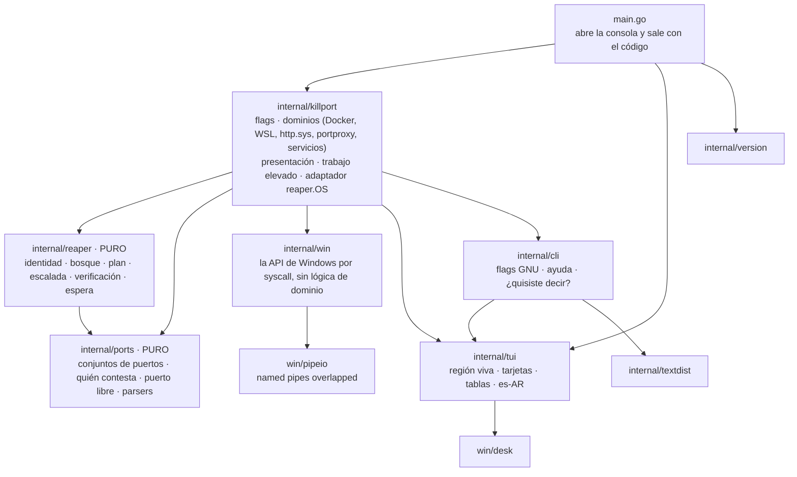
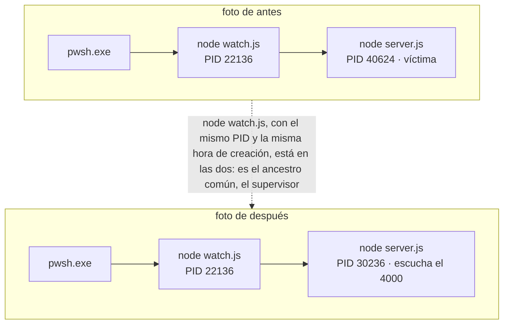
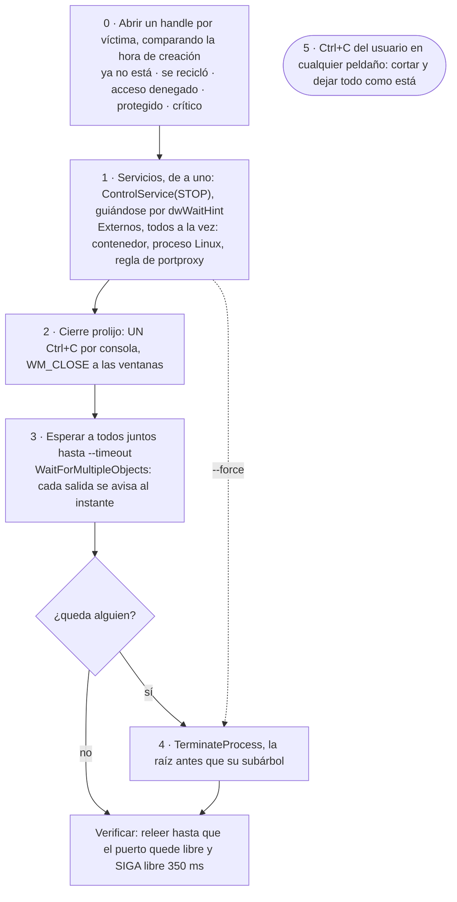
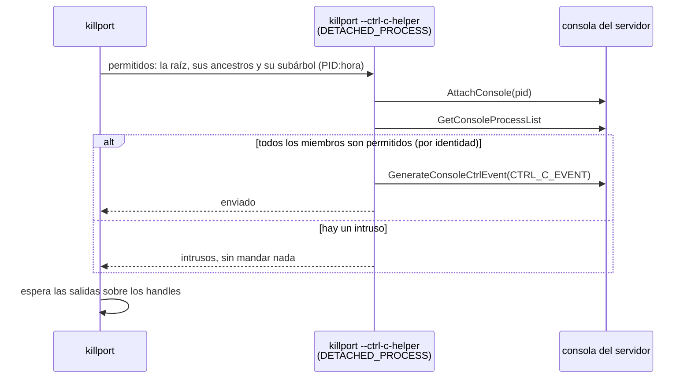
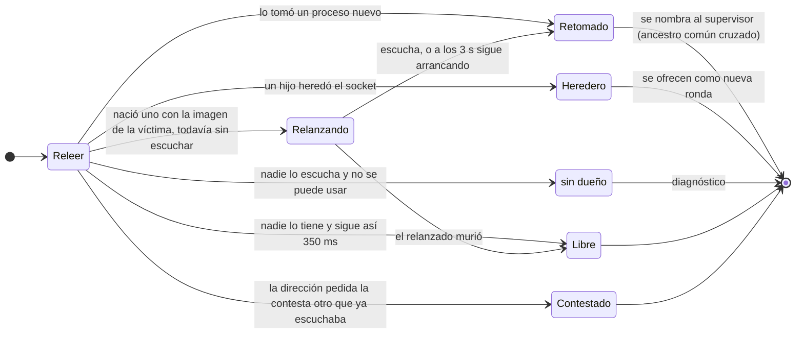
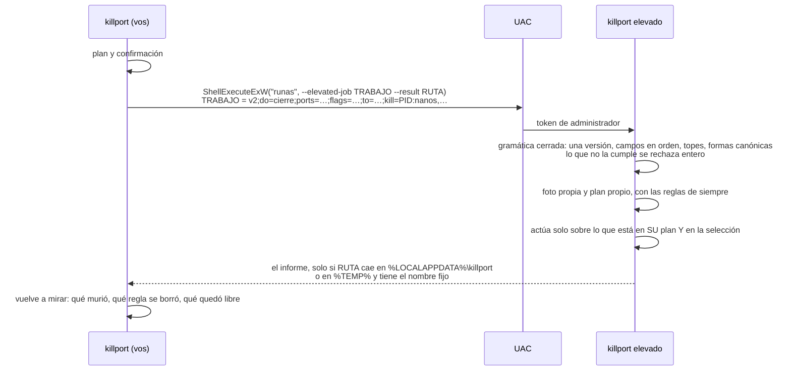

# killport

<p>
  <a href="https://github.com/agustinyarrus/killport/releases/latest"></a>
  
  
  
  <a href="LICENSE"></a>
</p>

Liberá el puerto que necesitás, con cuidado. killport te dice qué ocupa un puerto en Windows —un proceso, un servicio, un contenedor, un proceso dentro de WSL, una URL de http.sys—, lo cierra como lo harías a mano (Ctrl+C en su ventana y, solo si no cede, en seco) y después comprueba que haya quedado libre de verdad.

<p align="center">
  <picture>
    <source media="(prefers-reduced-motion: reduce)" srcset="demo/demo.png">
    
  </picture>
</p>
<p align="center"><sub>Una sesión real en una terminal de 100×30, grabada con <a href="https://github.com/charmbracelet/vhs">VHS</a> contra tres servidores de prueba · <a href="demo/demo.webm">en video</a> · <a href="demo/demo.tape">el guion</a> · <a href="demo/LEEME.md">cómo regrabarla</a></sub></p>

<details>
<summary>¿Sin imágenes? La misma sesión, en texto</summary>

```text
> killport --project . --list

  killport  ·  libera el puerto que necesitás                                               v1.0.0


  ● node.exe  PID 19316 · hace 5 s
      3000 TCP escuchando en 0.0.0.0 · toda la red
      node web.js
      proyecto: tienda (rama feat/carrito) · X:\dev\tienda
      cadena: pwsh.exe → node.exe

  ● node.exe  PID 15564 · hace 5 s
      5173 TCP escuchando en [::1] · esta PC (v6)
      node dev.js
      proyecto: tienda (rama feat/carrito) · X:\dev\tienda
      cadena: pwsh.exe → node.exe

  ● python.exe  PID 26512 · hace 5 s
      8080 TCP escuchando en 0.0.0.0 · toda la red
      python api.py
      proyecto: tienda (rama feat/carrito) · X:\dev\tienda
      cadena: pwsh.exe → python.exe

    › solo miré; killport <puerto> -y lo cierra

> killport 3000

  killport  ·  libera el puerto que necesitás                                               v1.0.0


  ● node.exe  PID 19316 · hace 8 s
      3000 TCP escuchando en 0.0.0.0 · toda la red
      node web.js
      proyecto: tienda (rama feat/carrito) · X:\dev\tienda
      cadena: pwsh.exe → node.exe

  ¿Cerrar node.exe y liberar el 3000? [s/N] y

  › Ctrl+C a node.exe
  ✓ node.exe cerró   18 ms · Ctrl+C


     killport

     ● Puertos libres   1 de 1                    ● Cerraron solos   1

> killport 3000 --free

  killport  ·  un puerto libre de verdad                                                    v1.0.0

  ✓ 3000 libre   TCP · IPv4 e IPv6 · confirmado con un bind exclusivo

    › en un script, sin consola, sale solo el número: $port = killport --free 3000 (en bash,
      PORT=$(killport --free 3000))
```

</details>

Un único `.exe` de unos 5 MB, en Go puro: sin instalador, sin dependencias, sin nube, sin administrador salvo cuando de verdad hace falta. Antes vivía en navaja, una suite de herramientas de consola para Windows; ahora es un proyecto propio.

[Por qué](#por-qué) · [Instalar](#instalar) · [Uso](#uso) · [Recorrido](#recorrido) · [Lo que nunca hace](#lo-que-nunca-hace) · [Cómo funciona](#cómo-funciona) · [Trampas de Windows](#trampas-de-windows) · [Cómo se verificó](#cómo-se-verificó) · [Límites](#límites)

## Por qué

`Error: listen EADDRINUSE: address already in use :::3000`. La receta de siempre en Windows es `netstat -ano | findstr :3000` y después `taskkill /PID 1234 /F`. La pregunta de Stack Overflow que la enseña ([39632667](https://stackoverflow.com/questions/39632667)) tiene 1.394 votos y más de 4 millones de visitas, y el paquete `kill-port` de npm se baja 2,4 millones de veces por semana (cifras del 27/9/2026). La receta anda casi siempre, y cuando no anda es por algo que netstat no dice:

- **El PID es un número, no un proceso.** Entre leerlo y matarlo, Windows lo puede haber reciclado.
- **`/F` no avisa.** El servidor no llega a cerrar sus conexiones ni a borrar sus temporales; el Ctrl+C que habrías apretado vos sí se lo permite.
- **El dueño que figura no es el que escucha.** El 80 a nombre de System (PID 4) casi siempre es http.sys trabajando para otro programa: la pregunta de Stack Overflow sobre eso ([1430141](https://stackoverflow.com/questions/1430141)) tiene 455 votos y más de 720.000 visitas, y es una ronda de adivinanzas. `com.docker.backend.exe` es Docker Desktop entero publicando un contenedor, `wslrelay.exe` es WSL reenviando un proceso Linux y `svchost.exe` puede ser una regla de `portproxy` olvidada. Matar al que figura rompe otra cosa y el puerto sigue ocupado.
- **Otro lo vuelve a tomar.** nodemon, pm2 o un servicio relanzan al servidor en menos de un cuarto de segundo, y el puerto parece "inmatable".
- **Dos escuchan el mismo puerto.** Uno en `[::1]` y otro en `0.0.0.0`, sin error: el navegador muestra la versión vieja y netstat muestra dos filas que nadie mira.
- **Nadie lo tiene.** WinNAT reservó el bloque para Hyper-V, WSL o Docker: no hay proceso que matar, y el [issue de Docker](https://github.com/docker/for-win/issues/3171) que lo cuenta tiene 184 👍 y sigue abierto. Y no toda exclusión es de WinNAT: el 2869 y el 5357 que aparecen en tantas tablas los aparta Windows mientras sus servicios los atienden, y ahí el `net stop winnat` de las recetas corta la red de WSL y Docker para nada.

killport resuelve cada uno de esos casos, y en los que no se puede resolver dice por qué y qué hacer.

## Instalar

Bajá `killport.exe` de la [última release](https://github.com/agustinyarrus/killport/releases/latest) y copialo a una carpeta del `PATH`. Es el programa entero: Windows 10 u 11 de 64 bits (se probó en Windows 11), sin instalador. Al lado viene `SHA256SUMS` para comprobarlo:

```powershell
(Get-FileHash .\killport.exe -Algorithm SHA256).Hash -eq ((Get-Content .\SHA256SUMS) -split '\s+')[0]   # True
```

El `.exe` es reproducible: la misma etiqueta compilada con el mismo Go da los mismos bytes en cualquier máquina ([cómo](docs/RELEASE.md#5-el-exe-es-reproducible)).

Con [Go](https://go.dev/dl) 1.26 o más nuevo (con un Go 1.21+ más viejo, Go baja solo la versión que pide el `go.mod`):

```powershell
go install github.com/agustinyarrus/killport@latest
```

Desde el repo:

```powershell
.\build.ps1          # dist\killport.exe, con la versión, el commit y el SHA256
.\build.ps1 -Test    # antes, go vet y todas las pruebas
```

killport usa Docker Desktop (o Podman) y WSL si están instalados, para ver qué contenedor o qué proceso Linux hay detrás de un puerto. Sin ellos anda igual, y nunca arranca ni una distro ni el motor.

## Uso

```powershell
killport                          # qué escucha en cada puerto, con su proyecto (oculta lo de Windows)
killport 3000                     # quién tiene el 3000; pregunta y lo cierra
killport 3000 5173 8080,8081      # varios puertos y rangos (5000-5003)
killport localhost:5173 -y        # solo el que contesta localhost, sin preguntar
killport 8080                     # si lo publica un contenedor, detiene el contenedor
killport --orphans -n node        # los node que quedaron escuchando después de cerrar la terminal
killport --project . --list       # qué escucha de este proyecto (su carpeta, su rama)
$port = killport --free 3000      # el primer puerto libre de verdad desde el 3000
killport 5173 --wait 60s          # espera a que el servidor escuche (para scripts)
killport 3000 --reserve           # que WinNAT no vuelva a reservar el 3000
```

| Flag | Qué hace |
|---|---|
| `-l`, `--list` | solo mirar |
| `-y`, `--yes` | no preguntar |
| `-f`, `--force` | sin cierre prolijo: en seco |
| `-t`, `--tree` | también los procesos hijos |
| `--timeout T` | cuánto esperar el cierre prolijo antes de ir en seco (3 s) |
| `--manual` | el servicio que se detiene queda en inicio manual |
| `--orphans`, `-n`/`--name NOMBRE`, `--project DIR` | elegir sin nombrar puertos; se combinan y cada uno achica |
| `--free`, `--count N` | el primer puerto (o los N primeros) libre de verdad |
| `--wait T`, `--wait-free T`, `--any`, `--stable T`, `--new` | esperar a que escuche o a que se libere |
| `--reserve`, `--unreserve`, `--fix-dynamic` | puertos que reserva Windows |
| `--tcp`, `--udp`, `-a`/`--all-states`, `-s`/`--system`, `--wsl`, `--no-docker` | qué mirar |
| `--json` | para scripts; sin `--yes`, solo describe |

`killport --help` tiene la ayuda completa, con 19 ejemplos. Respeta `NO_COLOR` y `--no-color`; si la salida no es una consola, no emite ni un escape. Códigos de salida: `0` listo (o ya estaba libre) · `1` una parte · `2` línea de comandos inválida · `3` no se pudo (o venció la espera) · `130` cancelado. Con `--list`, `0` si pudo mirar. Con `--json`, los mismos que el texto.

## Recorrido

Todas las salidas de esta sección son reales: killport 1.0.0 en una consola de 100 columnas contra servidores de prueba (la tienda de la demo, un par más, un contenedor de nginx y un programa que reserva puertos), capturadas el 28/9/2026. Las carpetas están montadas como `X:\dev\…` para que no aparezca ninguna ruta de verdad, y en los bloques que cierran o miran puertos se omite la cabecera, que es siempre la misma (`killport  ·  libera el puerto que necesitás  v1.0.0`).

### El listado

Sin argumentos, killport lista lo que escucha la máquina y pregunta cuál liberar. Esconde lo de Windows (`--system` lo muestra) y las columnas ceden ancho cuando la ventana es angosta: recorta por el medio lo que sobra y deja lo que importa.

```text
> killport

  killport  ·  qué escucha en cada puerto                                                   v1.0.0

   #   PUERTO   PROTO   ALCANCE          PID   PROCESO          PROYECTO      COMANDO
   1       80   TCP     toda la red    37528   http.s…wsh.exe   tienda · f…   http://+:…ES/TIENDA/
   2     3000   TCP     toda la red    40252   node.exe         tienda · f…   node web.js
   3     4000   TCP     toda la red     9576   node.exe         tienda · f…   node server.js
   4     4001   TCP     toda la red    37424   node.exe         tienda · f…   node colgado.js
   ⋮
   7   ! 5173   TCP     esta PC (v6)   30884   node.exe         tienda · f…   node dev.js
   8   ! 5173   TCP     toda la red    41844   node.exe         landing · …   node preview.js
   ⋮
  13     6006   TCP     toda la red    23580   node.exe         tienda · f…   node storybook.js
   ⋮
  17     8080   TCP     toda la red    25432   python.exe       tienda · f…   python api.py
   ⋮

    ! 5173: lo escuchan 2 procesos distintos a la vez, y ninguno dio error
      localhost y [::1] → node.exe (PID 30884) en [::1]
      127.0.0.1 y la red por IPv4 → node.exe (PID 41844) en 0.0.0.0
      → killport localhost:5173 cierra solo al que contesta localhost; killport 5173, a todos
    › 19 procesos de Windows ocultos · --system los muestra; 75 sockets UDP de clientes ocultos
      · --all-states los muestra
    › killport <puerto> cierra lo que ocupa ese puerto

  ¿Cuál liberar? número, o Enter para salir:
```

<sub>Recortada: las filas `⋮` son programas de la máquina donde se capturó. Como toda pista que no entra, la de lo oculto se parte al ancho de la consola, con el separador al principio del renglón que sigue.</sub>

La fila 1 ya dice algo que netstat no: el 80 figura a nombre de System (PID 4), pero lo que escucha es un `pwsh.exe` que registró una URL en http.sys (`http.s…wsh.exe` es `http.sys · pwsh.exe` recortado por el medio, y el PID es el suyo). El PROYECTO sale de la carpeta de trabajo de cada proceso, subiendo hasta el marcador más cercano: el nombre, del que lo declara (`package.json`, `go.mod`, `Cargo.toml`, `pyproject.toml`, un `.csproj`) o de la carpeta, y la rama, de `.git\HEAD`, sin ejecutar git.

### Cerrar

Un bloque por dueño y, sin `-y`, la pregunta (la demo de arriba la muestra). El Ctrl+C llega a cada consola una sola vez, todas las víctimas se esperan juntas y la tarjeta cuenta cómo terminó cada una:

```text
> killport 3000 8080 6006 -y

  ● node.exe  PID 40252 · hace 5 min 16 s
      3000 TCP escuchando en 0.0.0.0 · toda la red
      node web.js
      proyecto: tienda (rama feat/carrito) · X:\dev\tienda
      cadena: pwsh.exe → node.exe

  ● node.exe  PID 23580 · hace 5 min 14 s
      6006 TCP escuchando en 0.0.0.0 · toda la red
      node storybook.js
      proyecto: tienda (rama feat/carrito) · X:\dev\tienda
      quedó suelto: su padre (PID 36056) ya no existe

  ● python.exe  PID 25432 · hace 5 min 16 s
      8080 TCP escuchando en 0.0.0.0 · toda la red
      python api.py
      proyecto: tienda (rama feat/carrito) · X:\dev\tienda
      cadena: pwsh.exe → python.exe

  › Ctrl+C a node.exe (PID 40252)
  › Ctrl+C a node.exe (PID 23580)
  › Ctrl+C a python.exe
  ✓ node.exe (PID 40252) cerró   17 ms · Ctrl+C
  ✓ node.exe (PID 23580) cerró   17 ms · Ctrl+C
  ✓ python.exe cerró   115 ms · Ctrl+C


     killport

     ● Puertos libres   3 de 3                    ● Cerraron solos   3
```

Si no cede en `--timeout`, en seco, y lo dice:

```text
> killport 4001 -y --timeout 1s

  ● node.exe  PID 37424 · hace 1 min 53 s
      4001 TCP escuchando en 0.0.0.0 · toda la red
      node colgado.js
      proyecto: tienda (rama feat/carrito) · X:\dev\tienda
      cadena: pwsh.exe → node.exe

  › Ctrl+C a node.exe
  ! node.exe terminado en seco   no cedió al Ctrl+C en 1 s


     killport

     ● Puertos libres   1 de 1                    ● En seco          1
```

### El que lo vuelve a tomar

Un supervisor al estilo nodemon relanza al servidor apenas muere, y encima ignora el Ctrl+C. Antes de preguntar, killport avisa que el Ctrl+C le llega también al padre (comparten la consola). Después de cerrar, la verificación ve que otro proceso tomó el puerto, encuentra quién lo relanzó y ofrece cerrarlo a él:

```text
> killport 4000

  ● node.exe  PID 40624 · hace 8 s
      4000 TCP escuchando en 0.0.0.0 · toda la red
      node server.js
      proyecto: tienda (rama feat/carrito) · X:\dev\tienda
      cadena: pwsh.exe → node.exe → node.exe
      el Ctrl+C le llega también a node.exe (PID 22136), su padre: comparte la consola

  ¿Cerrar node.exe y liberar el 4000? (el Ctrl+C le llega también a node.exe (PID 22136)) [s/N] s

  › Ctrl+C a node.exe   le llega también a node.exe (PID 22136), que comparte la consola
  ✓ node.exe cerró   39 ms · Ctrl+C
  ! puerto 4000 lo retomó otro proceso
      lo relanza node.exe (PID 22136): cerrá ese supervisor (por ej. nodemon/pm2) y después el
      puerto queda libre
    → el 4001 está libre, si te sirve otro puerto
  ¿Cerrar también a node.exe (PID 22136), que lo relanza, con sus hijos? [s/N] s

  › Ctrl+C a node.exe (PID 22136)
  ✓ node.exe (PID 30236) cerró   16 ms · Ctrl+C
  ! node.exe (PID 22136) terminado en seco   no cedió al Ctrl+C en 3 s


     killport

     ● Puertos libres   1 de 1     ● Cerraron solos   2          ● En seco          1
```

Con `-y` o sin consola no cierra al supervisor (nadie lo nombró): da el comando exacto.

### localhost no es 127.0.0.1

Dos procesos escuchan el 5173: un servidor viejo de otro proyecto en `0.0.0.0` (como un `vite preview` olvidado) y el dev server en `[::1]`. Windows los deja convivir sin error; el navegador pide `localhost`, prueba `::1` primero y llega a uno, y un `curl 127.0.0.1` llega al otro:

```text
> killport 5173 --list

  ● node.exe  PID 41844 · hace 1 min 42 s
      5173 TCP escuchando en 0.0.0.0 · toda la red
      node preview.js
      proyecto: landing (rama main) · X:\dev\landing
      cadena: pwsh.exe → node.exe

  ● node.exe  PID 30884 · hace 10 s
      5173 TCP escuchando en [::1] · esta PC (v6)
      node dev.js
      proyecto: tienda (rama feat/carrito) · X:\dev\tienda
      cadena: pwsh.exe → node.exe

    ! 5173: lo escuchan 2 procesos distintos a la vez, y ninguno dio error
      localhost y [::1] → node.exe (PID 30884) en [::1]
      127.0.0.1 y la red por IPv4 → node.exe (PID 41844) en 0.0.0.0
      → killport localhost:5173 o 127.0.0.1:5173 apuntan solo al que contesta esa dirección

    › solo miré; killport <puerto> -y lo cierra
```

Una dirección apunta. `killport localhost:5173` cierra solo al que contesta `localhost`, deja al otro al margen y, al verificar, dice la verdad incómoda: `localhost` sigue llegando a alguien, así que para lo pedido el puerto no quedó libre (sale con `3`):

```text
> killport localhost:5173 -y

  ● node.exe  PID 30884 · hace 10 s
      5173 TCP escuchando en [::1] · esta PC (v6)
      node dev.js
      proyecto: tienda (rama feat/carrito) · X:\dev\tienda
      cadena: pwsh.exe → node.exe

    · node.exe (PID 41844) queda al margen
        escucha el 5173 en 0.0.0.0 · toda la red; no contesta localhost: no se toca

    ! 5173: lo escuchan 2 procesos distintos a la vez, y ninguno dio error
      localhost y [::1] → node.exe (PID 30884) en [::1]
      127.0.0.1 y la red por IPv4 → node.exe (PID 41844) en 0.0.0.0

  › Ctrl+C a node.exe
  ✓ node.exe cerró   16 ms · Ctrl+C
  ✓ localhost:5173 ya no llega a node.exe (PID 30884)
  ! ahora localhost (por 127.0.0.1) llega a node.exe (PID 41844)
      que ya escuchaba en 0.0.0.0 y no se pidió
    → el 5174 está libre, si te sirve otro puerto


     killport

     ● Puertos libres   0 de 1                    ● Cerraron solos   1
```

### Lo que hay detrás del dueño

Cuando la tabla nombra a un intermediario, killport mira detrás y el objetivo pasa a ser lo que de verdad escucha. El intermediario no se toca nunca.

**http.sys.** El 80 está a nombre de System, pero la URL la registró un programa (acá, un `HttpListener` de .NET en un `pwsh`). killport lo encuentra en las colas de http.sys y lo cierra a él:

```text
> killport 80 -y

  ● pwsh.exe  PID 37528 · hace 5 min 23 s
      80 TCP escuchando en ∗ v4+v6 · toda la red
      pwsh -NoProfile -File http.ps1
      proyecto: tienda (rama feat/carrito) · X:\dev\tienda
      cadena: pwsh.exe → pwsh.exe
      registró http://+:80/TEMPORARY_LISTEN_ADDRESSES/TIENDA/
      Windows lo ve como System (PID 4): es http.sys, el servidor HTTP de Windows, no se toca

  › Ctrl+C a pwsh.exe
  ✓ pwsh.exe cerró   76 ms · Ctrl+C


     killport

     ● Puertos libres   1 de 1                    ● Cerraron solos   1
```

**WSL.** Un servidor dentro de Ubuntu se ve en Windows como `wslrelay.exe`. killport pregunta dentro de las distros que ya corren, confirma al dueño por el inodo del socket y lo cierra con señales de Linux:

```text
> killport 8765 -y

  ● python3  PID 463 en Ubuntu · hace 14 s
      8765 TCP escuchando en 127.0.0.1 · esta PC
      python3 -m http.server 8765
      usuario: root (dentro de WSL)
      Windows lo ve como wslrelay.exe (PID 35116): es el reenvío de WSL, no se toca

  › SIGINT a python3 en Ubuntu   si no cede: SIGTERM y después SIGKILL
  ✓ python3 en Ubuntu se detuvo   176 ms · SIGINT


     killport

     ● Puertos libres            1 de 1           ● Procesos Linux cerrados   1
```

**Docker y Podman.** Si el puerto lo publica un contenedor, el bloque es el del contenedor: nombre, imagen, proyecto y servicio de compose, todos los puertos que publica (y que detenerlo libera también los otros), la política de reinicio y el `docker compose … stop` equivalente. Acá, un nginx de prueba con las etiquetas de compose de la tienda, en Docker Desktop 4.91:

```text
> killport 8088

  ● contenedor kp-prueba-web  nginx:alpine · compose tienda/web
      8088 TCP escuchando en ∗ v4+v6 · toda la red
      publica 8088 → 80/tcp, 8443 → 443/tcp
      se detiene entero: libera también 8443
      reinicio: unless-stopped (detenido a mano, no vuelve solo)
      es lo mismo que `docker compose -p tienda stop web`
      Windows lo ve como com.docker.backend.exe (PID 38200): es Docker Desktop, no se toca

  ¿Detener el contenedor kp-prueba-web y liberar el 8088? [s/N] y

  › Deteniendo el contenedor kp-prueba-web
  ✓ el contenedor kp-prueba-web se detuvo   403 ms · stop del motor


     killport

     ● Puertos libres           1 de 1            ● Contenedores detenidos   1
```

Se detiene por la API del motor (`POST /containers/{id}/stop?t=`, con `t` = `--timeout`), no matando a Docker Desktop. Con el backend de WSL 2, un puerto publicado son tres sockets de dos dueños (el motor en `0.0.0.0` y `[::]`, `wslrelay` en `[::1]`), y se muestran como uno. Lo verifica [`_oracle/docker.ps1`](internal/killport/_oracle/docker.ps1) contra contenedores de verdad (49 de 49).

**portproxy.** Si el puerto lo tiene el servicio IP Helper, es una regla de `netsh interface portproxy`: killport la muestra con el comando exacto que la borra y la borra (pide administrador), revalidándola contra el registro antes y después. El servicio no se toca: de él dependen el reenvío de localhost de WSL y los túneles de IPv6, que el `net stop iphlpsvc` de los foros corta.

**Servicios.** Un servicio de terceros (SQL Server, PostgreSQL, Apache) se detiene como servicio, porque si se mata el proceso el administrador de servicios lo revive. El bloque dice su tipo de inicio y si vuelve solo al reiniciar; `--manual` lo deja en inicio manual y dice cómo deshacerlo. Una tabla chica de sospechosos de siempre (IIS y MsDepSvc en el 80, VMware en el 443, Reporting Services, WinRM, y los de Windows que atienden por http.sys: SSDP en el 2869, WSD en el 5357) agrega su consejo. Lo de Windows no se toca, con el motivo:

```text
> killport 445 135 --list

  ● 135 — svchost.exe
      no se toca: lo escucha el servicio de Windows RpcSs (dentro de svchost)
      → Windows no deja detener RpcSs (corre sin aceptar esa orden): para ese puerto no hay nada que
        cerrar; usá otro
      servicio RpcSs · inicio automático: vuelve al reiniciar Windows

  ● 445 — System
      no se toca: es compartir archivos e impresoras de Windows (SMB): lo atiende el kernel, no
        http.sys
      → se libera apagando el uso compartido (servicio Servidor, LanmanServer) y reiniciando: si no
        es eso lo que buscás, usá otro puerto

    › solo miré; killport <puerto> -y lo cierra
```

### El puerto que reserva Windows

Nadie lo escucha y aun así da `EACCES`: Windows lo excluyó. La tabla de exclusiones (`netsh int ipv4 show excludedportrange`) no dice quién puso cada fila, solo si la agregó un administrador (la marca `*`). killport lo distingue de un puerto ocupado sondeándolo con un bind exclusivo, deduce de quién es por la forma de la fila y por lo que ve en http.sys, y solo a lo que es de WinNAT le da las salidas de WinNAT:

| La fila | De quién es | Qué dice killport |
|---|---|---|
| 100 puertos, sin `*` | WinNAT, para Hyper-V, WSL y Docker; los elige de nuevo en cada arranque | el bloque, `--reserve` y reiniciar WinNAT |
| un puerto TCP, sin `*`, con algo de http.sys ahí | http.sys, mientras atiende ese puerto: el 2869 de SSDP y el 5357 de WSD van y vienen así | para qué es y a nombre de quién; se va sola |
| cualquier otra sin `*` | un programa que pidió una reserva mientras corre; Windows no dice cuál | se va cuando ese programa la suelta o termina |
| con `*` | un administrador (o `killport --reserve`) | un programa que lo pide lo puede usar |

Un bloque de WinNAT:

```text
> killport 55200 --list

  · puerto 55200 lo reserva Windows
      cae en el bloque 55150–55249 que WinNAT reservó para Hyper-V, WSL o Docker (los elige de nuevo
      en cada arranque)
    → killport 55200 --reserve             lo reserva para vos: WinNAT no lo vuelve a tomar
                                           (permanente; pide administrador)
    → net stop winnat && net start winnat  como administrador: lo libera ahora; en el próximo
                                           arranque WinNAT vuelve a elegir sus bloques
    → el 55250 está libre, si te sirve otro puerto
```

La reserva de un programa (una de prueba, de 7 puertos, pedida sin administrador): ni `--reserve` ni reiniciar WinNAT la sacan, y killport no los ofrece.

```text
> killport 54465

  · puerto 54465 lo reserva Windows
      cae en la exclusión 54462–54468, que no es de WinNAT (sus bloques son de 100 puertos) ni la
      agregó un administrador: la tiene reservada un programa mientras corre, y Windows no dice cuál
    → no hay proceso a la vista que cerrar: la reserva se va cuando ese programa la suelta o
      termina; ni reservarlo ni reiniciar WinNAT la sacan
    → el 54469 está libre, si te sirve otro puerto
```

Y el 2869 mientras SSDP lo atiende (se lo provocó suscribiéndose a los avisos de un dispositivo UPnP de la red). La tabla lo pone a nombre de System; detrás está el servicio SSDPSRV, que no se toca, y la línea de abajo dice qué es y qué se puede hacer sin romper nada:

```text
> killport 2869 --list

  ● 2869 — svchost.exe  PID 6528 · a través de System
      registró http://*:2869/UPNP/EVENTING/
      no se toca: lo escucha el servicio de Windows SSDPSRV (dentro de svchost)
      → pará el servicio con `net stop SSDPSRV` como administrador; no se mata el svchost
      servicio SSDPSRV · inicio manual: no vuelve solo: arranca cuando alguien lo pide
      es SSDP (UPnP), el descubrimiento de dispositivos de la red: Windows lo atiende mientras algún
        programa sigue los avisos de un dispositivo UPnP (el router, un televisor) o esta PC
        comparte uno, y lo suelta solo: sin romper nada, usá otro puerto

    › solo miré; killport <puerto> -y lo cierra
```

`--reserve` agrega una exclusión administrada para ese puerto (deteniendo WinNAT solo si un bloque SUYO lo tapa, y volviéndolo a arrancar siempre), `--unreserve` la quita y `--fix-dynamic` devuelve el rango dinámico a 49152–65535. Cambian la red de toda la máquina, así que muestran el plan paso por paso y preguntan siempre, también con `--yes`; sin consola no hacen nada. Si lo que tapa el puerto es de http.sys o de un programa, `--reserve` se niega y dice por qué: detener WinNAT no lo libera.

### Elegir sin nombrar puertos

`--orphans` son los que quedaron escuchando sin su terminal, `-n` elige por nombre o por ruta (`node`, `python*`, `C:\dev\*`) y `--project` por carpeta. Se combinan, y cada uno achica:

```text
> killport --orphans --project . --list

  ● node.exe  PID 23580 · hace 4 min 27 s
      6006 TCP escuchando en 0.0.0.0 · toda la red
      node storybook.js
      proyecto: tienda (rama feat/carrito) · X:\dev\tienda
      quedó suelto: su padre (PID 36056) ya no existe

    › solo miré; killport <puerto> -y lo cierra
```

### Para scripts

`--free` da el primer puerto libre de verdad: que nadie escucha en ninguna dirección, fuera de lo que reserva Windows y del rango dinámico, confirmado con un bind exclusivo en IPv4 y en IPv6. Dice qué salteó y por qué:

```text
> killport --free 3000 --count 3

  killport  ·  un puerto libre de verdad                                                    v1.0.0

  ✓ 3001, 3002 y 3003 libres   TCP · IPv4 e IPv6 · confirmado con un bind exclusivo

  salteé
    3000   lo escucha node.exe (PID 40252 · tienda)

    › en un script, sin consola, sale un número por línea: $ports = killport --free 3000 --count 3
      (en bash, PORTS=$(killport --free 3000 --count 3))
```

Sin consola sale solo el número:

```powershell
PS> $port = killport --free 3000; $port
3001
```

`--wait` espera a que un puerto escuche, mirando la tabla de Windows: no se conecta a nadie, así que no cae en la trampa de `localhost` ni dispara el aviso del Firewall. `--wait-free` espera a que se libere: relee la misma tabla, pero entre lectura y lectura duerme sobre los procesos dueños, así que la salida del dueño lo despierta al instante:

```text
> killport 5174 --wait 20s

  killport  ·  esperar a que escuche                                                        v1.0.0

  · Espero a que escuche el 5174   hasta 20 s
  ✓ 5174 escucha   node.exe (PID 18352 · tienda) en [::1] · a los 2,47 s

> killport 5174 --wait-free 20s

  killport  ·  esperar a que se libere                                                      v1.0.0

  · Espero a que se libere el 5174, sin cerrar nada   hasta 20 s
  · 5174 lo ocupa node.exe (PID 18352 · tienda)
  ✓ 5174 libre   a los 1,85 s · node.exe (PID 18352 · tienda) lo soltó
```

```powershell
npm run dev &                                   # PowerShell 7 o bash
killport 5173 --wait 60s && npx playwright test
```

`--json` es un documento estable, con el mismo código de salida que el texto; sin `--yes`, solo describe:

<details>
<summary><code>killport 3000 --json</code></summary>

```json
{
  "puertos": [
    {
      "puerto": 3000,
      "proto": "TCP",
      "estado": "ocupado",
      "dueno": {
        "pid": 40252,
        "proceso": "node.exe"
      },
      "motivo": "lo tiene node.exe (PID 40252)"
    }
  ],
  "victimas": [],
  "libres": 0,
  "total": 1,
  "cancelado": false,
  "solo_listado": true,
  "objetivos": [
    {
      "tipo": "proceso",
      "pid": 40252,
      "proceso": "node.exe",
      "puertos": [
        3000
      ],
      "direcciones": [
        "0.0.0.0"
      ],
      "alcance": "red",
      "proyecto": {
        "raiz": "X:\\dev\\tienda",
        "nombre": "tienda",
        "marcador": "package.json",
        "repo": "X:\\dev\\tienda",
        "rama": "feat/carrito",
        "carpeta": "X:\\dev\\tienda"
      },
      "desde": "2026-09-28T18:13:56.1619038-03:00",
      "comando": "\"C:\\Program Files\\nodejs\\node.exe\" web.js",
      "ruta": "C:\\Program Files\\nodejs\\node.exe"
    }
  ],
  "negativas": [],
  "externos": [],
  "al_margen": []
}
```

</details>

## Lo que nunca hace

Un programa que cierra procesos tiene que ser más conservador que quien lo usa. Estas reglas están en el código, no solo en este texto, y las centrales se prueban como propiedades: en 400 bosques de procesos al azar, el plan nunca elige al kernel, a un proceso crítico, a killport ni a su terminal.

- **Nunca actúa sobre un PID suelto.** Todo proceso es PID + hora de creación. El handle se abre comparando la hora: si no coincide, el PID se recicló y ese proceso no se toca. Mientras el handle está abierto, Windows no puede reciclar el PID.
- **Nunca se cierra a sí mismo ni a la terminal desde donde lo corrés**, ni a ningún ancestro suyo.
- **Nunca toca el kernel, un proceso crítico, un `svchost` ni un intermediario** (Docker Desktop, `wslrelay`, VS Code, http.sys, el IP Helper). Cada negativa lleva su motivo y su consejo. Un nombre de Windows protege solo si la ruta es la de System32 y el padre es el esperado: un `svchost.exe` en otra carpeta se muestra como posible impostor y se trata como el programa cualquiera que es.
- **Nunca manda un Ctrl+C a una consola donde hay un extraño.** El Ctrl+C le llega a toda la consola, así que solo se manda si todos los que la comparten son de la familia del servidor: sus ancestros (el `npm` o el supervisor que lo lanzó) y sus hijos, lo mismo que alcanzaría apretarlo en esa ventana. Si le va a llegar a alguien de la familia que no se pidió, lo dice antes de preguntar; si hay un extraño, no lo manda y va en seco solo contra lo pedido.
- **Nunca actúa sin que lo confirmes**: sin consola hace falta `--yes`, y `--json` sin `--yes` solo describe. Si lo que no se toca sigue sosteniendo el puerto, cerrar a los demás no lo liberaría: lo dice, y con `--yes` no cierra a nadie.
- **Nunca arranca una distro de WSL ni el motor de Docker**, y nunca aconseja `wsl --shutdown` sin decir lo que apaga: todo lo que corre en WSL y, si el motor de Docker Desktop o Podman corre ahí (o no se pudo saber), también ese motor y sus contenedores.
- **Nunca cambia la red sin mostrarte el plan**, ni con `--yes`. Nunca aconseja borrar una exclusión de puertos ajena, deshabilitar el driver de http.sys ni detener WinNAT por un puerto que no aparta WinNAT.
- **Nunca deja nada corriendo.** Los comandos que ejecuta (`netsh`, `wsl.exe`) corren sin ventana, con plazo y dentro de un Job Object que los mata si killport se cae. No hay servicio, tarea programada ni proceso residente.
- **Nunca le da órdenes a un proceso administrador.** El proceso elevado recibe una selección, vuelve a mirar el sistema y solo toca lo que su propio plan permite.

## Cómo funciona

Lo que sigue es para quien quiera saber cómo está hecho. El detalle completo, con cada decisión, está en [docs/ARQUITECTURA.md](docs/ARQUITECTURA.md).

### Capas



La regla es que el algoritmo (`reaper`, `ports`) y la API de Windows (`win`) no se conocen. Todo lo que el algoritmo necesita del sistema pasa por una interfaz, `reaper.OS`: en producción la implementa `internal/killport/sistema.go` con `win`; en las pruebas, un simulador de eventos discretos. Lo puro no lleva etiqueta de compilación y compila en cualquier sistema (la CI lo comprueba con `GOOS=linux go vet`). Todo es biblioteca estándar: el `go.mod` no tiene ningún `require`, y las llamadas a Windows van por `syscall`, sin CGO.

Una corrida de `killport 3000` es: una foto (las tablas de sockets y todos los procesos, sin abrir ninguno), un plan puro sobre esa foto, desenmascarar a los intermediarios, mostrar y preguntar, la escalada, y una verificación que relee el sistema.

### Identidad

Windows recicla los PID, y rápido. killport nunca se refiere a un proceso por su número: la unidad es `ID{PID, Created}`, la hora de creación con resolución de 100 ns. Abrir un proceso compara `GetProcessTimes` con la hora esperada y distingue: ya no existe, se recicló, acceso denegado, protegido y crítico. El motor sostiene el handle desde que identifica a la víctima hasta que la ve morir, y mientras un handle está abierto el PID no se puede reutilizar: entre decidir y actuar no hay ventana.

Un detalle: `ID` es clave de mapa y se compara con `==`, y en Go `time.Time` compara también la zona horaria y la lectura monotónica. La hora que venía de un handle (hora local) no era `==` a la misma hora leída del sistema (UTC), la espera nunca reencontraba a su víctima y el motor giraba en falso hasta el plazo. Toda identidad se canoniza (UTC, sin lectura monotónica) al entrar al paquete.

### El bosque y el ancestro común

Todos los procesos salen de una sola llamada, `NtQuerySystemInformation(SystemProcessInformation)`: PID, padre, hora de creación, sesión y nombre de todos, incluidos los protegidos y los de otras sesiones, sin abrir ninguno. Con eso se arma un bosque en O(n), con una regla: la arista hijo → padre vale solo si el padre no nació después que el hijo. Si nació después, el PID del padre lo reusa otro proceso, y el "padre" que figura es un impostor.

Sobre el bosque hay ancestros, subárbol, herederos y el **ancestro común más cercano cruzado**: entre la víctima en el bosque de antes y el dueño nuevo del puerto en el bosque de después. Así se encuentra al supervisor que relanzó al servidor, sin saber cómo se llama:



La misma estructura resuelve la trampa clásica de netstat mostrando el PID de un proceso muerto: un hijo heredó el handle del socket. Los herederos son los hijos de ese PID nacidos después del socket, y se ofrecen como nueva ronda.

### La escalera de cierre



Los procesos y los externos van en paralelo, con un solo plazo por peldaño y sin polling; los servicios se detienen de a uno, cada uno con su plazo. El motor no imprime nada: emite eventos tipados (lo que se ve en vivo) y devuelve un reporte con el destino de cada víctima y de cada puerto. A nadie se lo termina en seco sin haber tenido su oportunidad de cerrar prolijo, salvo `--force` o que no haya por dónde pedírselo; es una invariante que se prueba en el simulador.

### Un Ctrl+C a la consola de otro

`GenerateConsoleCtrlEvent` le llega a toda la consola de quien lo llama, y un proceso solo puede estar enganchado a una consola. Así que killport se relanza a sí mismo como ayudante, sin consola propia, y el ayudante se engancha a la del servidor:



El conjunto permitido sale de una sola función, y es la misma que arma el aviso que ves antes de confirmar ("el Ctrl+C le llega también a su padre"). No es un detalle: durante la regresión final, con un padre al margen y su hijo en la misma consola, el aviso decía una cosa y el motor hacía otra. Desde entonces una propiedad compara la predicción con lo que el motor hace en 600 familias de procesos al azar.

### Desenmascarar intermediarios

| La tabla dice | Qué es | Dónde mira killport | Qué cierra |
|---|---|---|---|
| `com.docker.backend.exe`, `gvproxy.exe`, `vpnkit.exe` | Docker Desktop o Podman publicando un contenedor | la API del motor por named pipe (`docker_engine`, el de Docker Desktop, el de Podman, o el que digan `DOCKER_HOST` y el contexto de Docker), con un cliente HTTP/1.1 propio | el contenedor (`POST /containers/{id}/stop`) |
| `wslrelay.exe` | WSL reenviando un proceso Linux | `wsl.exe -d <distro>` en las distros que ya corren: `ss` y `/proc/net`, confirmando el inodo | el proceso Linux: SIGINT, SIGTERM, SIGKILL |
| System (PID 4), un puerto HTTP | http.sys atendiendo una URL registrada | `netsh http show servicestate view=requestq`, leído por forma | el proceso que registró la URL |
| `svchost.exe` del IP Helper | una regla de `netsh interface portproxy` | el registro (`…\Services\PortProxy`) | la regla (como administrador) |
| System, el 445 o el 139 | compartir archivos (SMB) | — | nada: se explica |

El plan recuerda la foto con que se armó y pregunta qué puertos están enmascarados (`Plan.Masked`); cada dominio mira detrás y contesta un `Unmasking` por puerto y por socket (dos contenedores pueden publicar el mismo puerto en IP distintas). `Unmask` reescribe el plan con las mismas reglas que el plan original: lo que se encuentra detrás pasa por la misma puerta de negativas, así que una respuesta de un dominio nunca puede volver objetivo al kernel ni a tu terminal. Qué clases se desenmascaran lo decide un solo lugar (`Relay.Unmaskable`).

El pipe de Docker se abre en modo overlapped y con `SECURITY_IDENTIFICATION`: un programa que se adelante con el nombre del pipe no puede hacerse pasar por killport, que puede estar corriendo como administrador. El cliente HTTP es mínimo y propio (`Content-Length`, chunked y hasta EOF, con topes): sin `net/http` ni `regexp`, el `.exe` bajó de 8,6 a 4,9 MB (medido con Go 1.26), y una prueba con `go list -deps` impide que vuelvan.

### Verificar con una ventana de asentamiento

Que el proceso haya muerto no significa que el puerto esté libre. Después de actuar, killport relee las tablas con backoff (10 ms → 200 ms, tope de 2 s), y cuando un puerto queda libre exige que **siga** libre 350 ms. El número no es arbitrario: un supervisor tardó 241 ms en volver a tomar el puerto (medido), y `wslrelay` suelta el `[::1]` de un contenedor unos 315 ms después de que el contenedor se detuvo. El caso normal no paga esa espera más de una vez, y un puerto que alguien retoma se informa al instante.

Cada puerto termina con un veredicto:



### Un puerto sin dueño

Un puerto que nadie escucha se **sondea antes** de diagnosticarlo: `socket` + `bind` sin `listen` (así no salta el aviso del Firewall), exclusivo (`SO_EXCLUSIVEADDRUSE`) y en IPv6 con `IPV6_V6ONLY`, para que cada familia se sondee por lo suyo. Lo exclusivo importa: un bind común a `0.0.0.0` dice "libre" aunque otro proceso tenga `127.0.0.1` en ese puerto, porque para Windows una dirección específica y un comodín no chocan.

Con el sondeo y los rangos excluidos de `netsh` se distingue: una exclusión administrada que deja atar es un puerto libre para vos; una sin `*` es "lo reserva Windows", y de quién es sale de la forma de la fila (`ExcludedRange.Origin`):

- **WinNAT** aparta bloques de exactamente 100 puertos, sin alinear (en la PC de desarrollo, 55150, 55308 y 55408); lo mismo todas las tablas de los issues públicos (Docker, WSL, multipass, duplicati). Es el único que recibe remedios tipados de WinNAT, que se convierten en comandos (`--reserve` con el protocolo del bloque, reiniciar WinNAT).
- **http.sys** aparta cada puerto TCP que atiende, en IPv4 y en IPv6 (aunque la URL esté atada a `127.0.0.1`), mientras lo atiende: una fila de un solo puerto, que se va cuando deja de atenderlo. La prueba la arma el adaptador y solo si hay una fila así: una cola con una URL en ese puerto, el kernel escuchándolo, o la reserva de URL de Windows (`netsh http show urlacl`), que dice para qué es aunque la cola sea de otro usuario. Las cuentas se leen del SDDL de la reserva, que no se traduce (`LS` es Servicio local en cualquier idioma), y el SID de un servicio (`S-1-5-80-…`, el SHA-1 de su nombre) se resuelve a su nombre. Una tabla chica de servicios de Windows (SSDP, WSD, WinRM, el uso compartido del Reproductor) dice para qué es.
- **Un programa** puede pedir una reserva en tiempo de ejecución (`SIO_ACQUIRE_PORT_RESERVATION`, sin administrador) del tamaño que quiera: dura lo que su socket, y Windows no dice de quién es. Es lo que queda cuando no es ninguna de las otras.

Con exclusivo, `WSAEACCES` es ambiguo (rango excluido, o un socket ajeno con `SO_REUSEADDR`), así que la tabla de sockets es la fuente primaria y el sondeo solo desempata.

### Quién contesta en localhost

`ports.Answer` implementa las reglas de Windows, medidas con conexiones de verdad: la dirección exacta le gana al comodín; un `0.0.0.0` nativo le gana a la mitad IPv4 de un socket de doble pila; entre dos `0.0.0.0` con `SO_REUSEADDR` contesta el que se ató primero; `localhost` prueba `::1` y cae a `127.0.0.1`. Una dirección en la línea de comandos (`localhost:5173`, `[::1]:8080`, `http://localhost:5173/app`) apunta a quien la contesta; `:5173` o `5173` es todo el puerto.

### El trabajo elevado y su gramática

Lo que pide administrador (detener un servicio, borrar una regla, reservar) se hace relanzando killport por el UAC. Un proceso con token de administrador que obedece a sus argumentos es un blanco: cualquier programa tuyo podría lanzarlo con los argumentos que quisiera, y el diálogo del UAC diría "killport". Por eso el trabajo no es una lista de órdenes sino una **selección**:



Viaja por argumentos, nunca por un archivo que otro proceso pueda cambiar entre que se escribe y se lee. Un proceso se cierra solo si el plan del hijo lo tiene de objetivo y su identidad exacta está en la selección; un servicio, si lo corre el mismo proceso que cuando confirmaste; una regla, si está en el registro con la misma clase, dirección y destino; la red se configura solo si la huella de los pasos coincide con la que confirmaste. El informe sirve para contar: lo que pasó, el padre lo comprueba por su cuenta. La gramática se prueba con 82 textos que tiene que rechazar, 8 más mandados al `killport.exe` de verdad (sale con `2` sin tocar nada) y 60.000 mutaciones al azar.

### Esperar sin polling

Esperar a que muera un proceso es `WaitForMultipleObjects` sobre los handles más un evento que se señala desde `ctx.Done()`: cancelar despierta la espera en menos de 1 ms, y con más de 63 procesos se reparten en tandas, cada una en su goroutine. `--wait-free` duerme sobre los handles de los dueños y despierta con la salida (5,6 ms después de la muerte, medido).

Lo que sí se relee es la tabla de sockets, porque sin administrador el kernel no avisa cuándo alguien empieza a escuchar (ETW y el filtrado de WFP piden administrador). Para eso hay una tabla liviana, solo lo que escucha y sin preguntar el servicio dueño de cada socket: 0,34 ms contra 6,95 ms de la completa, releída con backoff de 25 a 200 ms. `Watch`, la máquina de estados de la espera, es pura (recibe la hora y la tabla, no tiene reloj propio) y se prueba con reloj falso: `--stable` mide el sostén desde la hora de creación del socket, así que un reinicio de nodemon vuelve la cuenta a cero.

### La capa de Windows

- **Tablas de sockets**: `GetExtendedTcpTable` y `GetExtendedUdpTable` con las clases `OWNER_MODULE`, que traen PID, la hora de creación del socket y, en un svchost, el nombre del servicio dueño sin abrir el proceso. El layout se midió en la máquina: filas desde el offset 8 (4 bytes de relleno), TCP4 160 bytes, TCP6 192, UDP4 160, UDP6 176; el puerto es un DWORD con los 2 bytes bajos en orden de red y basura en los altos.
- **La ruta de cada proceso**: la clase 88 de `NtQuerySystemInformation` (`SystemProcessIdInformation`). Sin administrador, `QueryFullProcessImageNameW` se negó en 50 de 51 servicios; la clase 88 dio la ruta de todos, sin abrir ninguno.
- **La carpeta de trabajo de otro proceso**, que Windows no expone: se lee del PEB con tres `ReadProcessMemory` (PEB → `ProcessParameters` → `CurrentDirectory`). En un proceso de 32 bits manda el PEB de 32, el único que sigue un `cd` posterior.
- **Búferes crudos**: ninguna lectura sin validar antes que la ventana cabe entera; los punteros que el sistema escribe adentro se leen como desplazamientos. Un búfer corrupto termina en error, no en pánico.
- **DLL por ruta absoluta de System32**: con el nombre pelado, `LoadLibrary` buscaría primero junto al `.exe`, y un DLL plantado ahí ganaría. Solo `kernel32` y `ntdll` van por nombre: son KnownDLL, Windows las carga siempre de System32. Lo mismo con `netsh.exe` y `wsl.exe`, que se lanzan por ruta completa.
- **El ejecutor acotado**: el único camino para `netsh` y `wsl.exe`. El hijo nace suspendido, entra a un Job Object con `KILL_ON_JOB_CLOSE` y `DIE_ON_UNHANDLED_EXCEPTION` y recién ahí corre, sin ventana, con plazo y tope de salida.

## Trampas de Windows

Lo que la documentación no dice y se aprendió midiendo, casi siempre al contrastar killport con una fuente independiente. Las que eran defectos llegaron con una prueba que falla en el código de antes.

**El PID de un servicio está en 0x2C.** En `ENUM_SERVICE_STATUS_PROCESSW`, `dwProcessId` es el octavo DWORD: 0x2C, no 0x28, donde está `dwWaitHint` (que vale 0 en un servicio que corre). Con 0x28 todos los servicios tenían PID 0. El test de bytes pasaba, porque se había armado con el mismo offset equivocado; lo atrapó `Win32_Service`.

**`SOCKET_ERROR` llega sin signo.** `bind` devuelve -1, pero en el registro de 64 bits llega como `0xFFFFFFFF`: `int(r) == -1` nunca era cierto y toda falla se leía como éxito. El 135 y el 445 daban "libre". Se compara con `r != 0`, y vale para cualquier llamada que devuelve un entero negativo de 32 bits.

**`//go:uintptrescapes`.** Un búfer pasado como `uintptr` puede vivir en la pila de la goroutine; si la pila crece entre la conversión y la llamada, Windows escribe en la pila vieja y el resultado vuelve vacío. Se reprodujo siempre con 64 goroutines nuevas llamando a `GetFinalPathNameByHandleW`: falla sin la directiva, pasa con ella.

**Una carrera dentro de la biblioteca estándar.** `go test -race` marcaba 18 carreras, todas en `os.File`: lleva un offset por archivo que leer y escribir actualizan con candados distintos, y un cliente HTTP sobre un pipe lee y escribe a la vez. Inofensiva (en un pipe el kernel ignora el offset), pero tapaba cualquier carrera de verdad. De ahí `win/pipeio`, E/S overlapped propia con un OVERLAPPED y un evento por sentido y plazos con `CancelIoEx`.

**El ayudante se ve a sí mismo.** Al engancharse a la consola del objetivo, el ayudante del Ctrl+C aparece en la lista de miembros: sin excluirlo, siempre había un intruso. Y "no hay consola" son tres códigos de error (5, 6 y 87), no uno.

**netsh habla el idioma de Windows** y escribe UTF-8 a un pipe aunque la consola sea 850, también en los nombres de las cuentas (`NT AUTHORITY\SERVICIO LOCAL`). Los parsers leen la forma y no las palabras: los rangos excluidos se anclan en la línea de guiones, las colas de http.sys se arman por sangría (la etiqueta de la cola se repite adentro de cada grupo de URL, así que separar por líneas en blanco habría andado de casualidad) y las reservas de URL toman las cuentas del SDDL, que no se traduce.

**Una URL atada a una IP tiene un tercer tramo.** Un `HttpListener` en `http://127.0.0.1:8080/` queda en http.sys como `HTTP://127.0.0.1:8080:127.0.0.1/`. Sin leer ese tramo, el 8080 quedaba "sin ninguna URL a la vista" y el consejo culpaba a las de otros usuarios; apareció investigando las exclusiones de http.sys.

**No toda exclusión es de WinNAT.** http.sys aparta con una fila de un solo puerto (en IPv4 y en IPv6, aunque escuche solo en `127.0.0.1`) cada puerto que atiende, y la suelta al dejar de atenderlo: el 2869 aparece cuando SSDP recibe los avisos de un dispositivo UPnP y se va a los segundos. Y cualquier programa, sin administrador, puede reservar puertos con `SIO_ACQUIRE_PORT_RESERVATION`: su fila tampoco lleva `*`. Tomar todo eso por WinNAT llevaba a aconsejar `--reserve`, que detiene WinNAT y no libera ninguno de los dos.

**Un puerto de Docker son tres sockets.** `com.docker.backend` en `0.0.0.0` y `[::]`, `wslrelay` en `[::1]`, y `wslrelay` suelta el suyo 315 ms después del contenedor. Tratarlos por separado daba una fila de más en el listado y, con `--no-docker`, el consejo de `wsl --shutdown`, que apaga también a Docker.

**WinNAT cambia de idea en cada arranque.** Los bloques que reserva no son fijos: el `net stop winnat` de todas las recetas libera el puerto hasta el próximo reinicio. Por eso `--reserve` agrega una exclusión administrada, que WinNAT respeta.

**El padre de Registry nació después.** Registry y Secure System figuran con un padre (System) cuya hora de creación es posterior a la suya: el bosque descarta esa arista, como con cualquier PID reciclado. Para esos procesos sin archivo hay que mirar el padre crudo.

**En WOW64 hay dos PEB.** Leer el PEB nativo de un proceso de 32 bits da la carpeta con que arrancó; solo el PEB de 32 sigue un `cd` posterior. Lo destapó una mutación que sobrevivía: "en WOW64 manda el PEB de 64 bits" pasaba todas las pruebas hasta que una hizo `cd` en un cmd de 32 bits.

**Desde Git Bash el Ctrl+C llega ignorado.** Un proceso lanzado desde bash hereda el Ctrl+C desactivado: killport lo manda, no llega, y a los 3 s lo termina en seco. No es un error de killport. Los guiones de Ctrl+C corren desde PowerShell, y la prueba de Go que manda un Ctrl+C de verdad lo reactiva antes de lanzar a quien lo va a recibir.

**Chrome vive en el rango dinámico.** Las pruebas atan TCP en un puerto que da el sistema, y Chrome tiene decenas de sockets UDP efímeros en ese mismo rango. Sin `--tcp`, un `killport P -y` de una prueba podía cerrar el Chrome de quien la corría. Toda prueba que cierra por número de puerto lleva `--tcp` y elige un puerto que no está en ninguna tabla.

## Cómo se verificó

La regla: cada capa se contrasta con algo independiente. Un parser que lee lo que escribió su propio escritor no prueba nada; netstat, `Win32_Process`, el CLI de docker o `ss` dentro de la distro sí.

| Qué | Contra qué | Resultado |
|---|---|---|
| sockets TCP y UDP | `netstat -ano` | 42 de 42 y 109 de 109, idénticos |
| procesos | `Win32_Process` | 417 de 417 en PID, padre, sesión y hora de creación |
| servicios | `Win32_Service`, `sc query`, `sc qc` | 147 de 147 en PID y estado |
| línea de comandos | `CommandLineToArgvW` | idéntica en 30.000 líneas al azar |
| Docker | el CLI de `docker` y la tabla de sockets | 49 de 49 |
| WSL | `ss`, `pgrep` y `wsl -l --running` dentro de la distro | 31 de 31 |
| de quién es una exclusión | `netsh … excludedportrange` con las tres clases provocadas a la vez, sin administrador | WinNAT: 12 bloques de exactamente 100; http.sys: una fila de un solo puerto por cada puerto que atiende, en v4 y v6; un programa: una fila de su tamaño que muere con él |
| cierre prolijo | el marcador que deja un servidor al recibir SIGINT | aparece con Ctrl+C; no aparece con `--force` |

- **613 pruebas de Go** (`go test ./...`). Las de punta a punta compilan el `killport.exe` de verdad y lo corren contra servidores de prueba; no piden administrador ni cambian la configuración de la máquina.
- **Un simulador de eventos discretos** para el algoritmo: reloj virtual que salta al próximo evento, procesos guionados (cuánto tardan en ceder, si ignoran el Ctrl+C, si un supervisor los relanza), consolas compartidas, servicios, contenedores. Un Ctrl+C que cierra a los 420 ms deja el reloj en +420 ms exactos.
- **Propiedades contra implementaciones ingenuas**, con semilla fija: el conjunto de puertos contra 65.536 booleanos, el bosque en 500 bosques con PID reciclados, el plan en 400 (nunca el kernel, un crítico ni tu terminal), la escalada en 300 escenarios, el aviso del Ctrl+C contra el motor en 600 familias, el puerto libre en 400 semillas, la espera en 300 historias, la tabla en 20.000 disposiciones, y los parsers de http.sys en 300 salidas cada uno con las etiquetas en un idioma inventado, distinto cada vez.
- **290 mutaciones**, todas atrapadas: un script cambia una línea a propósito (invertir una condición, confundir IPv4 con IPv6), corre las pruebas y restaura el archivo comprobando el hash. Seis sobrevivieron a su primera corrida y cada una destapó una prueba floja.
- **270 verificaciones de punta a punta** contra la máquina real, con Docker Desktop y Ubuntu en WSL de verdad: 0 fallas, ningún servidor de prueba vivo al terminar y los procesos del usuario intactos. Fue la regresión final, cuando killport todavía vivía en la suite; lo que cambió después, y cómo se probó, está en [VERIFICACION.md](docs/VERIFICACION.md#regresión-final).
- **CI en `windows-latest`** con el Go mínimo del `go.mod`: `gofmt`, `go vet` (también para Linux), todas las pruebas y el `.exe` con su versión y su SHA256.

El detalle, con los guiones y los números de cada capa: [docs/VERIFICACION.md](docs/VERIFICACION.md).

## Límites

- **Lo que pide administrador nunca corrió como administrador.** Borrar una regla de `portproxy`, detener un servicio y dejarlo en manual, `--reserve`, `--unreserve`, `--fix-dynamic` y el camino por el UAC están probados con dobles, con el plan que imprimirían y con el proceso elevado corrido sin elevar contra procesos propios. El guion para la primera corrida está listo: [`_oracle/ADMIN.md`](internal/killport/_oracle/ADMIN.md).
- Sin probar contra la cosa real: Podman y los contenedores de Windows (solo con respuestas grabadas), un relay de WSL colgado de verdad ([WSL#10601](https://github.com/microsoft/WSL/issues/10601) no se puede provocar a propósito) y WSL con `networkingMode=mirrored`, que no tiene `wslrelay`: ahí el puerto figura sin dueño.
- Un nombre de host (`api.local:3000`) no se resuelve: se toma el puerto entero y se avisa.
- De quién es una exclusión se deduce por su forma: un programa que reservara justo 100 puertos pasaría por WinNAT, y de la reserva de un programa Windows no dice cuál es (no hay una API que lo exponga).
- El supervisor que relanza a un servidor se busca en su padre y su abuelo vivos: uno más arriba, o uno que relanza después de la ventana de verificación, no se ve.
- `--free` da un puerto libre en ese instante; entre que lo da y que lo usás, otro programa lo puede tomar.
- Se compila y se prueba para `windows/amd64` (el `.exe` de la release). Para Windows ARM64 compila, pero nunca corrió ahí. Lo puro compila en cualquier sistema, pero killport es solo para Windows.

La lista completa, con lo que falta y cómo verificarlo: [docs/PENDIENTE.md](docs/PENDIENTE.md).

## Estructura

```
main.go               abre la consola y llama a killport.Main
internal/
  killport/           la herramienta: flags, dominios, presentación, trabajo elevado
    _oracle/          guiones contra Docker, WSL y la prueba con administrador
  reaper/             el algoritmo, puro: identidad, bosque, plan, escalada, verificación, espera
  ports/              puro: conjuntos de puertos, direcciones, puerto libre, parsers
  win/                la API de Windows: sockets, procesos, servicios, consola ajena, ejecutor acotado
    pipeio/           named pipes overlapped con la forma de un net.Conn
    pipetest/         servidor de named pipe para las pruebas
    desk/             modo y tamaño de la consola propia
    _oracle/          la capa win contra netstat, WMI y un Ctrl+C real
  tui/                consola: paleta, región viva, tarjetas, tablas, formato es-AR
  cli/                flags estilo GNU, ayuda, "¿quisiste decir…?"
  textdist/           distancia de Damerau–Levenshtein
  version/            versión y commit, estampados por build.ps1
demo/                 la grabación del README, su guion de VHS y los servidores de prueba
docs/                 arquitectura, verificación, pendientes y cómo se arma una release
.github/              la CI: formato, vet, pruebas y el .exe con su SHA256
build.ps1             compila dist\killport.exe con la versión y el commit (-Test: antes, vet y pruebas)
```

## Licencia

[MIT](LICENSE).
