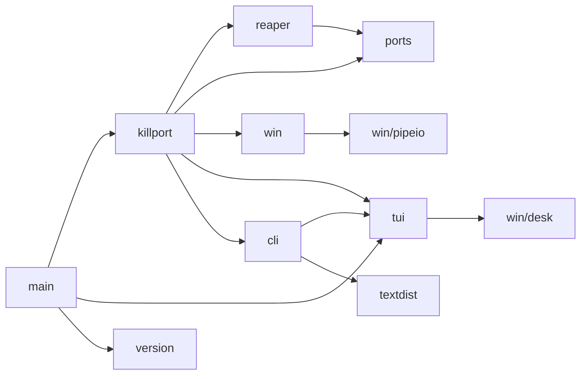
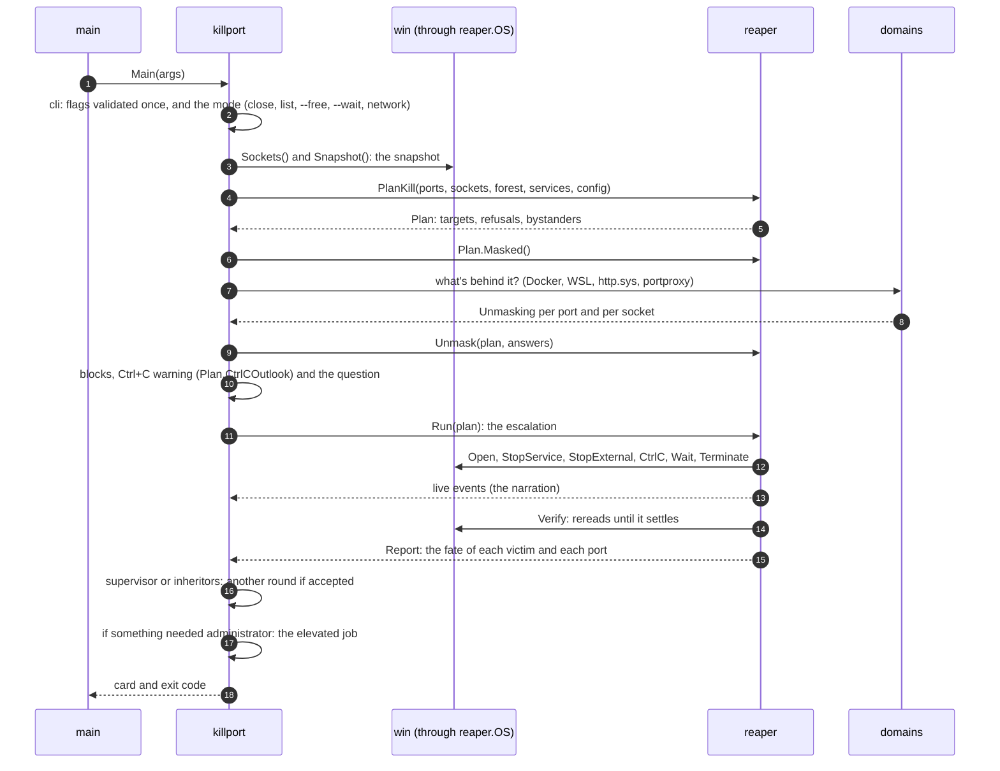
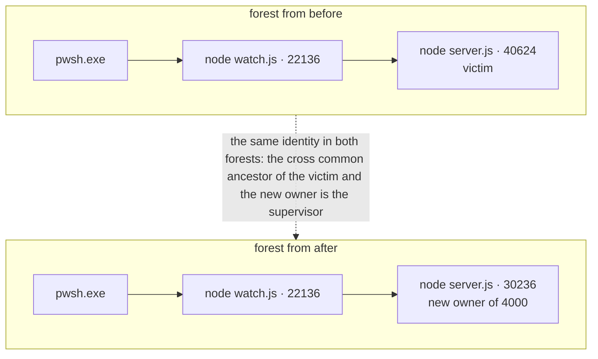
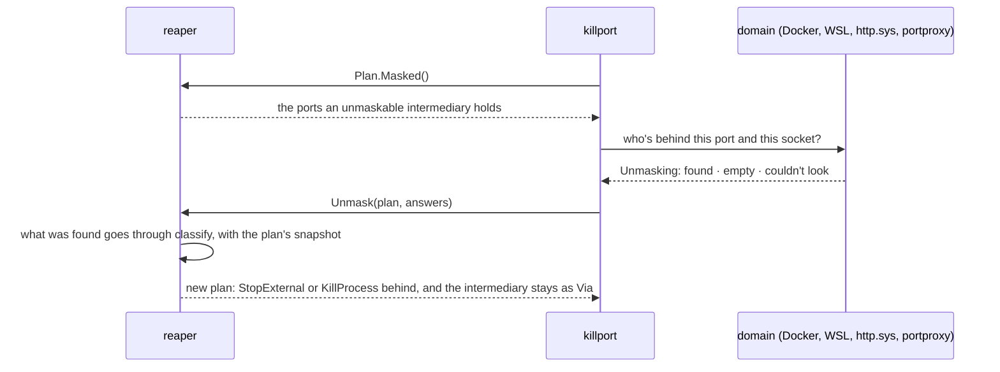
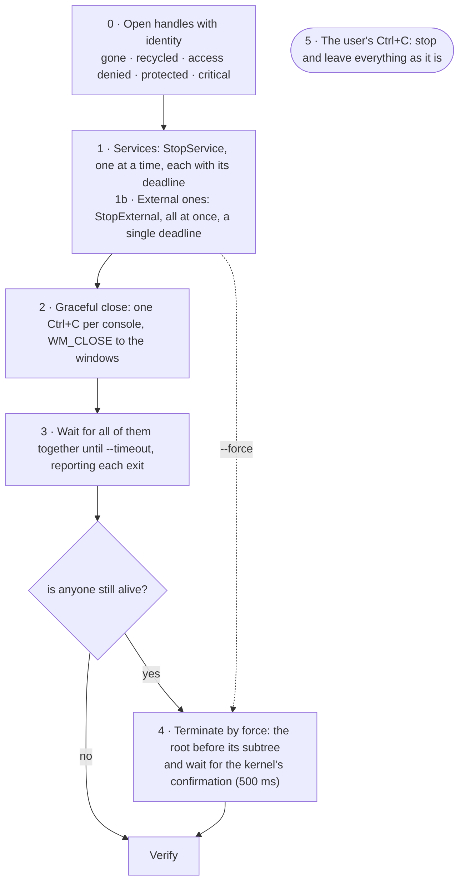
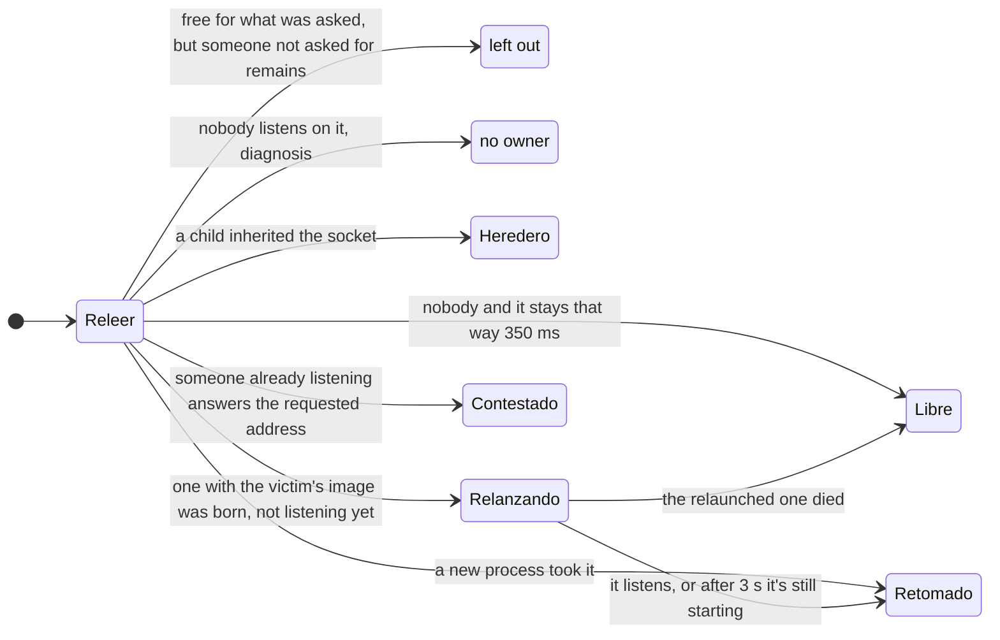
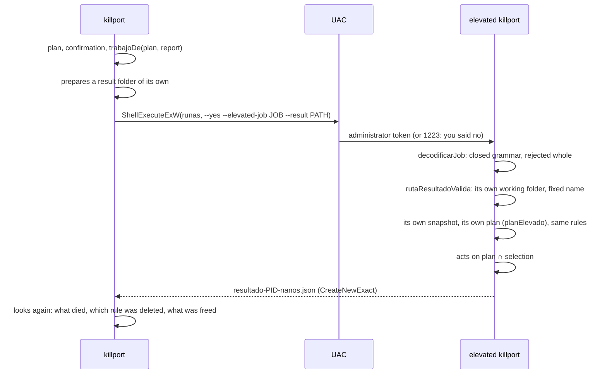

<p align="right"><sub><b>English</b> · <a href="ARQUITECTURA.md">Español</a></sub></p>

# Architecture

killport is a single program, but not a single package: the raw Windows API, the algorithm and the interface live apart, and whatever decides what gets closed knows nothing about Windows. This document walks through a run from end to end and then the layers, from the bottom up. The [README](../README.en.md#how-it-works) has the summary; here is the detail, with every decision and its reason. How each layer is verified is in [VERIFICACION.en.md](VERIFICACION.en.md); what's missing, in [PENDIENTE.en.md](PENDIENTE.en.md).

- [Principles](#principles)
- [Packages](#packages)
- [A run, end to end](#a-run-end-to-end)
- [The boundary: reaper.OS](#the-boundary-reaperos)
- [Console core](#console-core): tui, cli, win/desk
- [The win layer](#the-win-layer)
- [ports (pure)](#ports-pure)
- [reaper (pure): the algorithm](#reaper-pure-the-algorithm)
- [internal/killport: the adapter and the domains](#internalkillport-the-adapter-and-the-domains)
- [The elevated job](#the-elevated-job)
- [Timings and caps](#timings-and-caps)

## Principles

- **Pure Go, no CGO or dependencies.** A single static `.exe`; calls into Windows go through `syscall`, with no C bindings. The `go.mod` has no `require` at all: everything is the standard library or this repo.
- **One responsibility per package.** The Windows API (`win`) and the algorithm (`reaper`, `ports`) don't know each other; the glue lives in a single place (`internal/killport`).
- **Identity, not PID.** Every process is referred to by PID + creation time. A recycled PID is never touched.
- **Verify, don't assume.** After acting, the system is reread: a port is free when the table says so and it stays that way, not when the process died.
- **A single rule for each decision.** What gets warned before asking and what the engine does afterwards come from the same function; which intermediary classes get unmasked, from a single place; which gate a process enters the plan through, from a single one (`classify`), also when it arrives from behind an intermediary or from the elevated process.
- **Validate at the boundary.** Flags are interpreted and validated once, when parsing; inside, the values are already of the right type. The same with the job the elevated process receives: a closed grammar that's rejected whole if it isn't met.
- **Nothing resident.** No service, task or process is left alive; external commands run inside a Job Object that kills them if killport crashes, and the waits sleep on kernel objects.
- **Visual output that degrades.** Pastel colors on black, live progress and a summary card in the console; plain text without a single escape code when the output is a pipe or a file, and stable `--json` for scripts.

## Packages

```
main.go              opens the console, calls killport.Main and exits with its code
internal/
  killport/          the tool: flags, the reaper.OS adapter over win, the domains
                     (Docker, WSL, http.sys, portproxy, services), the presentation and the elevated job
  reaper/            the algorithm, pure: identity, forest, plan, unmasking, escalation, verification, waiting
  ports/             pure: port sets, addresses, who answers, free port, parsers
  win/               the raw Windows API: sockets, processes, services, someone else's console, bounded executor, UAC
    pipeio/          overlapped named pipes shaped like a net.Conn (the Docker API)
    pipetest/        named pipe server for the tests
    desk/            the console's own mode and size (what tui needs)
  tui/               console: palette, live region, cards, tables, es-AR formatting
  cli/               GNU-style flags, help at the window's width, "did you mean…?"
  textdist/          Damerau–Levenshtein distance
  version/           version and commit, which build.ps1 stamps with -ldflags
```

Who imports whom (nothing else):



`ports`, `textdist`, `version`, `win/desk` and `win/pipeio` only use the standard library. The heart is four packages with a dependency rule: `win` (the raw Windows API, with no domain logic) and `reaper`/`ports` (the algorithm, pure) don't import each other. The glue lives in `internal/killport`: `sistema.go` implements the `reaper.OS` interface with `win`, and the tests implement it with a simulator. The pure parts carry no build tag and are tested on any system (a test runs `go vet` on the tool's package with `GOOS=linux` so nothing from Windows sneaks in, and the CI repeats it for the whole repo); whatever calls the API, with `//go:build windows`. A `tui` test checks with `go list -deps` that the presentation doesn't drag in the system layer.

That's about 27,400 lines of code and 24,100 of tests in those four packages; the whole repo adds up to about 29,700 and 24,900.

## A run, end to end

`killport 3000`, nothing more:



The modes that don't close anything (`--free`, `--wait`, `--wait-free`, `--reserve`/`--unreserve`/`--fix-dynamic`, the listing) share the snapshot and the parsers but have their own flow: `libre_windows.go`, `espera_windows.go`, `config_windows.go`, `listado.go`. `modos.go` decides which flag goes with which mode and rejects meaningless combinations before looking at anything.

## The boundary: reaper.OS

Everything the algorithm needs from the system goes through an interface. In production `internal/killport/sistema.go` implements it on top of `win`; in `reaper`'s tests, a discrete-event simulator (`simos_test.go`) with a virtual clock.

| Method | What it does in production | In the simulator |
|---|---|---|
| `Now`, `Sleep` | the clock; `Sleep` is the engine's only delay (the verification's backoff) | moves the virtual clock forward |
| `Sockets` | `GetExtendedTcpTable`/`GetExtendedUdpTable` in both families | the scenario's scripted table |
| `Snapshot` | `NtQuerySystemInformation(SystemProcessInformation)`: every process, without opening any | the scenario's processes |
| `Detail` | path, command line, critical, user, working folder (PEB); only for showing, never for deciding | — |
| `Services` | `EnumServicesStatusExW`: PID → services | the scripted services |
| `Excluded`, `DynamicRanges` | `netsh … excludedportrange` and `… dynamicport`, in parallel | fixed ranges |
| `Open` | `OpenProcess` comparing the creation time: `ErrGone`, `ErrRecycled`, `ErrAccessDenied`, `ErrProtected`, `ErrCritical` | the same errors, scripted |
| `Wait` | `WaitForMultipleObjects` plus an event tied to `ctx.Done()` | jumps to the next event; `Now()` lands on the exact instant of the exit |
| `CloseWindows` | `EnumWindows` + `PostMessageW(WM_CLOSE)` | the process closes or not according to its script |
| `ConsolePIDs`, `CtrlC` | the console helper (below) | scripted shared consoles; `CtrlC` returns the intruders |
| `StopService` | `ControlService(STOP)` and waiting for `STOPPED` guided by `dwWaitHint` | takes as long as the script says |
| `ProbeBind` | exclusive `bind` without `listen` | the scripted result |
| `StopExternal` | each external target's domain (container, Linux process, rule), all at once | takes as long as the script says |

`StopExternal` always calls its `done` from the calling goroutine: the engine stays sequential and the simulator, deterministic.

## Console core

### tui

- **Live region**: progress is redrawn in place at 20 frames per second and permanent lines are printed above it. There's a fixed lock order so there's no deadlock:
  - the draw function runs without the terminal's lock (it can take the tool's state lock);
  - `Println` never calls the draw function: it reuses the last frame.
- **Safe clipping**: `ClipANSI` cuts a line with escape codes to N visible columns without breaking the colors. Live lines are cut one column before the edge, so the terminal doesn't wrap them and the line count doesn't get out of sync.
- **Lines that don't fit**: errors (`✗`) are wrapped by words at the window's width, with the extra lines aligned after the mark (`Term.Marked`); into a pipe they go whole. Before, the console cut them wherever the edge fell (`killport 3000 --wsl`, at 100 columns, left "ree" / "nvío lo tiene").
- **Bar**: 1/8-column resolution (`▏▎▍▌▋▊▉█` blocks) with a gradient.
- **Card**: background barely tinted, no borders, in columns read from top to bottom. Without color (`NO_COLOR`, `--no-color`, a pipe), a plain-text version.
- **es-AR formatting**: thousands with a period, decimals with a comma, bytes in decimal units (the ones services use for their limits), human times ("hace 5 min 16 s", "<1 ms").
- **Taskbar**: in Windows Terminal, the progress is also published on the icon and the tab (OSC 9;4).
- **Table**: each column has a minimum, the optional ones are dropped in order if they don't fit, and the flexible ones give up space by "water filling" (the widest first). Trimming in the middle respects the beginning that matters (the program and its script) or switches to a short form. Without a console it trims nothing: a script receives the whole text. The layout is a pure function, tested with 20,000 random tables.

### cli

- GNU-style flags: `-o x`, `--out=x`, `-abc`, `--no-x`, `--`.
- Typed binders with validation: bounded integers, enums, sizes (`25MB`, `10MiB`) and times (`1:30`, `1m30s`).
- The help is generated with the same visual language as the rest of the output, by sections, and wraps the descriptions at the window's width (tested from 60 to 180 columns).
- A misspelled flag suggests the closest one ("¿quisiste decir --force?") by Damerau–Levenshtein distance. It's dynamic programming in O(n·m) with three rolling rows, and swapping two letters counts as a single error (`textdist`).

### win/desk

- The only part of the Windows API that `tui` needs: reading and changing the console's own mode (to turn on escape sequences) and its size. It lives apart from `win` so the presentation doesn't depend on the system layer.
- kernel32 is named without a path because it's a KnownDLL (the same with ntdll in `win/pipeio`); `win` loads the rest of the system DLLs by absolute System32 path, and also launches `netsh.exe` and `wsl.exe` by full path. With the bare name, `LoadLibrary` would look next to the exe first, and a DLL planted there would win.
- The wrapper for the calls carries `//go:uintptrescapes`: without that directive, a buffer that travels as a `uintptr` can end up on the goroutine's stack, and if the stack grows between the conversion and the call, Windows writes to the old stack.

## The win layer

- **Socket tables**: `GetExtendedTcpTable` and `GetExtendedUdpTable` with the `OWNER_MODULE` classes, which besides the PID bring the socket's creation time and what's needed to ask for the owning module; in an svchost that owner is the name of the SERVICE (what `netstat -b` adds), and finding it out doesn't require opening the process. The layout was verified against the machine: a DWORD with the count, 4 bytes of padding, rows from offset 8 (TCP4 160, TCP6 192, UDP4 160 and UDP6 176 bytes); the port is a DWORD with the 2 low bytes in network order and garbage in the high ones; the IPv4 address is in network order as is in memory. The table can grow between the call that measures and the one that fills: it's repeated while it gives `ERROR_INSUFFICIENT_BUFFER`. For `--wait` there's a lightweight table (`TCP_TABLE_OWNER_MODULE_LISTENER`: only what's listening, without asking for each socket's owning module): 0.34 ms against 6.95 ms for the full one with the owners (measured with 161 rows).
- **Every process in one call**: `NtQuerySystemInformation(SystemProcessInformation)` gives PID, parent, creation time, session and name of ALL of them, including the protected ones and those from other sessions, without opening any. It's repeated while it gives `STATUS_INFO_LENGTH_MISMATCH`. The path comes from class 88 (`SystemProcessIdInformation`): without administrator, `QueryFullProcessImageNameW` refused 50 of 51 services; class 88 gave the path of all of them, without opening any. The parsers for these buffers are in `rawbuf.go`: no read without first validating that the window fits entirely, and the pointers the system writes inside the buffer are read as offsets, never as Go pointers. A corrupt buffer ends in an error, not a panic.
- **NT paths**: what the kernel returns is `\Device\HarddiskVolume3\…`; it's turned into `C:\…` with `QueryDosDeviceW`'s table (the longest device wins). A `subst` drive resolves to its real folder.
- **One process's detail**: the command line (`ProcessCommandLineInformation`, `QUERY_LIMITED_INFORMATION` is enough), whether it's marked as critical (`ProcessBreakOnTermination`), the token's user and the working folder, which Windows doesn't expose: it's read from the PEB with three `ReadProcessMemory` calls (PEB → `ProcessParameters` → `CurrentDirectory`). In a 32-bit process the 32-bit PEB rules, the only one that follows a later `cd` (measured). The permission to read memory is requested on a second handle and only if the process isn't a Windows one or critical.
- **Handles with identity**: opening compares `GetProcessTimes` with the expected time; if it doesn't match, the PID was recycled and it's a distinguishable error (also "no longer exists", "access denied", "protected" and "critical"). If `PROCESS_TERMINATE` is refused, it's reopened without it so it can at least wait, and that's reported. While the handle is open the PID can't be recycled, so the engine holds it from the moment it identifies the victim until it sees it die.
- **Waiting without polling**: `WaitForMultipleObjects` on the handles plus an event signaled from `ctx.Done()`, so canceling wakes the wait instantly (under 1 ms, measured). With more than 63 processes they're split into batches, each in its own goroutine, and the first exit from any of them returns.
- **The Ctrl+C helper**: `GenerateConsoleCtrlEvent` reaches the whole console of the caller, and a process can only be attached to one console. That's why killport relaunches itself as a helper (`--ctrl-c-helper PID --allow PID:nanos,…`) with `DETACHED_PROCESS`, which attaches to the target's console, reads who shares it with `GetConsoleProcessList` (without counting itself) and sends the Ctrl+C only if ALL of them are in the allowed set, by identity. The check and the send go together; if there's an intruder, it sends nothing and returns it. "No console to handle" is three codes (5, 6 and 87). Another mode of the helper (`--console-of PID`) only lists the members, to group victims by console.
- **Windows**: `EnumWindows` + `GetWindowThreadProcessId` and `PostMessageW(WM_CLOSE)` to the process's top-level ones.
- **Services**: `EnumServicesStatusExW` gives the PID → services map (the PID is at offset 0x2C of `ENUM_SERVICE_STATUS_PROCESSW`, not at 0x28); stopping waits for `STOPPED` guided by `dwWaitHint` and `dwCheckPoint`, and tells apart "administrator needed", "has active dependents" (1051, with their names) and "timed out"; `QueryServiceConfigW` and `QueryServiceConfig2W` give the startup type (with the delayed one), the triggers and the recovery policy, and leaving it on manual is a `ChangeServiceConfigW` with everything at `SERVICE_NO_CHANGE` except the startup.
- **Bind probe**: `socket` + `bind` without `listen`, which doesn't trigger the Firewall prompt. It's exclusive (`SO_EXCLUSIVEADDRUSE`), because a plain bind to `0.0.0.0` doesn't clash with someone on `127.0.0.1`, and on IPv6 it sets `IPV6_V6ONLY` so each family is probed on its own. With exclusive binds, `WSAEACCES` is ambiguous (an excluded range, or someone else's socket with `SO_REUSEADDR`): the socket table is the primary source and the probe only breaks ties on a port without an owner. `bind` returns `SOCKET_ERROR` as `0xFFFFFFFF` without sign extension: it's compared with `r != 0`.
- **Named pipes (pipeio)**: the Docker API goes through `\\.\pipe\docker_engine` (and the other candidate pipes). The pipe is opened overlapped (with a synchronous one there's no reliable way to cut a stuck read) and with `SECURITY_IDENTIFICATION`, so a server that grabs the pipe's name first can't impersonate the client, which may be an administrator. It doesn't use `os.NewFile`: `os.File` keeps an offset that reads and writes update under different locks, a race inside the standard library that made the race detector useless. Each direction has its OVERLAPPED and its event, the deadline is a timer that cancels with `CancelIoEx`, `Close` waits for in-flight operations to finish before closing the handle, and a synchronous handle is rejected (`NtQueryInformationFile`).
- **The bounded executor** (`RunBounded`): the only path for `netsh` and `wsl.exe`. The child is born suspended, enters a Job Object with `KILL_ON_JOB_CLOSE` and `DIE_ON_UNHANDLED_EXCEPTION` and only then runs: nothing is left hanging even if killport crashes, and no error dialog appears. Without a window (`CREATE_NO_WINDOW`), with a total deadline and an output cap. An exit code other than 0 isn't an error: the caller decides.
- **Elevation and the safe file**: `ShellExecuteExW` with `runas`, waiting for the exit code (1223 = the user said no in UAC). The elevated process's report is created with `CreateNewExact`: a new file, without following a reparse point, and with the final path verified through the handle before writing a single byte.
- **The rest**: the name of an IP's interface (`GetAdaptersAddresses`, for the SCOPE column) and the portproxy rules from the registry (without silently skipping an `ERROR_MORE_DATA`).

## ports (pure)

- **Port set**: canonical intervals (sorted, disjoint, with no adjacent ones). `Contains` in O(log k) by bisection; union, intersection and difference in O(k + m) by merging. The canonical form is unique, so the text (`3000, 5000–5003`) is deterministic and goes back in through the parser. Edge arithmetic is done in `int`: in `uint16`, 65535 + 1 is 0.
- **What the user writes**: `3000`, `8080,8081`, `5000-5003` (and `5003-5000`, normalized), `:3000`, `localhost:3000`, `127.0.0.1:3000`, `[::1]:8080`, `http://localhost:5173/x` (and `https`; without a port, 80 and 443). The address AIMS: `ParseRequest` remembers which destination each port goes to. A host name that isn't `localhost` isn't resolved: the whole port is taken and it warns about it.
- **Who answers** (`Answer`): Windows' rules measured with real connections. The exact address beats the wildcard; a native `0.0.0.0`, the IPv4 half of a dual-stack socket; between two `0.0.0.0` with `SO_REUSEADDR` the one that bound first answers; `localhost` tries `::1` and falls back to `127.0.0.1`.
- **Parsers that don't understand the language**: netsh comes out in Windows' language, so the shape is read and not the words. Excluded ranges anchor on the dashed line and take the "integer integer [*]" rows; http.sys queues are assembled by indentation (the queue's label repeats inside each URL group, so the block starts at column 0, not at the label), and a URL bound to an IP brings a third segment (`HTTP://127.0.0.1:8080:127.0.0.1/`); URL reservations (`netsh http show urlacl`) start at the line whose last field is a URL and take the accounts from the SDDL, which isn't translated; the dynamic range ("two integers after a colon"), the portproxy rules (with the exact command that deletes each one), Linux's `ss` and `/proc/net/tcp`.
- **Whose an exclusion is** (`ExcludedRange.Origin`): the table only marks the administered ones (`*`); the rest is recognized by shape. A block of exactly `WinNATBlock` = 100 ports is WinNAT's (unaligned: 55150, 55308, 55408 on the same machine); a one-port row with evidence from http.sys (`HTTPHold`, which the adapter fills) is the port http.sys sets aside while it serves it; the rest, the reservation a program requested while it runs. The shape rules over the evidence: a block of 100 is WinNAT's even if someone says otherwise.
- **Free port** (`FindFree`): candidates = the range minus what's taken, what Windows reserves (WinNAT, http.sys, a program), the administered exclusions and the dynamic range, all by intervals; they're probed in order (exclusive bind on v4 and v6 per protocol) until the requested ones are gathered, with a cap on probes, and each skipped stretch keeps its reason. Starting at 49152 or above is asking for the dynamic zone knowingly and it's respected; starting below with a shifted dynamic range (1025–5000) doesn't invade it.

## reaper (pure): the algorithm

### Identity

`ID{PID, Created}`. It's used as a map key and compared with `==`, and `time.Time` also compares the zone and the monotonic reading: two equal times built along different paths would be different identities. That's why every identity is canonicalized (UTC, no monotonic reading) when it enters the package. Between reading the table and opening the handle, the PID may have been recycled; `Open` compares the time and returns `ErrRecycled`, and while the handle lives the PID can't be recycled.

### The forest

From the snapshot a `Forest` is built in O(n). The child → parent edge only counts if the parent exists with `Created <= child.Created`; if the "parent" was born later, its PID was recycled and it's an impostor, so the child is a root. (Registry and Secure System are listed with a parent, System, born after them: the forest leaves them as roots, and whatever needs to know where they come from looks at the raw parent.) Queries in O(depth):

- ancestors (the chain that's shown: `pwsh.exe → node.exe`) and subtree (BFS);
- the **lowest common ancestor**, also **across** the forest from before and the one from after, joining by identity: the supervisor that relaunched a server is the common ancestor of the victim (no longer there) and the port's new owner;
- the **inheritors** of a socket whose owner died (`Hold`): that PID's children born after the socket. It's the netstat trap of showing a dead PID: a child inherited the handle.



### The plan: a single gate

The sockets of the requested ports are grouped by owner and each owner goes through a single gate, `classify`. `refuseOwner` first decides whether it's untouchable, in this order: the kernel (PID ≤ 4; 445, 139, 137 and 138 are SMB/NetBIOS, the rest of TCP is http.sys), killport itself, killport's chain of ancestors (the terminal you run it from), critical processes, intermediaries, svchost (one refusal per service, naming it) and system services. Every refusal carries a reason and advice. If it passes, it's a target: a third-party service is stopped as a service (if the process is killed, the service manager revives it through its recovery policy) and an ordinary process is closed. An `.exe` that hosts several services stops the one that has the port, identified by socket; if it isn't known which, none.

A Windows name (svchost, lsass, csrss…) only protects if the path is exactly System32's and the parent is the expected one (`StandingOf`): if not, it's a possible impostor and it follows the ordinary path, flagged. The general listing hides Windows' own things with the same yardstick (`IsWindowsProc`): an image under `%SystemRoot%` is hidden only in session 0, outside the folders where any user writes (`Temp`, `Tasks`, `tracing`, `spool`…) and if it isn't a script host.

With `--tree` the victims are the root and its subtree (the root first: a supervisor dies before it can relaunch), with an antichain that absorbs a target into its ancestor and without what hangs from an untouchable: what was refused as an owner doesn't come back in dragged along by a subtree. A ghost owner (its PID isn't in the snapshot) is resolved with its inheritors.

`Focus` keeps what was asked for: the one that answers an address (`localhost:5173`, see `ports.Answer`), or what `--orphans`, `-n` and `--project` pick. The rest isn't a refusal: it stays in `Plan.Bystanders`, is named ("queda al margen", left out), isn't touched, and the verification doesn't mistake it for someone who took the port back. `Orphans` says who was left loose: a root of the forest (its parent died or its PID is reused by another), in killport's session, and not a Windows one or part of the machinery.

### Unmasking intermediaries

Sometimes the table names whoever holds the port on someone else's behalf: `com.docker.backend` for a container, `wslrelay` for a Linux process, VS Code for a forwarded port, System for the URL someone else registered in http.sys, the IP Helper for a portproxy rule. The first three classes are recognized by the image (`RelayOf`); the two Windows ones, by what they hold (the kernel on an HTTP port, `iphlpsvc`'s svchost on TCP). The intermediary is never a victim.



The answer is per port and per socket (two containers can publish the same port on different IPs). `Unmask` rewrites the plan with the SAME rules as `PlanKill`, because the plan remembers the snapshot it was built with: a Windows process behind http.sys goes through `classify` like anyone else, and an answer can't turn the kernel or a terminal into a target. Which classes get unmasked is decided in a single place (`Relay.Unmaskable`). The intermediary becomes a victim only if the domain declared it hung and safe to close (`KillVia`: a `wslrelay` with nobody behind it, and never if a container engine is running in WSL). A port published by Docker with the WSL 2 backend is three sockets from two intermediaries (the engine on `0.0.0.0` and `[::]`, `wslrelay` on `[::1]`): `Unmask` joins them into ONE target and the verification waits for both to let go.

### The escalation engine



Processes and external targets go in parallel, with a single deadline per rung and no polling; services are stopped one at a time (`StopService` waits for each one's `STOPPED` until `--timeout`). Each external domain does its own ladder inside rung 1b: the container with `POST /containers/{id}/stop?t=` (SIGTERM and, when `t` expires, SIGKILL), the Linux process with SIGINT, SIGTERM and SIGKILL. Rung 3's wait is only for those that received a graceful signal, and it ends as soon as all of them exited; the ones that had no console or window to ask go straight to rung 4, and the line says so.

The Ctrl+C's allowed set is the root, its ancestors and its subtree, minus what was left out: it's what pressing Ctrl+C in that window would do. It comes from a single function (`ctrlCAllow`), which `Plan.CtrlCOutlook` also uses: what the tool warns about BEFORE asking (who else it reaches, or that it can't be sent and it'll go by force) is what the engine does afterwards. A service victim doesn't add its console. It's never sent to killport's own console.

The engine doesn't print: it emits typed events (`EvOpened`, `EvCtrlC` with `Also` for those that aren't victims, `EvCtrlCSkipped`, `EvExited`, `EvTerminated`, the service and external ones…) and returns a `Report` with the fate of each victim (closed on its own and with what, terminated by force, already gone, recycled, access denied, protected, critical, error), of each external target and of each port, plus those that received the Ctrl+C without being victims (`Reached`). When the verification offers another round (a socket's inheritors, or the supervisor that relaunches), the tool runs it with the same engine and merges the reports; one reached in the first round that's a victim in the second is counted by its result, not twice.

Invariants, tested in the simulator: nobody is terminated by force without having had their chance to close gracefully (except with `--force` or when there's no way to ask); an untouchable is never a victim; with `--tree` nobody shows up twice; a cancellation doesn't terminate anyone by force.

### Verification

It rereads the tables with backoff (10 → 200 ms, capped at 2 s) and, when a port is free, requires that it STAY free for 350 ms (`Settle`): a supervisor takes about 240 ms to grab it again and `wslrelay` releases its own about 315 ms after the container. That wait isn't paid if someone took the port back (that's reported right away) or if it was never busy. The intermediary of an external target that stopped counts as recently dead ONLY on that external target's ports: it waits for it to release them, without waiting for the ones it'll never release.



- **Taken back**: the supervisor is the cross common ancestor; if it's `services.exe`, it's the service that restarts itself. The tool offers to close the supervisor with its children (in a console) or gives the exact command (`-y` doesn't authorize closing someone nobody named).
- **Relaunching**: the evidence is in the forest from after, a NEW process with the victim's image hanging (as child or grandchild) from the victim's living parent or grandparent. It's waited for (up to 3 s from its birth, rereading every 100 ms) to listen or to die. If at the cap it's still starting, the port is NOT considered free: it's a taken-back one that isn't listening yet (`Starting`), with its supervisor. If it hasn't been born yet, the only clue is a living parent with the same image (the shape of pm2, nodemon, uvicorn and werkzeug): it's given 1.5 s to appear. With a parent of another image (the terminal) there's no waiting.
- **Answered**: on a port requested with an address, it asks who answers it NOW; if it's someone else who was already listening, the address wasn't freed (`PortAnswered`), even if the victim died.

### Diagnosing a port without an owner

It's probed FIRST. An administered exclusion that lets you bind is a free port; one without `*` is "Windows reserves it", and the verdict depends on who put it there (`ExcludedRange.Origin`):

| Origin | Reason | Ways out |
|---|---|---|
| WinNAT (a block of 100) | the block, and the dynamic range if it's shifted (it starts before 49152: that's why the blocks land among the development ports) | typed remedies the tool turns into commands: `--reserve` with the block's protocol, `net stop winnat` + `net start winnat` as a single way out, and `--fix-dynamic` if it applies |
| http.sys (one port, with evidence) | "Windows puts it there while http.sys serves that port", what it's for (the table of Windows services) and the URL with its service or its account | none: it goes away on its own when http.sys stops serving it |
| a program (the rest) | "it isn't WinNAT's (its blocks are of 100) nor did an administrator add it"; Windows doesn't say which | none: it goes away when the program releases it or ends |

It never advises deleting someone else's exclusion, or reserving or restarting WinNAT for what isn't its own (stopping it cuts WSL's, Docker's and Hyper-V's networking, and frees none of the rest). `Diagnoser.Blocked` quickly cuts a wait that an exclusion without `*` blocks, and says whose it is.

### Waiting

`Watch` is the pure state machine of `--wait` and `--wait-free` (it receives the time and the table; it has no clock of its own): per port, which sockets comply and since when, with `--stable` (the same witness held, measured from the socket's creation time: a nodemon restart sets the count back to zero), `--new` (only sockets created after killport started) and `--any`. "It already was" is the machine's state on the first read, not a comparison of times. `WaitPorts` is the loop: it rereads the lightweight table with backoff from 25 to 200 ms and, waiting for it to be freed, sleeps on the owners' handles (`OpenForWait`: only `SYNCHRONIZE` and limited query, never permission to terminate): an exit wakes it instantly. It rereads because without administrator the kernel doesn't report changes to the table (ETW and WFP filtering need admin).

## internal/killport: the adapter and the domains

- **Docker and Podman**: through the API on a named pipe (`DOCKER_HOST`'s or the current context's if they're local, `docker_engine`, `dockerDesktopLinuxEngine` and `podman-machine-default`; containers are deduplicated by id, because two pipes are often the same engine), with our own minimal HTTP/1.1 client (`http1.go`: `Content-Length`, chunked and until EOF, with caps), without `net/http` or regular expressions: the exe went down from 8.6 to 4.9 MB (measured with Go 1.26; `TestBinarioSinNetHTTPNiRegexp` keeps them from coming back). Each engine is queried only once per run, and only if a port being looked at is held by a container intermediary. The container that publishes a port is stopped with `POST /containers/{id}/stop?t=` (`t` = `--timeout`; 0 with `--force`). The block shows name, image, compose project and service, every port it publishes, the restart policy and the equivalent compose command.
- **WSL**: `wsl.exe -l --running` (in UTF-16) and an `sh` script per distro that dumps `ss` and `/proc/net`, with a marker protocol to separate the parts; the owner is confirmed by the socket's inode among the process's descriptors, not by the name `ss` gives. PID 1 (systemd's socket activation) is a refusal. It's closed with SIGINT, SIGTERM and SIGKILL, and verified from the Windows side. It never starts a distro, and when it advises `wsl --shutdown` it says what it shuts down: everything running in WSL and, if the container engine runs there (or it couldn't find out which distros are running), also the engine and its containers. The engine's distro (`docker-desktop`) isn't a user distro: what runs there doesn't show up under "only inside WSL".
- **http.sys**: `netsh http show servicestate view=requestq`; a queue's owners are its controller if netsh reports it (in IIS the queue belongs to WAS, not `w3wp`) or the attached processes. 445 and 139 aren't http.sys: they're SMB, the kernel's.
- **Exclusions** (`exclusiones.go`, pure, and `exclusiones_windows.go`): if the table brings a row that could be http.sys's (TCP, a single port, no `*`), the adapter gathers the evidence once per read: the queues and the URL reservations (`netsh http show urlacl`, at the same time), the ports the kernel listens on and each process's services. A URL registered on that port rules (its URL and the service that serves it); if not, Windows' reservation says what it's for and on whose behalf (`LS` = local service; an `S-1-5-80-…` SID is a service's, derived from its name, and `LookupAccountSid` returns it). Without any candidate row, not a single extra netsh is run.
- **portproxy**: the rules are read from the registry (`HKLM\SYSTEM\CurrentControlSet\Services\PortProxy\v4tov4\tcp` and the other three combinations); the one with the port is shown with the exact `netsh interface portproxy delete …`, deleted by the elevated process and revalidated against the registry before and after. If there are two rules on the same port, both are named.
- **Services**: each service's startup type (automatic, delayed, manual, disabled, triggers), whether it comes back on its own after a reboot, and a small table of the usual suspects (VMware on 443, Reporting Services, MsDepSvc, IIS/WAS and classic Skype on 80 and 443, WinRM, Apache, MySQL, PostgreSQL, SQL Server, MongoDB, Jenkins; and the Windows services served through http.sys: SSDP on 2869, WSD on 5357 and 5358, Media Player sharing) with its advice. The Windows ones also say what the exclusion http.sys puts on their port is for. `--manual` isn't in the core: the tool does it after the escalation (and so does the elevated child), so a service that was stopped but couldn't be left on manual is solved along the same path, and it prints how to undo it.
- **Project**: from each process's working folder it walks up to the nearest marker (`package.json`, `go.mod`, `Cargo.toml`, `pyproject.toml`, a `.csproj`/`.fsproj`/`.vbproj` or an `.sln`, in that order within a folder). The name is the one the marker declares (`package.json`'s `name`, the module's last segment, Cargo's `[package]`, pyproject's `[project]` or `[tool.poetry]`, the `.csproj`'s) or, if it doesn't declare one, the folder's. The repository is the nearest folder with `.git` (also a worktree's `gitdir:` file), and the branch is read from its `HEAD` without running git (detached: the commit's first 7 characters); in a monorepo the chain is shown (`shop › web`). A drive's root and the user's profile are never a project, and if the working folder isn't one, it tries the folder of the first argument that's a script (`node C:\dev\shop\server.js`). It's pure, over `fs.FS`, with bounded reads.
- **Selectors**: `--orphans`, `-n` (an image name, with or without `.exe`, case-insensitive and with wildcards like `python*`; or a path with wildcards, where `C:\dev\*` is anything under that folder) and `--project` intersect with each other and with the named ports; they pick among what LISTENS on a port (never a node without a port, like a language server). `--project` doesn't accept as a project a drive's root, the user's profile (or the folders that contain it) or the Windows folder: it's where the terminal opens by default, and `killport --project . -y` from there would pick half the machine.
- **Network configuration** (`--reserve`, `--unreserve`, `--fix-dynamic`) doesn't go through the engine. A pure planner (`config.go`) builds the steps from the state it read, with a closed vocabulary of five kinds of step: WinNAT is stopped only if one of its blocks covers what's being reserved, and what http.sys or a program sets aside is an obstacle that says why (stopping WinNAT doesn't free it); without `--tcp`/`--udp`, reserving and removing go through TCP (the minimal permanent change) and in both families; `--unreserve` only removes whole administered exclusions within what was named (it never splits one or touches a WinNAT block); `--fix-dynamic` only touches the ranges that start before 49152; with an obstacle there are no steps at all; "undo" is exact. An executor (`config_ejecutar.go`) runs them and always starts WinNAT again whenever it tried to stop it (with a context that isn't canceled), and a real bind checks the result. It always asks, also with `--yes`; without a console it does nothing and exits 3; `--list` and `--json` are only the plan.
- **Presentation**: the listing's table, each target's blocks with the question, the live escalation and the final card; lines are wrapped without cutting a command. The "usuario:" line only shows up if the owner is another account. The JSON is a stable document, without HTML escaping, and exits with the same code as the text.

## The elevated job

Whatever needs administrator is done by relaunching killport through UAC. A process with an administrator token that obeys its arguments is a target (any of the user's programs can launch it, and the dialog will say "killport"), so the job isn't a list of orders but a SELECTION.



- **As arguments**, never through a file another program could change between being written and being read.
- **A closed grammar**: `v2;do=cierre;ports=…;flags=…;to=…;kill=PID:nanos,…;svc=…;manual=…;rule=…` (or `do=config` with `res`, `unres`, the dynamic range and the fingerprint). Version, alphabet, fields in order and without repeats, service names in base64url, caps (8,000 characters, 64 processes, 16 services, 16 rules, a one-hour deadline) and mandatory canonical forms: a port `05001` isn't `5001` (two texts for the same rule would be two ways of saying the same thing). Whatever doesn't comply isn't interpreted "as best as possible": it's rejected whole.
- **The child decides**: it takes its own snapshot, builds its own plan with the usual rules and uses only the selection from the job: a process with its exact identity; a service with the same owning process; a rule with the same class, address and destination, still in the registry; a "leave on manual" only for what it stopped itself in that run (and is third-party, and stayed stopped); the network configuration only if the fingerprint of the steps matches the one the user confirmed. A `wslrelay` the parent declared hung becomes a target again only with its exact identity.
- **The report**: only in one of the user's working folders the child runs with (`%LOCALAPPDATA%\killport` or `%TEMP%`) or under one, with a single name shape (`resultado-<PID>-<nanos>.json`: neither the extension nor the name come from an argument) and an absolute path in its simplest form (no `.`, `..`, alternate streams or names Windows rewrites). Whatever doesn't comply isn't fixed: there's no report. And the report is only for telling: what died, which rule was deleted and which ports were freed, the parent checks on its own.

## Timings and caps

| What | Value | Why |
|---|---|---|
| graceful close (`--timeout`) | 3 s | the default value; `--timeout` changes it (up to one hour in the elevated job) |
| confirming a forced termination | 500 ms | rung 4's brief wait, until the kernel considers it terminated |
| verification: backoff | 10 → 200 ms, capped at 2 s | the kernel doesn't report when a port is freed |
| settling window (`Settle`) | 350 ms | a supervisor takes it back in ~240 ms; `wslrelay` releases ~315 ms after the container |
| waiting for a relaunched one to appear | 1.5 s | a living parent with the victim's same image |
| waiting for the relaunched one to listen | 3 s from its birth | rereading every 100 ms |
| `--wait`: backoff | 25 → 200 ms | lightweight table (0.34 ms) |
| `--wait`, `--wait-free`: deadline | mandatory, up to 30 min | nothing is left waiting forever |
| `--count` | 1 to 100 | |
| Docker: `/_ping`, list, inspect | 1.5 s · 3 s · 2 s | a stuck engine is reported, not waited for |
| Docker: stop | `t` + 15 s | the engine's SIGKILL and its answer |
| live region | 20 frames per second | |
| elevated job | 8,000 characters | fits comfortably in a command line (32,767) |

<!-- i18n source=ARQUITECTURA.md sha256=4d7ab7536b34 -->
