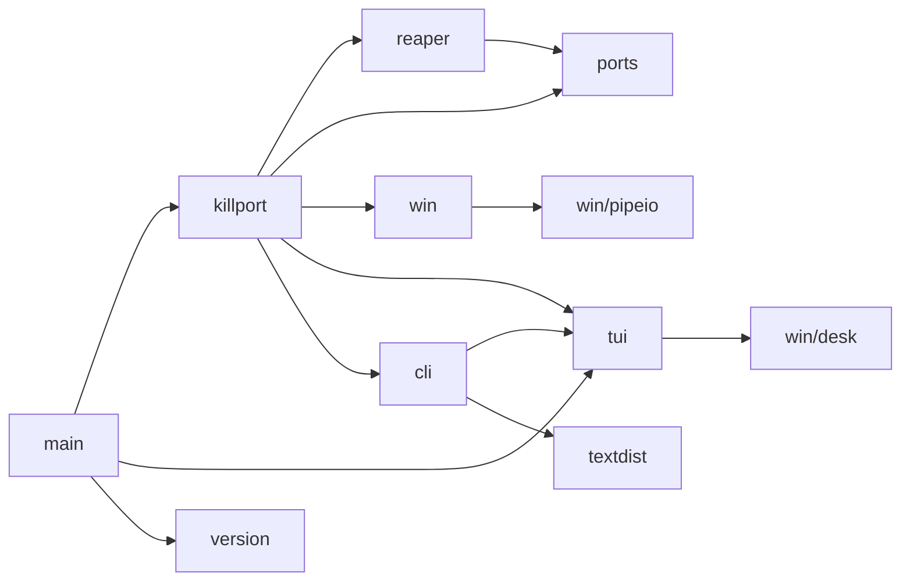
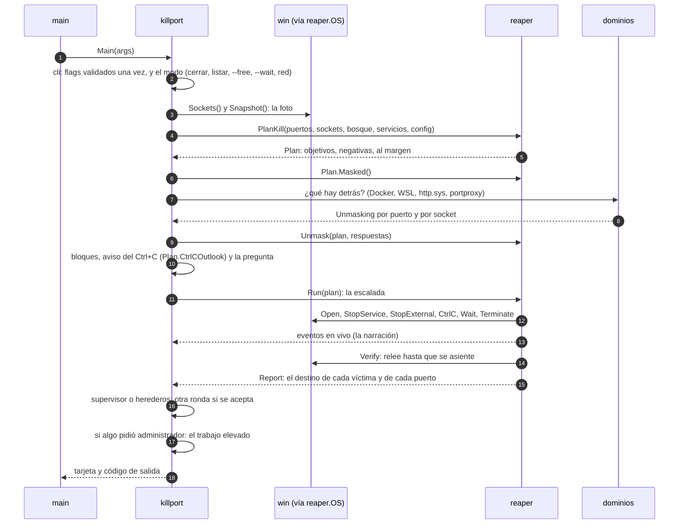
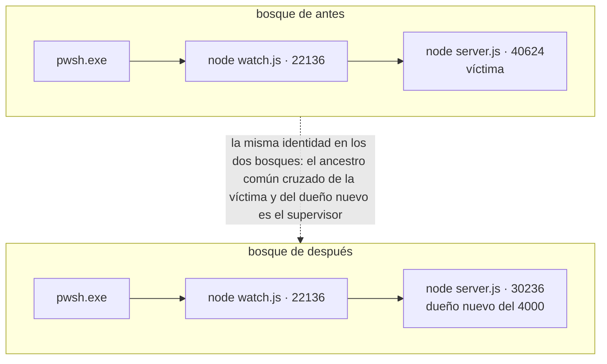
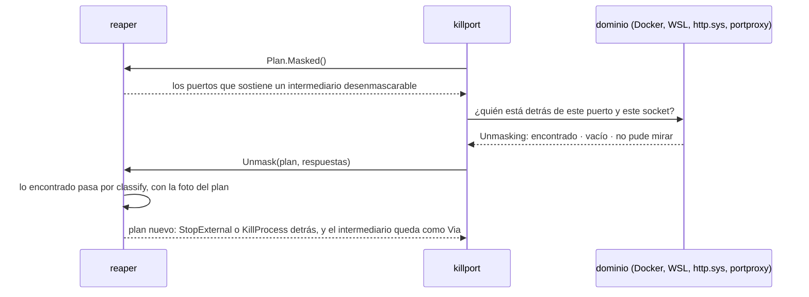
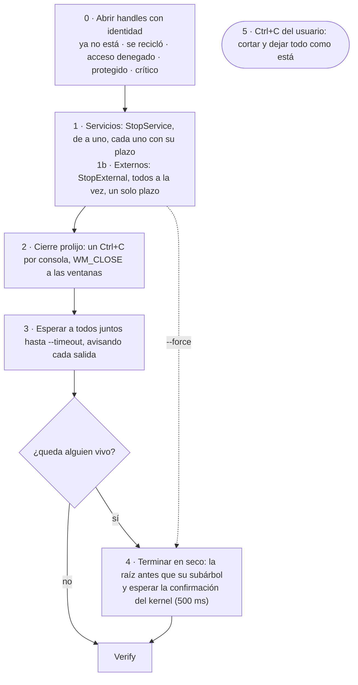
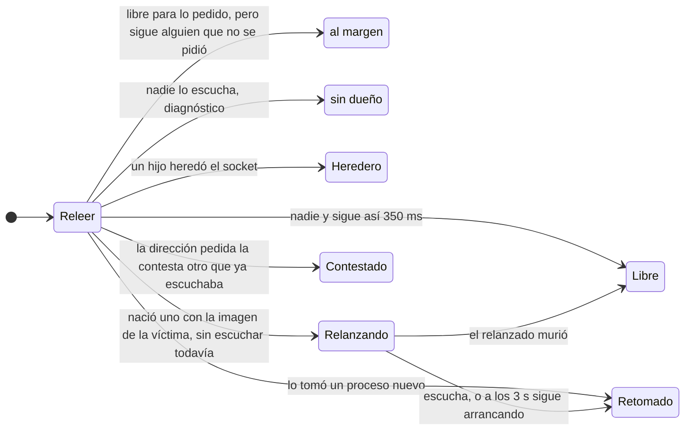
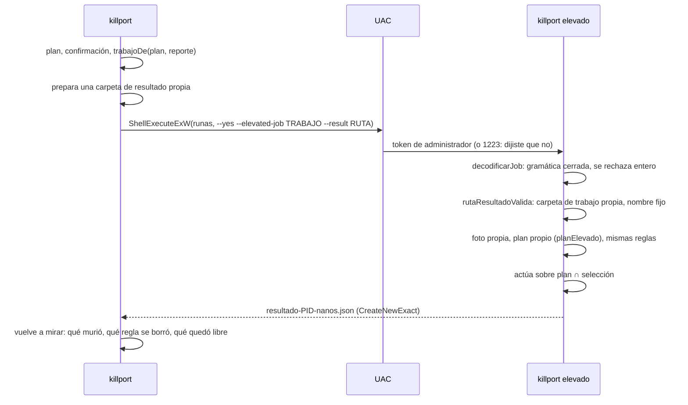

# Arquitectura

killport es un solo programa, pero no un solo paquete: la API cruda de Windows, el algoritmo y la interfaz viven separados, y lo que decide qué se cierra no sabe nada de Windows. Este documento recorre una corrida de punta a punta y después las capas, de abajo hacia arriba. El [README](../README.md#cómo-funciona) tiene el resumen; acá está el detalle, con cada decisión y su porqué. Cómo se verifica cada capa está en [VERIFICACION.md](VERIFICACION.md); lo que falta, en [PENDIENTE.md](PENDIENTE.md).

- [Principios](#principios)
- [Paquetes](#paquetes)
- [Una corrida, de punta a punta](#una-corrida-de-punta-a-punta)
- [La frontera: reaper.OS](#la-frontera-reaperos)
- [Núcleo de consola](#núcleo-de-consola): tui, cli, win/desk
- [La capa win](#la-capa-win)
- [ports (puro)](#ports-puro)
- [reaper (puro): el algoritmo](#reaper-puro-el-algoritmo)
- [internal/killport: el adaptador y los dominios](#internalkillport-el-adaptador-y-los-dominios)
- [El trabajo elevado](#el-trabajo-elevado)
- [Tiempos y topes](#tiempos-y-topes)

## Principios

- **Go puro, sin CGO ni dependencias.** Un único `.exe` estático; las llamadas a Windows van por `syscall`, sin bindings de C. El `go.mod` no tiene ningún `require`: todo es biblioteca estándar o de este repo.
- **Una responsabilidad por paquete.** La API de Windows (`win`) y el algoritmo (`reaper`, `ports`) no se conocen; el pegamento vive en un solo lugar (`internal/killport`).
- **Identidad, no PID.** Todo proceso se refiere por PID + hora de creación. Un PID reciclado nunca se toca.
- **Verificar, no suponer.** Después de actuar, se relee el sistema: un puerto está libre cuando la tabla lo dice y se sostiene así, no cuando el proceso murió.
- **Una sola regla para cada decisión.** Lo que se avisa antes de preguntar y lo que el motor hace después salen de la misma función; qué clases de intermediario se desenmascaran, de un solo lugar; por qué puerta entra un proceso al plan, de una sola (`classify`), también cuando llega desde detrás de un intermediario o desde el proceso elevado.
- **Validar en la frontera.** Los flags se interpretan y validan una sola vez al parsear; adentro los valores ya son del tipo correcto. Lo mismo el trabajo que recibe el proceso elevado: una gramática cerrada que se rechaza entera si no se cumple.
- **Nada residente.** Ningún servicio, tarea ni proceso que quede vivo; los comandos externos corren dentro de un Job Object que los mata si killport se cae, y las esperas duermen sobre objetos del kernel.
- **Salida visual que degrada.** Colores pastel sobre negro, progreso vivo y tarjeta de resumen en la consola; texto plano sin un solo escape cuando la salida es un pipe o un archivo, y `--json` estable para scripts.

## Paquetes

```
main.go              abre la consola, llama a killport.Main y sale con su código
internal/
  killport/          la herramienta: flags, el adaptador de reaper.OS sobre win, los dominios
                     (Docker, WSL, http.sys, portproxy, servicios), la presentación y el trabajo elevado
  reaper/            el algoritmo, puro: identidad, bosque, plan, desenmascarar, escalada, verificación, espera
  ports/             puro: conjuntos de puertos, direcciones, quién contesta, puerto libre, parsers
  win/               la API cruda de Windows: sockets, procesos, servicios, consola ajena, ejecutor acotado, UAC
    pipeio/          named pipes overlapped con la forma de un net.Conn (la API de Docker)
    pipetest/        servidor de named pipe para las pruebas
    desk/            el modo y el tamaño de la consola propia (lo que necesita tui)
  tui/               consola: paleta, región viva, tarjetas, tablas, formato es-AR
  cli/               flags estilo GNU, ayuda al ancho de la ventana, "¿quisiste decir…?"
  textdist/          distancia de Damerau–Levenshtein
  version/           versión y commit, que build.ps1 estampa con -ldflags
```

Quién importa a quién (nada más):



`ports`, `textdist`, `version`, `win/desk` y `win/pipeio` solo usan la biblioteca estándar. El corazón son cuatro paquetes con una regla de dependencias: `win` (la API cruda de Windows, sin lógica de dominio) y `reaper`/`ports` (el algoritmo, puro) no se importan entre sí. El pegamento vive en `internal/killport`: `sistema.go` implementa la interfaz `reaper.OS` con `win`, y los tests la implementan con un simulador. Lo puro va sin etiqueta de compilación y se prueba en cualquier sistema (un test pasa `go vet` al paquete de la herramienta con `GOOS=linux` para que no se cuele nada de Windows, y la CI lo repite para todo el repo); lo que llama a la API, con `//go:build windows`. Un test de `tui` comprueba con `go list -deps` que la presentación no arrastra la capa de sistema.

Son unas 27.400 líneas de código y 24.100 de tests en esos cuatro paquetes; el repo entero suma unas 29.700 y 24.900.

## Una corrida, de punta a punta

`killport 3000`, sin más:



Los modos que no cierran nada (`--free`, `--wait`, `--wait-free`, `--reserve`/`--unreserve`/`--fix-dynamic`, el listado) comparten la foto y los parsers pero tienen su propio flujo: `libre_windows.go`, `espera_windows.go`, `config_windows.go`, `listado.go`. `modos.go` decide qué flag va con qué modo y rechaza las combinaciones sin sentido antes de mirar nada.

## La frontera: reaper.OS

Todo lo que el algoritmo necesita del sistema pasa por una interfaz. En producción la implementa `internal/killport/sistema.go` sobre `win`; en las pruebas de `reaper`, un simulador de eventos discretos (`simos_test.go`) con reloj virtual.

| Método | Qué hace en producción | En el simulador |
|---|---|---|
| `Now`, `Sleep` | el reloj; `Sleep` es el único retardo del motor (el backoff de la verificación) | adelanta el reloj virtual |
| `Sockets` | `GetExtendedTcpTable`/`GetExtendedUdpTable` en las dos familias | la tabla guionada del escenario |
| `Snapshot` | `NtQuerySystemInformation(SystemProcessInformation)`: todos los procesos, sin abrir ninguno | los procesos del escenario |
| `Detail` | ruta, línea de comandos, crítico, usuario, carpeta de trabajo (PEB); solo para mostrar, nunca para decidir | — |
| `Services` | `EnumServicesStatusExW`: PID → servicios | los servicios guionados |
| `Excluded`, `DynamicRanges` | `netsh … excludedportrange` y `… dynamicport`, en paralelo | rangos fijos |
| `Open` | `OpenProcess` comparando la hora de creación: `ErrGone`, `ErrRecycled`, `ErrAccessDenied`, `ErrProtected`, `ErrCritical` | los mismos errores, guionados |
| `Wait` | `WaitForMultipleObjects` más un evento atado a `ctx.Done()` | salta al próximo evento; `Now()` queda en el instante exacto de la salida |
| `CloseWindows` | `EnumWindows` + `PostMessageW(WM_CLOSE)` | el proceso cierra o no según su guion |
| `ConsolePIDs`, `CtrlC` | el ayudante de consola (más abajo) | consolas compartidas guionadas; `CtrlC` devuelve los intrusos |
| `StopService` | `ControlService(STOP)` y esperar `STOPPED` guiándose por `dwWaitHint` | tarda lo que diga el guion |
| `ProbeBind` | `bind` exclusivo sin `listen` | el resultado guionado |
| `StopExternal` | el dominio de cada externo (contenedor, proceso Linux, regla), todos a la vez | tarda lo que diga el guion |

`StopExternal` llama a su `done` siempre desde la goroutine que llamó: el motor sigue siendo secuencial y el simulador, determinista.

## Núcleo de consola

### tui

- **Región viva**: el progreso se redibuja en el lugar a 20 cuadros por segundo y las líneas permanentes se imprimen por encima. Hay un orden de candados fijo para que no haya deadlock:
  - la función de dibujo corre sin el candado del terminal (puede tomar el del estado de la herramienta);
  - `Println` nunca llama a la función de dibujo: reusa el último cuadro.
- **Recorte seguro**: `ClipANSI` recorta una línea con escapes a N columnas visibles sin romper los colores. Las líneas vivas se cortan una columna antes del borde, para que el terminal no las parta y el conteo de líneas no se desfase.
- **Renglones que no entran**: los errores (`✗`) se parten en palabras al ancho de la ventana, con las líneas de más alineadas después de la marca (`Term.Marked`); a un pipe van enteros. Antes la consola los cortaba donde caía el borde (`killport 3000 --wsl`, a 100 columnas, dejaba "ree" / "nvío lo tiene").
- **Barra**: resolución de 1/8 de columna (bloques `▏▎▍▌▋▊▉█`) con degradé.
- **Tarjeta**: fondo apenas teñido, sin bordes, en columnas que se leen de arriba hacia abajo. Sin color (`NO_COLOR`, `--no-color`, un pipe), una versión en texto plano.
- **Formato es-AR**: miles con punto, decimales con coma, bytes en unidades decimales (las que usan los servicios para sus límites), tiempos humanos ("hace 5 min 16 s", "<1 ms").
- **Barra de tareas**: en Windows Terminal, el avance también se publica en el ícono y la pestaña (OSC 9;4).
- **Tabla**: cada columna tiene un mínimo, las opcionales se sacan en orden si no entran, y las flexibles ceden espacio por "llenado de agua" (la más ancha primero). El recorte por el medio respeta el principio que importa (el programa y su script) o cambia a una forma corta. Sin consola no recorta nada: un script recibe el texto entero. La disposición es una función pura, probada con 20.000 tablas al azar.

### cli

- Flags al estilo GNU: `-o x`, `--out=x`, `-abc`, `--no-x`, `--`.
- Binders tipados con validación: enteros acotados, enumerados, tamaños (`25MB`, `10MiB`) y tiempos (`1:30`, `1m30s`).
- La ayuda se genera con el mismo lenguaje visual que el resto de la salida, por secciones, y parte las descripciones al ancho de la ventana (probada de 60 a 180 columnas).
- Un flag mal escrito sugiere el más parecido ("¿quisiste decir --force?") por distancia de Damerau–Levenshtein. Es programación dinámica en O(n·m) con tres filas rodantes, y la transposición de dos letras cuenta como un solo error (`textdist`).

### win/desk

- Lo único de la API de Windows que necesita `tui`: leer y cambiar el modo de la consola propia (para activar las secuencias de escape) y su tamaño. Vive aparte de `win` para que la presentación no dependa de la capa de sistema.
- kernel32 se nombra sin ruta porque es una KnownDLL (lo mismo ntdll en `win/pipeio`); `win` carga el resto de las DLL del sistema por ruta absoluta de System32, y lanza `netsh.exe` y `wsl.exe` también por ruta completa. Con el nombre pelado, `LoadLibrary` buscaría primero junto al exe, y un DLL plantado ahí ganaría.
- El envoltorio de las llamadas lleva `//go:uintptrescapes`: sin esa directiva, un búfer que viaja como `uintptr` puede quedar en la pila de la goroutine, y si la pila crece entre la conversión y la llamada, Windows escribe en la pila vieja.

## La capa win

- **Tablas de sockets**: `GetExtendedTcpTable` y `GetExtendedUdpTable` con las clases `OWNER_MODULE`, que además del PID traen la hora de creación del socket y lo necesario para preguntar el módulo dueño; en un svchost ese dueño es el nombre del SERVICIO (lo que agrega `netstat -b`), y averiguarlo no pide abrir el proceso. El layout se verificó contra la máquina: un DWORD con la cantidad, 4 bytes de relleno, filas desde el offset 8 (TCP4 160, TCP6 192, UDP4 160 y UDP6 176 bytes); el puerto es un DWORD con los 2 bytes bajos en orden de red y basura en los altos; la IPv4 está en orden de red tal cual en memoria. La tabla puede crecer entre la llamada que mide y la que llena: se repite mientras dé `ERROR_INSUFFICIENT_BUFFER`. Para `--wait` hay una tabla liviana (`TCP_TABLE_OWNER_MODULE_LISTENER`: solo lo que escucha, sin preguntar el módulo dueño de cada socket): 0,34 ms contra 6,95 ms de la completa con los dueños (medido con 161 filas).
- **Todos los procesos en una llamada**: `NtQuerySystemInformation(SystemProcessInformation)` da PID, padre, hora de creación, sesión y nombre de TODOS, incluidos los protegidos y los de otras sesiones, sin abrir ninguno. Se repite mientras dé `STATUS_INFO_LENGTH_MISMATCH`. La ruta sale de la clase 88 (`SystemProcessIdInformation`): sin administrador, `QueryFullProcessImageNameW` se negó en 50 de 51 servicios; la clase 88 dio la ruta de todos, sin abrir ninguno. Los parsers de estos búferes están en `rawbuf.go`: ninguna lectura sin validar antes que la ventana cabe entera, y los punteros que el sistema escribe dentro del búfer se leen como desplazamientos, nunca como punteros de Go. Un búfer corrupto termina en error, no en pánico.
- **Rutas NT**: lo que devuelve el kernel es `\Device\HarddiskVolume3\…`; se pasa a `C:\…` con la tabla de `QueryDosDeviceW` (gana el dispositivo más largo). Una unidad de `subst` resuelve a su carpeta real.
- **El detalle de uno**: la línea de comandos (`ProcessCommandLineInformation`, alcanza con `QUERY_LIMITED_INFORMATION`), si está marcado como crítico (`ProcessBreakOnTermination`), el usuario del token y la carpeta de trabajo, que Windows no expone: se lee del PEB con tres `ReadProcessMemory` (PEB → `ProcessParameters` → `CurrentDirectory`). En un proceso de 32 bits manda el PEB de 32, el único que sigue un `cd` posterior (medido). El permiso de leer memoria se pide en un segundo handle y solo si el proceso no es de Windows ni crítico.
- **Handles con identidad**: abrir compara `GetProcessTimes` con la hora esperada; si no coincide, el PID se recicló y es un error distinguible (también "ya no existe", "acceso denegado", "protegido" y "crítico"). Si `PROCESS_TERMINATE` se niega, se reabre sin él para al menos poder esperar, y se informa. Mientras el handle está abierto el PID no se puede reciclar, así que el motor lo sostiene desde que identifica a la víctima hasta que la ve morir.
- **Espera sin polling**: `WaitForMultipleObjects` sobre los handles más un evento que se señala desde `ctx.Done()`, así que cancelar despierta la espera al instante (menos de 1 ms medido). Con más de 63 procesos se reparten en tandas, cada una en su goroutine, y vuelve la primera salida de cualquiera.
- **El ayudante de Ctrl+C**: `GenerateConsoleCtrlEvent` le llega a toda la consola del que llama, y un proceso solo puede estar enganchado a una consola. Por eso killport se relanza a sí mismo como ayudante (`--ctrl-c-helper PID --allow PID:nanos,…`) con `DETACHED_PROCESS`, que se engancha a la consola del objetivo, lee quiénes la comparten con `GetConsoleProcessList` (sin contarse a sí mismo) y manda el Ctrl+C solo si TODOS están en el conjunto permitido, por identidad. La comprobación y el envío van pegados; si hay un intruso, no manda nada y lo devuelve. "No hay consola que manejar" son tres códigos (5, 6 y 87). Otro modo del ayudante (`--console-of PID`) solo lista los miembros, para agrupar víctimas por consola.
- **Ventanas**: `EnumWindows` + `GetWindowThreadProcessId` y `PostMessageW(WM_CLOSE)` a las de nivel superior del proceso.
- **Servicios**: `EnumServicesStatusExW` da el mapa PID → servicios (el PID está en el offset 0x2C de `ENUM_SERVICE_STATUS_PROCESSW`, no en 0x28); detener espera `STOPPED` guiándose por `dwWaitHint` y `dwCheckPoint`, y distingue "hace falta administrador", "tiene dependientes activos" (1051, con sus nombres) y "venció"; `QueryServiceConfigW` y `QueryServiceConfig2W` dan el tipo de inicio (con el diferido), los disparadores y la política de recuperación, y dejarlo en manual es un `ChangeServiceConfigW` con todo en `SERVICE_NO_CHANGE` salvo el inicio.
- **Sondeo de bind**: `socket` + `bind` sin `listen`, que no dispara el aviso del Firewall. Es exclusivo (`SO_EXCLUSIVEADDRUSE`), porque un bind común a `0.0.0.0` no choca con alguien en `127.0.0.1`, y en IPv6 fija `IPV6_V6ONLY` para que cada familia se sondee por lo suyo. Con exclusivo, `WSAEACCES` es ambiguo (rango excluido, o un socket ajeno con `SO_REUSEADDR`): la tabla de sockets es la fuente primaria y el sondeo solo desempata un puerto sin dueño. `bind` devuelve `SOCKET_ERROR` como `0xFFFFFFFF` sin extender el signo: se compara con `r != 0`.
- **Named pipes (pipeio)**: la API de Docker va por `\\.\pipe\docker_engine` (y los demás pipes candidatos). El pipe se abre overlapped (con uno síncrono no hay forma confiable de cortar una lectura trabada) y con `SECURITY_IDENTIFICATION`, para que un servidor que se adelante con el nombre del pipe no pueda suplantar al cliente, que puede ser administrador. No usa `os.NewFile`: `os.File` lleva un offset que lectura y escritura actualizan con candados distintos, una carrera dentro de la biblioteca estándar que dejaba inservible al detector de carreras. Cada sentido tiene su OVERLAPPED y su evento, el deadline es un temporizador que cancela con `CancelIoEx`, `Close` espera a que terminen las operaciones en vuelo antes de cerrar el handle, y un handle síncrono se rechaza (`NtQueryInformationFile`).
- **El ejecutor acotado** (`RunBounded`): el único camino para `netsh` y `wsl.exe`. El hijo nace suspendido, entra a un Job Object con `KILL_ON_JOB_CLOSE` y `DIE_ON_UNHANDLED_EXCEPTION` y recién ahí corre: nada queda colgado aunque killport se caiga, y ningún diálogo de error aparece. Sin ventana (`CREATE_NO_WINDOW`), con plazo total y tope de salida. Un código de salida distinto de 0 no es un error: decide quien llama.
- **Elevación y el archivo seguro**: `ShellExecuteExW` con `runas`, esperando el código de salida (1223 = el usuario dijo que no en el UAC). El informe del proceso elevado se crea con `CreateNewExact`: archivo nuevo, sin seguir un punto de reanálisis, y con la ruta final verificada por el handle antes de escribir un byte.
- **Lo demás**: el nombre de la interfaz de una IP (`GetAdaptersAddresses`, para la columna ALCANCE) y las reglas de portproxy del registro (sin saltear en silencio un `ERROR_MORE_DATA`).

## ports (puro)

- **Conjunto de puertos**: intervalos canónicos (ordenados, disjuntos, sin adyacentes). `Contains` en O(log k) por bisección; unión, intersección y diferencia en O(k + m) por mezcla. La forma canónica es única, así que el texto (`3000, 5000–5003`) es determinista y vuelve a entrar por el parser. La aritmética de los bordes se hace en `int`: en `uint16`, 65535 + 1 es 0.
- **Lo que escribe el usuario**: `3000`, `8080,8081`, `5000-5003` (y `5003-5000`, normalizado), `:3000`, `localhost:3000`, `127.0.0.1:3000`, `[::1]:8080`, `http://localhost:5173/x` (y `https`; sin puerto, 80 y 443). La dirección APUNTA: `ParseRequest` recuerda a qué destino va cada puerto. Un nombre de host que no es `localhost` no se resuelve: se toma el puerto entero y se avisa.
- **Quién contesta** (`Answer`): las reglas de Windows medidas con conexiones de verdad. La dirección exacta le gana al comodín; un `0.0.0.0` nativo, a la mitad IPv4 de un socket de doble pila; entre dos `0.0.0.0` con `SO_REUSEADDR` contesta el que se ató primero; `localhost` prueba `::1` y cae a `127.0.0.1`.
- **Parsers que no entienden el idioma**: netsh sale en el idioma de Windows, así que se lee la forma y no las palabras. Los rangos excluidos se anclan en la línea de guiones y toman las filas "entero entero [*]"; las colas de http.sys se arman por sangría (la etiqueta de la cola se repite adentro de cada grupo de URL, así que el bloque empieza en la columna 0, no en la etiqueta), y una URL atada a una IP trae un tercer tramo (`HTTP://127.0.0.1:8080:127.0.0.1/`); las reservas de URL (`netsh http show urlacl`) empiezan en la línea cuyo último campo es una URL y toman las cuentas del SDDL, que no se traduce; el rango dinámico ("dos enteros tras dos puntos"), las reglas de portproxy (con el comando exacto que borra cada una), `ss` y `/proc/net/tcp` de Linux.
- **De quién es una exclusión** (`ExcludedRange.Origin`): la tabla solo marca las administradas (`*`); el resto se reconoce por la forma. Un bloque de exactamente `WinNATBlock` = 100 puertos es de WinNAT (sin alinear: 55150, 55308, 55408 en una misma máquina); una fila de un puerto con pruebas de http.sys (`HTTPHold`, que llena el adaptador) es el puerto que http.sys aparta mientras lo atiende; lo demás, la reserva que pidió un programa mientras corre. La forma manda sobre la prueba: un bloque de 100 es de WinNAT aunque alguien diga otra cosa.
- **Puerto libre** (`FindFree`): candidatos = el rango menos lo tomado, lo que reserva Windows (WinNAT, http.sys, un programa), las exclusiones administradas y el rango dinámico, todo por intervalos; se sondean en orden (bind exclusivo en v4 y v6 por protocolo) hasta juntar los pedidos, con un tope de sondeos, y cada tramo salteado queda con su motivo. Arrancar en 49152 o más es pedir la zona dinámica a sabiendas y se respeta; arrancar abajo con un rango dinámico corrido (1025–5000) no la invade.

## reaper (puro): el algoritmo

### Identidad

`ID{PID, Created}`. Se usa como clave de mapa y se compara con `==`, y `time.Time` compara también la zona y la lectura monotónica: dos horas iguales armadas por caminos distintos serían identidades distintas. Por eso toda identidad se canoniza (UTC, sin monotónica) al entrar al paquete. Entre leer la tabla y abrir el handle, el PID pudo reciclarse; `Open` compara la hora y devuelve `ErrRecycled`, y mientras el handle vive el PID no se puede reciclar.

### El bosque

A partir de la foto se arma un `Forest` en O(n). La arista hijo → padre vale solo si el padre existe con `Created <= hijo.Created`; si el "padre" nació después, su PID se recicló y es un impostor, así que el hijo es raíz. (Registry y Secure System figuran con un padre, System, nacido después que ellos: el bosque los deja como raíces, y lo que necesita saber de dónde vienen mira el padre crudo.) Consultas en O(profundidad):

- ancestros (la cadena que se muestra: `pwsh.exe → node.exe`) y subárbol (BFS);
- el **ancestro común más cercano**, también **cruzado** entre el bosque de antes y el de después, uniendo por identidad: el supervisor que relanzó a un servidor es el ancestro común entre la víctima (que ya no está) y el dueño nuevo del puerto;
- los **herederos** de un socket cuyo dueño murió (`Hold`): los hijos de ese PID nacidos después del socket. Es la trampa de netstat mostrando un PID muerto: un hijo heredó el handle.



### El plan: una sola puerta

Los sockets de los puertos pedidos se agrupan por dueño y cada dueño pasa por una sola puerta, `classify`. `refuseOwner` decide primero si es intocable, en este orden: el kernel (PID ≤ 4; el 445, 139, 137 y 138 son SMB/NetBIOS, el resto de TCP es http.sys), killport mismo, la cadena de ancestros de killport (la terminal desde donde corrés), los procesos críticos, los intermediarios, svchost (una negativa por servicio, nombrándolo) y los servicios del sistema. Cada negativa lleva motivo y consejo. Si pasa, es objetivo: un servicio de terceros se detiene como servicio (si se mata el proceso, el administrador de servicios lo revive por su política de recuperación) y un proceso común se cierra. Un `.exe` que aloja varios servicios detiene el que tiene el puerto, identificado por socket; si no se sabe cuál, ninguno.

Un nombre de Windows (svchost, lsass, csrss…) protege solo si la ruta es exactamente la de System32 y el padre es el esperado (`StandingOf`): si no, es un posible impostor y sigue el camino común, marcado. El listado general esconde lo de Windows con la misma vara (`IsWindowsProc`): una imagen bajo `%SystemRoot%` se esconde solo en la sesión 0, fuera de las carpetas donde escribe cualquier usuario (`Temp`, `Tasks`, `tracing`, `spool`…) y si no es un host de scripts.

Con `--tree` las víctimas son la raíz y su subárbol (la raíz primero: un supervisor muere antes de poder relanzar), con un antichain que absorbe un objetivo en su ancestro y sin lo que cuelga de un intocable: lo negado como dueño no vuelve a entrar arrastrado por un subárbol. Un dueño fantasma (su PID no está en la foto) se resuelve con sus herederos.

`Focus` se queda con lo pedido: el que contesta una dirección (`localhost:5173`, ver `ports.Answer`), o lo que eligen `--orphans`, `-n` y `--project`. Lo demás no es una negativa: queda en `Plan.Bystanders`, se nombra ("queda al margen"), no se toca, y la verificación no lo confunde con alguien que retomó el puerto. `Orphans` dice quién quedó suelto: raíz del bosque (su padre murió o su PID lo reusa otro), en la sesión de killport, y que no sea de Windows ni de la maquinaria.

### Desenmascarar intermediarios

A veces la tabla nombra a quien sostiene el puerto en nombre de otro: `com.docker.backend` por un contenedor, `wslrelay` por un proceso Linux, VS Code por un puerto reenviado, System por la URL que otro registró en http.sys, el IP Helper por una regla de portproxy. Las tres primeras clases se reconocen por la imagen (`RelayOf`); las dos de Windows, por lo que sostienen (el kernel en un puerto HTTP, el svchost de `iphlpsvc` en TCP). El intermediario nunca es víctima.



La respuesta es por puerto y por socket (dos contenedores pueden publicar el mismo puerto en IP distintas). `Unmask` reescribe el plan con las MISMAS reglas de `PlanKill`, porque el plan recuerda la foto con que se armó: un proceso de Windows detrás de http.sys entra por `classify` como cualquiera, y una respuesta no puede volver objetivo al kernel ni a una terminal. Qué clases se desenmascaran lo decide un solo lugar (`Relay.Unmaskable`). El intermediario pasa a víctima solo si el dominio lo declaró colgado y seguro de cerrar (`KillVia`: un `wslrelay` sin nadie detrás, y nunca si hay un motor de contenedores corriendo en WSL). Un puerto publicado por Docker con backend WSL 2 son tres sockets de dos intermediarios (el motor en `0.0.0.0` y `[::]`, `wslrelay` en `[::1]`): `Unmask` los junta en UN objetivo y la verificación espera a que suelten los dos.

### El motor de escalada



Los procesos y los externos van en paralelo, con un solo plazo por peldaño y sin polling; los servicios se detienen de a uno (`StopService` espera el `STOPPED` de cada uno hasta `--timeout`). Cada dominio externo hace su propia escalera dentro del peldaño 1b: el contenedor con `POST /containers/{id}/stop?t=` (SIGTERM y, al vencer `t`, SIGKILL), el proceso Linux con SIGINT, SIGTERM y SIGKILL. La espera del peldaño 3 es solo para los que recibieron una señal prolija, y termina apenas salieron todos; los que no tenían consola ni ventana a la que pedírselo van directo al peldaño 4, y el renglón lo dice.

El conjunto permitido del Ctrl+C es la raíz, sus ancestros y su subárbol, sin lo que quedó al margen: es lo que haría apretar Ctrl+C en esa ventana. Sale de una sola función (`ctrlCAllow`), que usa también `Plan.CtrlCOutlook`: lo que la herramienta avisa ANTES de preguntar (a quién más le llega, o que no se va a poder mandar y va en seco) es lo que el motor hace después. Una víctima de servicio no suma su consola. Nunca se manda a la consola propia de killport.

El motor no imprime: emite eventos tipados (`EvOpened`, `EvCtrlC` con `Also` para los que no son víctimas, `EvCtrlCSkipped`, `EvExited`, `EvTerminated`, los de servicios y externos…) y devuelve un `Report` con el destino de cada víctima (cerró sola y con qué, terminada en seco, ya no estaba, reciclada, acceso denegado, protegida, crítica, error), de cada externo y de cada puerto, más los que recibieron el Ctrl+C sin ser víctimas (`Reached`). Cuando la verificación ofrece otra ronda (los herederos de un socket, o el supervisor que relanza), la herramienta la corre con el mismo motor y fusiona los reportes; un alcanzado de la primera ronda que en la segunda es víctima se cuenta por su resultado, no dos veces.

Invariantes, probadas en el simulador: a nadie se lo termina en seco sin haber tenido su oportunidad de cerrar prolijo (salvo `--force` o que no haya por dónde pedírselo); un intocable nunca es víctima; con `--tree` nadie aparece dos veces; una cancelación no termina a nadie en seco.

### Verificación

Relee las tablas con backoff (10 → 200 ms, tope 2 s) y, cuando un puerto queda libre, exige que SIGA libre 350 ms (`Settle`): un supervisor tarda unos 240 ms en volver a tomarlo y `wslrelay` suelta el suyo unos 315 ms después del contenedor. Esa espera no se paga si el puerto lo retomó alguien (eso se informa al toque) ni si nunca estuvo ocupado. El intermediario de un externo que se detuvo cuenta como muerto reciente SOLO en los puertos de ese externo: se espera a que los suelte, sin esperar los que nunca va a soltar.



- **Retomado**: el supervisor es el ancestro común cruzado; si es `services.exe`, es el servicio que se reinicia. La herramienta ofrece cerrar al supervisor con sus hijos (en consola) o da el comando exacto (`-y` no autoriza a cerrar a quien nadie nombró).
- **Relanzando**: la evidencia está en el bosque de después, un proceso NUEVO con la imagen de la víctima colgado (como hijo o nieto) del padre o del abuelo vivo de la víctima. Se lo espera (hasta 3 s desde que nació, releyendo cada 100 ms) a que escuche o a que muera. Si al tope sigue arrancando, el puerto NO se da por libre: es un retomado que todavía no escucha (`Starting`), con su supervisor. Si todavía no nació, la única pista es un padre vivo con la misma imagen (la forma de pm2, nodemon, uvicorn y werkzeug): se le dan 1,5 s para aparecer. Con un padre de otra imagen (la terminal) no se espera.
- **Contestado**: en un puerto pedido con dirección se pregunta quién la contesta AHORA; si es otro que ya escuchaba, la dirección no quedó libre (`PortAnswered`), aunque la víctima haya muerto.

### Diagnóstico de un puerto sin dueño

Se sondea PRIMERO. Una exclusión administrada que deja atar es un puerto libre; una sin `*` es "lo reserva Windows", y el veredicto depende de quién la puso (`ExcludedRange.Origin`):

| Origen | Motivo | Salidas |
|---|---|---|
| WinNAT (un bloque de 100) | el bloque, y el rango dinámico si está corrido (arranca antes del 49152: es la razón de que los bloques caigan entre los puertos de desarrollo) | remedios tipados que la herramienta convierte en comandos: `--reserve` con el protocolo del bloque, `net stop winnat` + `net start winnat` en una sola salida, y `--fix-dynamic` si corresponde |
| http.sys (un puerto, con pruebas) | "Windows la pone mientras http.sys atiende ese puerto", para qué es (la tabla de servicios de Windows) y la URL con su servicio o su cuenta | ninguna: se va sola cuando http.sys deja de atenderlo |
| un programa (lo demás) | "no es de WinNAT (sus bloques son de 100) ni la agregó un administrador"; Windows no dice cuál | ninguna: se va cuando el programa la suelta o termina |

Nunca se aconseja borrar una exclusión ajena, ni reservar o reiniciar WinNAT por lo que no es suyo (detenerlo corta la red de WSL, Docker y Hyper-V, y no libera nada de lo otro). `Diagnoser.Blocked` corta rápido una espera que tapa una exclusión sin `*`, y dice de quién es.

### Esperar

`Watch` es la máquina de estados pura de `--wait` y `--wait-free` (recibe la hora y la tabla; no tiene reloj propio): por puerto, qué sockets cumplen y desde cuándo, con `--stable` (el mismo testigo sostenido, medido desde la hora de creación del socket: un reinicio de nodemon vuelve la cuenta a cero), `--new` (solo sockets creados después de arrancar killport) y `--any`. "Ya estaba" es el estado de la máquina en la primera lectura, no una comparación de horas. `WaitPorts` es el bucle: relee la tabla liviana con backoff de 25 a 200 ms y, esperando que se libere, duerme sobre los handles de los dueños (`OpenForWait`: solo `SYNCHRONIZE` y consulta limitada, nunca permiso de terminar): una salida despierta al instante. Relee porque sin administrador el kernel no avisa los cambios de la tabla (ETW y el filtrado de WFP piden admin).

## internal/killport: el adaptador y los dominios

- **Docker y Podman**: por la API en un named pipe (el de `DOCKER_HOST` o el contexto actual si son locales, `docker_engine`, `dockerDesktopLinuxEngine` y `podman-machine-default`; los contenedores se deduplican por id, porque dos pipes suelen ser el mismo motor), con un cliente HTTP/1.1 mínimo propio (`http1.go`: `Content-Length`, chunked y hasta EOF, con topes), sin `net/http` ni expresiones regulares: el exe bajó de 8,6 a 4,9 MB (medido con Go 1.26; `TestBinarioSinNetHTTPNiRegexp` impide que vuelvan). Cada motor se consulta una sola vez por corrida, y solo si algún puerto que se mira lo sostiene un intermediario de contenedores. El contenedor que publica un puerto se detiene con `POST /containers/{id}/stop?t=` (`t` = `--timeout`; 0 con `--force`). El bloque muestra nombre, imagen, proyecto y servicio de compose, todos los puertos que publica, la política de reinicio y el comando de compose equivalente.
- **WSL**: `wsl.exe -l --running` (en UTF-16) y un script de `sh` por distro que vuelca `ss` y `/proc/net`, con un protocolo de marcas para separar las partes; el dueño se confirma por el inodo del socket en los descriptores del proceso, no por el nombre que dice `ss`. El PID 1 (activación de sockets de systemd) es una negativa. Se cierra con SIGINT, SIGTERM y SIGKILL, y se verifica del lado de Windows. Nunca arranca una distro, y cuando aconseja `wsl --shutdown` dice lo que apaga: todo lo que corre en WSL y, si el motor de contenedores corre ahí (o no se pudo saber qué distros corren), también el motor y sus contenedores. La distro del motor (`docker-desktop`) no es una distro del usuario: lo que corre ahí no sale en "solo dentro de WSL".
- **http.sys**: `netsh http show servicestate view=requestq`; los dueños de una cola son su controlador si netsh lo informa (en IIS la cola es de WAS, no de `w3wp`) o los procesos adjuntos. El 445 y el 139 no son http.sys: son SMB, del kernel.
- **Exclusiones** (`exclusiones.go`, puro, y `exclusiones_windows.go`): si la tabla trae una fila que puede ser de http.sys (TCP, un solo puerto, sin `*`), el adaptador junta la prueba una vez por lectura: las colas y las reservas de URL (`netsh http show urlacl`, a la vez), los puertos que escucha el kernel y los servicios de cada proceso. Una URL registrada en ese puerto manda (su URL y el servicio que la atiende); si no, la reserva de Windows dice para qué es y a nombre de quién (`LS` = servicio local; un SID `S-1-5-80-…` es el de un servicio, derivado de su nombre, y `LookupAccountSid` lo devuelve). Sin ninguna fila candidata no se corre ni un netsh de más.
- **portproxy**: las reglas se leen del registro (`HKLM\SYSTEM\CurrentControlSet\Services\PortProxy\v4tov4\tcp` y las otras tres combinaciones); la que tiene el puerto se muestra con el `netsh interface portproxy delete …` exacto, se borra por el proceso elevado y se revalida contra el registro antes y después. Si hay dos reglas en el mismo puerto, se dicen las dos.
- **Servicios**: el tipo de inicio de cada servicio (automático, diferido, manual, deshabilitado, disparadores), si vuelve solo al reiniciar, y una tabla chica de sospechosos de siempre (VMware en el 443, Reporting Services, MsDepSvc, IIS/WAS y el Skype clásico en el 80 y el 443, WinRM, Apache, MySQL, PostgreSQL, SQL Server, MongoDB, Jenkins; y los servicios de Windows que atienden por http.sys: SSDP en el 2869, WSD en el 5357 y el 5358, el uso compartido del Reproductor) con su consejo. Los de Windows dicen también para qué es la exclusión que http.sys pone en su puerto. `--manual` no está en el núcleo: lo hace la herramienta después de la escalada (y el hijo elevado), así un servicio que se detuvo pero no se pudo dejar en manual se resuelve por el mismo camino, e imprime cómo deshacerlo.
- **Proyecto**: desde la carpeta de trabajo de cada proceso se sube hasta el marcador más cercano (`package.json`, `go.mod`, `Cargo.toml`, `pyproject.toml`, un `.csproj`/`.fsproj`/`.vbproj` o una `.sln`, en ese orden dentro de una carpeta). El nombre es el que declara el marcador (el `name` de `package.json`, el último tramo del módulo, el `[package]` de Cargo, el `[project]` o `[tool.poetry]` de pyproject, el del `.csproj`) o, si no declara, el de la carpeta. El repositorio es la carpeta más cercana con `.git` (también el archivo `gitdir:` de un worktree), y la rama se lee de su `HEAD` sin ejecutar git (desacoplado: los 7 primeros del commit); en un monorepo se muestra la cadena (`shop › web`). La raíz de una unidad y el perfil del usuario nunca son un proyecto, y si la carpeta de trabajo no lo es, se prueba con la del primer argumento que es un script (`node C:\dev\shop\server.js`). Es puro, sobre `fs.FS`, con lecturas acotadas.
- **Selectores**: `--orphans`, `-n` (nombre de imagen, con o sin `.exe`, sin distinguir mayúsculas y con comodines como `python*`; o ruta con comodines, donde `C:\dev\*` es cualquier cosa debajo de esa carpeta) y `--project` se intersecan entre sí y con los puertos nombrados; eligen entre lo que ESCUCHA un puerto (nunca un node sin puerto, como un language server). `--project` no acepta como proyecto la raíz de una unidad, el perfil del usuario (ni las carpetas que lo contienen) ni la carpeta de Windows: es donde abre la terminal por defecto, y `killport --project . -y` desde ahí elegiría media máquina.
- **La configuración de red** (`--reserve`, `--unreserve`, `--fix-dynamic`) no pasa por el motor. Un planificador puro (`config.go`) arma los pasos a partir del estado leído, con un vocabulario cerrado de cinco clases de paso: WinNAT se detiene solo si un bloque suyo tapa lo que se reserva, y lo que aparta http.sys o un programa es un impedimento que dice por qué (detener WinNAT no lo libera); sin `--tcp`/`--udp`, reservar y quitar van por TCP (el mínimo cambio permanente) y en las dos familias; `--unreserve` quita solo exclusiones administradas enteras dentro de lo nombrado (nunca parte una ni toca un bloque de WinNAT); `--fix-dynamic` toca solo los rangos que arrancan antes del 49152; con un impedimento no hay ningún paso; "deshacer" es exacto. Un ejecutor (`config_ejecutar.go`) los corre y vuelve a arrancar WinNAT siempre que se lo intentó detener (con un contexto que no se cancela), y un bind real comprueba el resultado. Siempre pregunta, también con `--yes`; sin consola no hace nada y sale 3; `--list` y `--json` son solo el plan.
- **Presentación**: la tabla del listado, los bloques de cada objetivo con la pregunta, la escalada en vivo y la tarjeta final; los renglones se parten sin cortar un comando. La línea "usuario:" sale solo si el dueño es otra cuenta. El JSON es un documento estable, sin escapado HTML, y sale con el mismo código que el texto.

## El trabajo elevado

Lo que pide administrador se hace relanzando killport por el UAC. Un proceso con token de administrador que obedece a sus argumentos es un blanco (cualquier programa del usuario puede lanzarlo, y el diálogo dirá "killport"), así que el trabajo no es una lista de órdenes sino una SELECCIÓN.



- **Por argumentos**, nunca por un archivo que otro programa pueda cambiar entre que se escribe y se lee.
- **Una gramática cerrada**: `v2;do=cierre;ports=…;flags=…;to=…;kill=PID:nanos,…;svc=…;manual=…;rule=…` (o `do=config` con `res`, `unres`, el rango dinámico y la huella). Versión, alfabeto, campos en orden y sin repetidos, nombres de servicio en base64url, topes (8.000 caracteres, 64 procesos, 16 servicios, 16 reglas, una hora de plazo) y formas canónicas obligatorias: un puerto `05001` no es `5001` (dos textos para la misma regla serían dos maneras de decir lo mismo). Lo que no la cumple no se interpreta "lo mejor posible": se rechaza entero.
- **El hijo decide**: toma su propia foto, arma su propio plan con las reglas de siempre y del trabajo usa solo la selección: un proceso con su identidad exacta; un servicio con el mismo proceso dueño; una regla con la misma clase, dirección y destino, que siga en el registro; un "dejar en manual" solo para lo que él mismo detuvo en esa corrida (y es de terceros, y quedó detenido); la configuración de red solo si la huella de los pasos coincide con la que confirmó el usuario. Un `wslrelay` que el padre declaró colgado vuelve a ser objetivo solo con su identidad exacta.
- **El informe**: solo en una de las carpetas de trabajo del usuario con que corre el hijo (`%LOCALAPPDATA%\killport` o `%TEMP%`) o debajo de una, con una sola forma de nombre (`resultado-<PID>-<nanos>.json`: ni la extensión ni el nombre salen de un argumento) y una ruta absoluta en su forma más simple (sin `.`, `..`, flujos alternativos ni nombres que Windows reescribe). Lo que no cumple no se arregla: no hay informe. Y el informe sirve solo para contar: qué murió, qué regla se borró y qué puertos quedaron libres lo comprueba el padre por su cuenta.

## Tiempos y topes

| Qué | Valor | Por qué |
|---|---|---|
| cierre prolijo (`--timeout`) | 3 s | el valor por defecto; `--timeout` lo cambia (hasta una hora en el trabajo elevado) |
| confirmación de una terminación en seco | 500 ms | la espera breve del peldaño 4, hasta que el kernel lo da por terminado |
| verificación: backoff | 10 → 200 ms, tope 2 s | el kernel no avisa cuándo se libera un puerto |
| ventana de asentamiento (`Settle`) | 350 ms | un supervisor retoma en ~240 ms; `wslrelay` suelta ~315 ms después del contenedor |
| esperar a que aparezca un relanzado | 1,5 s | un padre vivo con la misma imagen de la víctima |
| esperar a que el relanzado escuche | 3 s desde que nació | relectura cada 100 ms |
| `--wait`: backoff | 25 → 200 ms | tabla liviana (0,34 ms) |
| `--wait`, `--wait-free`: plazo | obligatorio, hasta 30 min | nada queda esperando para siempre |
| `--count` | 1 a 100 | |
| Docker: `/_ping`, lista, inspección | 1,5 s · 3 s · 2 s | un motor trabado se dice, no se espera |
| Docker: detener | `t` + 15 s | el SIGKILL del motor y su respuesta |
| región viva | 20 cuadros por segundo | |
| trabajo elevado | 8.000 caracteres | entra holgado en una línea de comandos (32.767) |
